# NeuroTrace technical reference

## Purpose and scope

NeuroTrace reads local EEG/iEEG recordings, displays time-bounded signal views, and stores reviewer annotations. It does not classify seizures from waveform samples or provide validated clinical diagnoses. Display operations never rewrite source files.

This reference describes the cleanup based on `83d566e468b7a9fbab6198ae1fcd738bc5845a0a`. [Cleanup evidence](CLEANUP_AUDIT.md) separates checks from remaining uncertainty. [STRUCTURE](../STRUCTURE.md) inventories authored modules; [type models](models/README.md) document declared fields, signatures, visibility, and dependencies.

## Platforms and versions

| Entry | Access or location | Version and source | Tested environment | Differences and status |
| --- | --- | --- | --- | --- |
| Local browser | `npm run build:pages`, then `npm run preview:local` | Package 0.1.0; cleanup based on commit above | Windows x64, Node 24.12.0, embedded Chromium, 1280×720; November 24–25, 2026 | Synthetic EDF flows captured; exact browser engine version not recorded; not mobile or accessibility certification |
| GitHub Pages | [Public viewer](https://amaynes.github.io/neurotrace-eeg-studio/) | `main`, built by [workflow](../.github/workflows/deploy-pages.yml) | Artifact built/tested locally | Static runtime; deployed commit mapping must be checked in Actions |
| vinext / Worker | `npm run build`; [adapter](../worker/index.ts) | Same manifest/lockfile | Build checked on Windows | Retained delivery path; live Cloudflare bindings/deployment untested |
| macOS launcher | [Launch NeuroTrace.command](../Launch%20NeuroTrace.command) | Repository script | Not executed on this Windows host | Opens the static browser app; no separate native viewer |
| Source repository | [GitHub](https://github.com/AMaynes/neurotrace-eeg-studio) | Baseline commit above; package version is not a deployment identifier | Node 24.12.0 locally; CI declares Node 22.13.0 on Ubuntu | Declared minimum Node 22.13; Linux/macOS runtime parity not checked here |

No mobile application is implemented in this repository. Narrow-screen layouts, mobile gestures, and browser-specific file APIs need separate verification.

## Dependencies

The [manifest](../package.json) and [lockfile](../package-lock.json) are authoritative for declared and resolved versions. No library versions changed in cleanup. The static viewer requires no credentials or environment variables. The optional Worker adapter refers to `ASSETS`, `DB`, and `IMAGES`; [hosting metadata](../.openai/hosting.json) currently enables neither D1 nor R2.

| Dependency | Declared / locked version | Role and boundary |
| --- | --- | --- |
| drizzle-orm | 0.45.2 | Optional D1 adapter; db/index.ts |
| h5wasm | 0.10.3 | HDF5 dataset worker; app/mat73-worker.ts |
| next | 16.2.6 | Compatible app framework; app/layout.tsx |
| react | 19.2.6 | Runtime UI; app/page.tsx |
| react-dom | 19.2.6 | Browser mount; app/pages-client.tsx |
| @cloudflare/vite-plugin | 1.37.1 | Optional Worker build adapter |
| @tailwindcss/postcss | 4.2.1 | CSS build integration; postcss.config.mjs |
| @types/node | 22.19.19 | Compile-time Node declarations |
| @types/react | 19.2.14 | Compile-time React declarations |
| @types/react-dom | 19.2.3 | Compile-time DOM renderer declarations |
| @vitejs/plugin-react | 6.0.2 | Static React compilation; vite.pages.config.ts |
| @vitejs/plugin-rsc | 0.5.26 | Retained server-component build |
| drizzle-kit | 0.31.10 | Optional schema generation; drizzle.config.ts |
| eslint | 9.39.4 | Source lint; eslint.config.mjs |
| eslint-config-next | 16.2.6 | React/Next lint rules |
| react-server-dom-webpack | 19.2.6 | Retained server-component transport |
| tailwindcss | 4.2.1 | Style compilation; app/globals.css |
| typescript | 5.9.3 | Type checks, test harnesses, source inventories |
| vinext | 0.0.50 | Retained app/Worker build; vite.config.ts |
| vite | 8.0.13 | Static build/preview; vite.pages.config.ts |
| wrangler | 4.92.0 | Cloudflare tooling; live bindings untested |
| Node / npm | Node ≥22.13; npm unpinned | Build/test host; local and CI versions in platform table |
| Browser APIs | Browser-defined | File/Blob, Workers, Canvas, streams, localStorage, IndexedDB, performance observers; availability varies |
| GitHub Actions / Pages | Versions pinned in workflow | Static hosting; no application recording-upload service |

Runtime dependencies are the manifest’s `dependencies`; tools and type declarations are `devDependencies`. Transitive versions remain in the lockfile. Required installation and commands are linked below; no service credentials are required by the static app.


## Setup and commands

See [README: Run and check](../README.md#run-and-check). `npm run check` is the publication gate. Keep source recordings and temporary investigation output outside tracked fixtures. Generated builds are not hand-edited.

## General usage

1. Open Load a recording, choose Files or Folder, inspect the preview, and confirm.
2. Use Info → Folder/File for source details and Info → Window/Performance for the current view and resources.
3. Navigate with the full-session bar, timestamp field, window controls, pointer gestures, or playback. Directory arrows navigate neighboring recordings.
4. Use Viewing Tools for montage, grouping, gain, clamping, filters, and spectrum.
5. Use Labels for session/context/event marks and review. Save creates portable exports; browser recovery is separate.
6. Settings contains preferences and review locks; Help opens task-based tutorials.

## UI and UX

Screenshots below are literal local-browser captures using a synthetic EDF, not the supplied patient file. [Before/after pairs](CLEANUP_AUDIT.md#visual-comparison) preserve the comparison. Baseline captures are November 24, 2026; post-cleanup captures are November 25, 2026, at 1280×720.

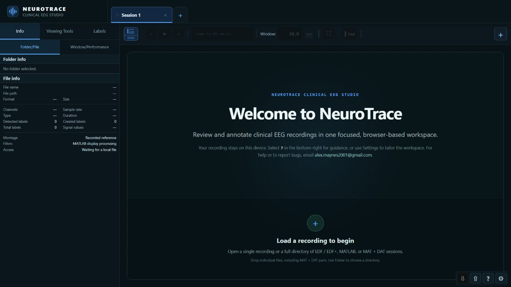

Empty workspace and Info subtabs.

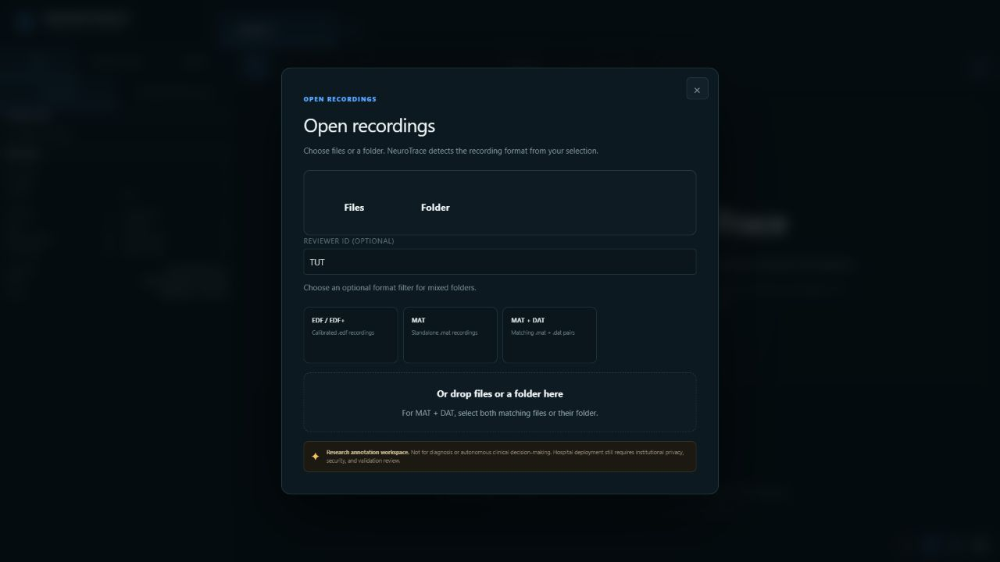

Import selection before confirmation.

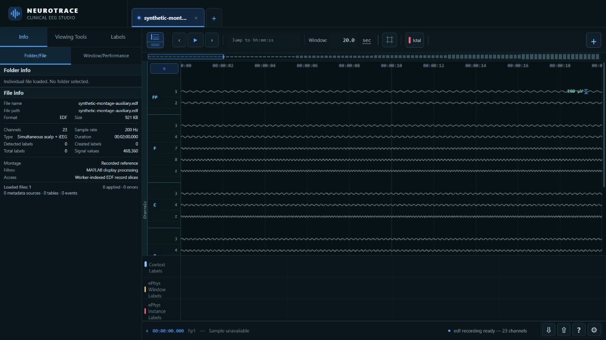

Synthetic EDF successfully loaded.

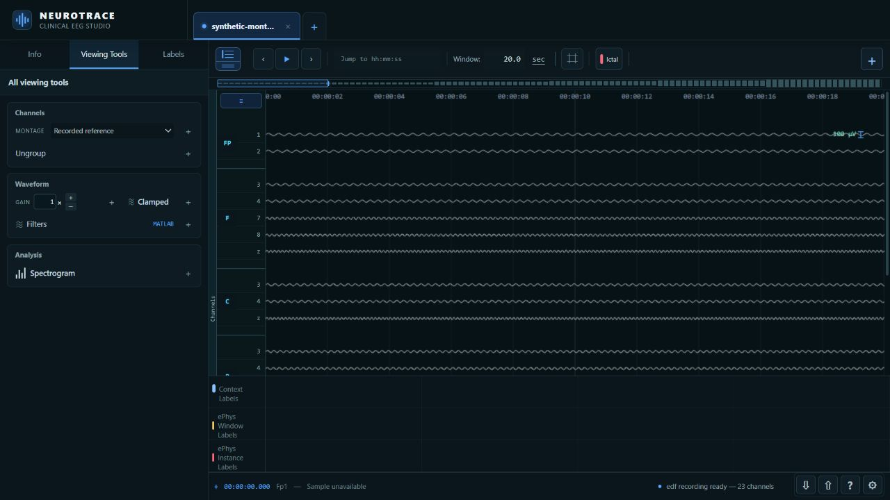

Viewing Tools beside the recording.

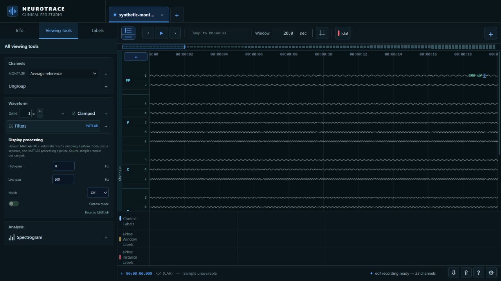

Filter dialog with the current montage.

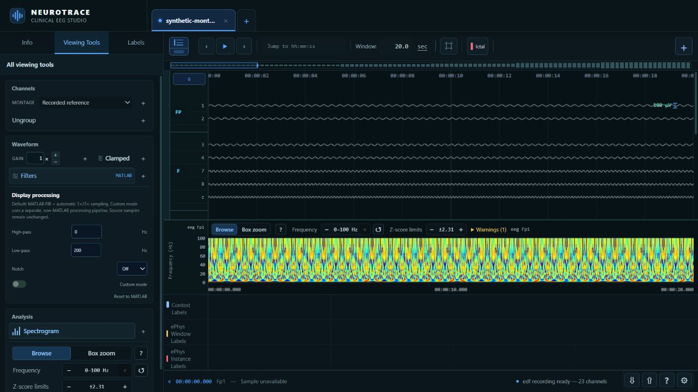

Wavelet display using raw synthetic samples.

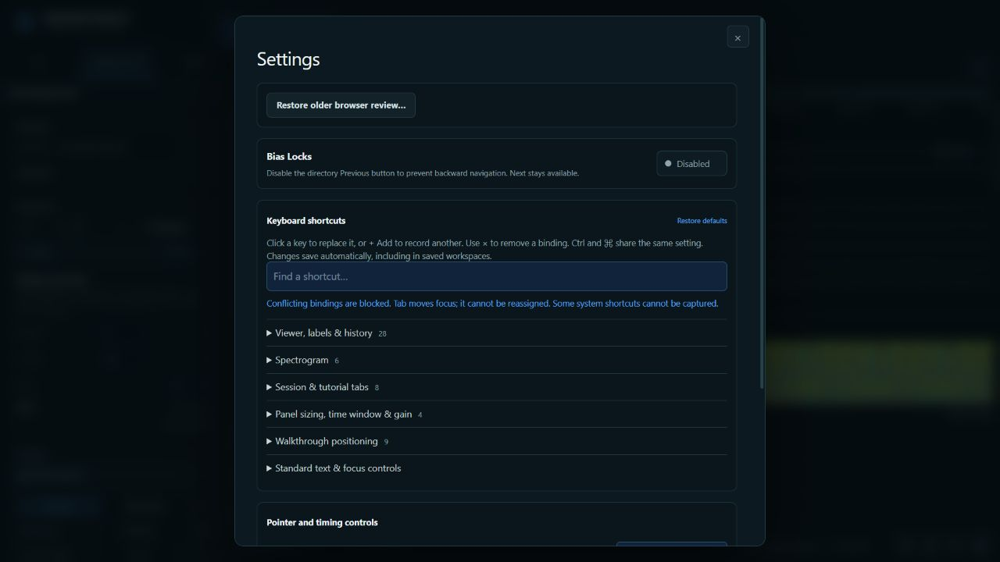

Settings dialog.

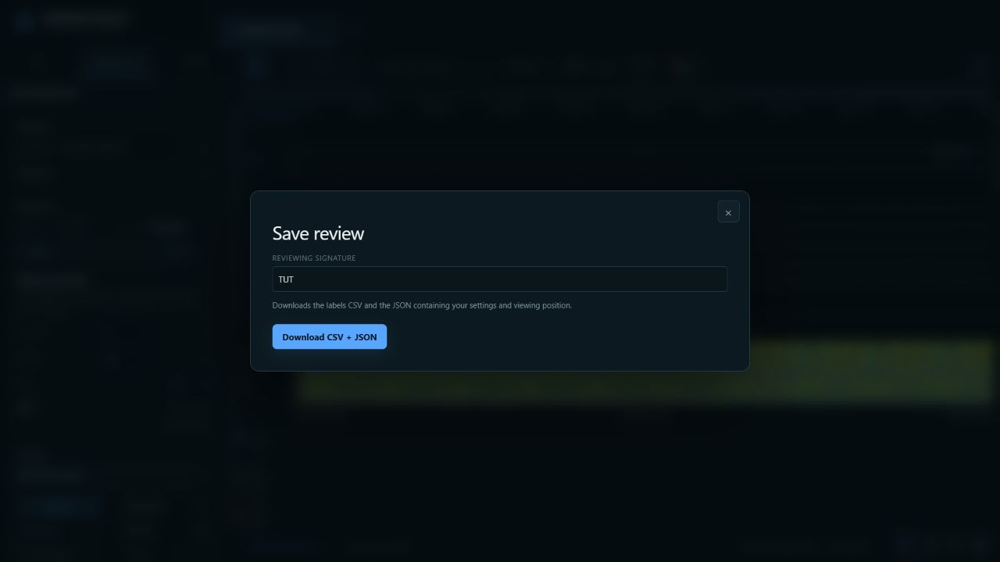

Save prompt before any download.

All product screens remain on `/`. File selection leads to a confirmation preview; errors leave the current review available. Dialogs retain their roles and modal semantics. Shortcuts respect focus areas and native text editing; conflicts are reported. Tutorial guidance stays inside active modal focus scope. Source/harness checks cover those contracts, but a screen-reader audit, mobile interactions, every loading/error state, and all lessons in a real browser remain unverified.

## Software pipeline

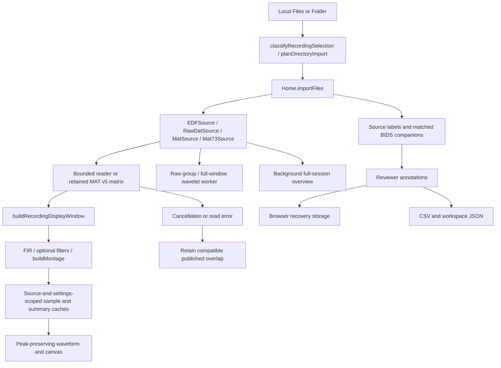

Raw reads, prepared waveform samples, navigator overviews, and raw-input wavelets have distinct contracts. Obsolete workers cannot publish into a new source/settings request. Annotation geometry remains in recording seconds; display offsets do not alter exported times.

## Architecture and class/object model

[Complete source-derived models](models/README.md) cover application, UI-state, worker protocol, storage, diagnostics, and optional hosting types. Actual classes are distinguished from interfaces and type aliases. Module-level functions are indexed by owner in [STRUCTURE](../STRUCTURE.md), rather than depicted as invented service classes.

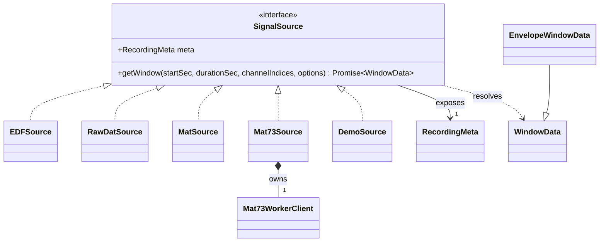

This overview omits member detail; [recording models](models/recording.md) include exact declarations and optional methods. File/Blob, Worker, React, Canvas, and storage are external browser/library boundaries.

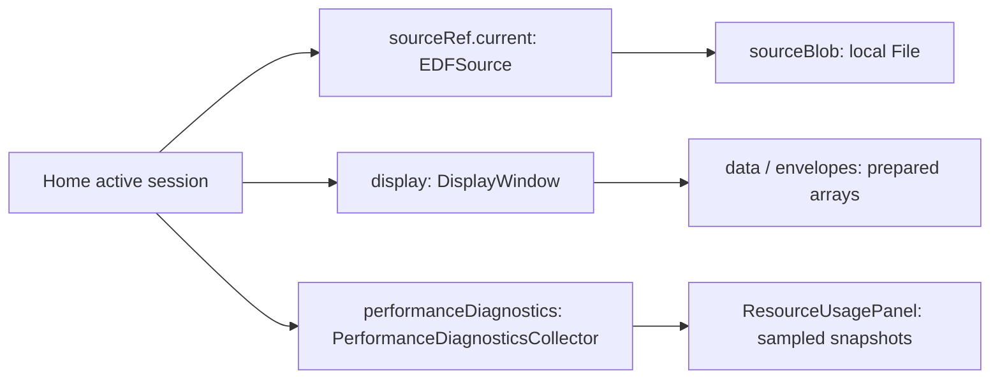

Illustrative object snapshot with one synthetic EDF open; source names come from [page](../app/page.tsx), [eeg-core](../app/eeg-core.ts), and [resource panel](../app/resource-usage-panel.tsx). It does not assert a particular runtime allocation count.

## Feature index

| Feature | Contract | Source / verification |
| --- | --- | --- |
| File/folder/drop selection, format enforcement, DAT mapping | [Recording ingestion](#recording-ingestion) | [Selection](../app/import-selection.ts), [tests](../tests/import-selection.test.mjs) |
| EDF/MAT/HDF5/DAT reads, units, BIDS companions | [Source contracts](#source-contracts) | [Core](../app/eeg-core.ts), [integrity tests](../tests/eeg-integrity.test.mjs), [BIDS tests](../tests/bids-companions.test.mjs) |
| Directory tabs, navigation, keyword indexing, review locks/resume | [Recording ingestion](#recording-ingestion) | [Directory](../app/directory-sessions.tsx), [index](../app/directory-event-index.ts), [workflow tests](../tests/directory-workflow.test.mjs) |
| Annotations, queue, source labels, dictionaries, acceptance, session map | [Review and export](#review-and-export) | [Labels](../app/recording-labels.ts), [tests](../tests/recording-labels.test.mjs), [save flow](../tests/review-save-flow.test.mjs) |
| CSV/JSON, archive compatibility, autosave/recovery | [Privacy and local state](#privacy-and-local-state), [review/export](#review-and-export) | [Workspace](../app/review-workspace.ts), [CSV](../app/matlab-annotations-csv.ts), [round trips](../tests/recovery-roundtrip.test.mjs) |
| Time/window units, cursor, playback, gestures, selection, history | [Loading and navigation](#loading-memory-panning-and-zooming) | [Window units](../app/window-amount.ts), [playback](../app/playback.ts), [selection tests](../tests/channel-selection.test.mjs) |
| Montage, grouping, gain, centering, clamp/overlap | [Montages](#montages), [rendering](#wide-window-resampling-and-trace-rendering) | [Montage pairs](../app/bipolar-montage.ts), [layout](../app/channel-layout.ts), [stability tests](../tests/montage-render-stability.test.mjs) |
| FIR, optional filtering, decimation, sample timing | [Numerical contracts](#numerical-contracts), [filters](#filters) | [FIR](../app/matlab-display-processing.ts), [independent tests](../tests/matlab-display-processing.test.mjs) |
| Spectrogram, raw-group averaging, full-window tiles, frequency/color controls | [Loading and navigation](#loading-memory-panning-and-zooming), [numerical contracts](#numerical-contracts) | [Wavelets](../app/matlab-spectrogram.ts), [full window](../app/full-window-spectrogram.ts), [DFT tests](../tests/matlab-spectrogram.test.mjs) |
| Byte/read/decode measurements, frame cadence, estimated allocations | [Diagnostics](#diagnostics) | [Collector](../app/performance-diagnostics.ts), [tests](../tests/performance-diagnostics.test.mjs) |
| Info subtabs, toolbar, settings, remappable shortcuts, tutorials | [Workspace and tutorials](#workspace-and-tutorials), [navigation](#loading-memory-panning-and-zooming) | [Layout](../app/workspace-layout.ts), [shortcuts](../app/shortcuts.ts), [tutorial tests](../tests/tutorials.test.mjs) |
| Static deployment, local launcher, retained Worker adapter | [Operations](#operations-and-known-limitations) | [Workflow](../.github/workflows/deploy-pages.yml), [release tests](../tests/pages-release.test.mjs) |

## Features

### Source contracts

`SignalSource.getWindow` accepts finite seconds, a nonnegative duration, and unique in-range channel indices. It returns channel-major samples, per-channel rates, first-sample times, indices, labels, and units. Reads are bounded to recording duration; cancellation is checked between bounded operations. Invalid requests retain coded `SignalFileError` failures. Truncation is not valid zero data.

EDF/DAT/HDF5 stay file-backed. MAT v5 retains its decoded matrix, so import memory scales with the complete selected signal. EDF+ events are read from annotation-only ranges separately from samples. MAT + DAT uses metadata mapping; uncalibrated values remain counts. Supported HDF5 reads require a two-dimensional numeric dataset; arbitrary event schemas are not guessed.

For nondegenerate EDF calibration, [edfOutputChannel](../app/file-window.ts) maps signed digital sample $d$ to physical units:

$$
x=d\frac{p_{\max}-p_{\min}}{d_{\max}-d_{\min}}+p_{\min}-d_{\min}\frac{p_{\max}-p_{\min}}{d_{\max}-d_{\min}}.
$$

Header extrema define the scale and offset; voltage-unit conversion is separate. Degenerate spans follow the preserved decoder fallback rather than a guessed calibration. [File-worker](../tests/file-window-worker.test.mjs), [MAT parser](../tests/mat-parser-compatibility.test.mjs), and [HDF5](../tests/mat73.test.mjs) tests cover decoding boundaries; these are not a MATLAB-runtime comparison on protected data.

### Recording ingestion

- **Recording selection:** Click **Load a recording**, then choose **Files** or **Folder**. Format detection is automatic. Choose an optional format filter to limit a mixed folder to EDF/EDF+, MAT, or MAT + DAT. For MAT + DAT, use the same name before the extension (case-insensitive). Choose both files together or add the matching file in the same loader. If DAT mapping is already open, use **Choose matching MAT** to supply the metadata. Folder includes subfolders automatically and pairs siblings only. Confirm the detected files to open a recording. Confirming a folder or multi-file collection opens its first recording and keeps the others available from the directory header.
- **Drag and drop:** The homepage and workspace accept individual files, including multiple recordings or a MAT + DAT pair. Drop a folder inside **Load a recording** to preview it. Additional companion files can be dropped onto an active workspace without replacing its waveform.
- **Full-directory session loading:** The loader filters folders by your selected recording format (or auto-detects a collection when no format was explicitly chosen), previews matching sessions, then offers **Load N sessions**. Folder selection and folder drops include subfolders; sessions are listed in natural path order. Use the **Directory** button beside the session tabs to open or resume any entry. The paginated list retains local file references and a small event-label index, not decoded waveforms or recording hashes. Each selected recording opens in its own tab after its format and metadata are read; A complete MAT + DAT pair opens using its metadata. NeuroTrace prompts for layout details if it cannot determine the mapping. Selecting a new directory replaces the list, not open tabs; clearing the list never deletes files. Use **Add filters** and **Load matching sessions** to open only recordings with matching event-label keywords. After loading, choose **Open Loaded Folder** in **Info → Folder/File**, then **Change folder filters**. Select presets under **Common keywords** or enter your own terms, then click **Apply to folder** or press **Enter** in the keyword field. No matches produces an empty list; clearing the keywords or choosing **Remove filters** restores all recordings. The file-reference list lasts for the current browser session and must be selected again after a reload.
  - **Next event:** Open **Labels → Window / Instance**. Enter comma-separated keywords in the Instance Queue search and use the right arrow to move to the next match. With **Continue events across sessions** enabled beside search, the queue can open a later recording and pin its earliest matching event. Whole-session labels have no event time.
  - **Filter by event label:** Use **Common keywords** in the loader or the loaded folder to add or remove presets such as Seizure / Sz / Seiz, Spikes / sharp waves, Artifact, and Stimulation. The presets share the Instance Queue’s keyword list. Matching is case-insensitive literal text: commas mean **any** keyword, and spaces remain a phrase (for example, `seizure, EEG onset`). This searches existing event-label text, not filenames, and does not classify signals or infer diagnoses. **Remove filters** restores the list. Applied folder filters also determine the eligible directory navigation list; queue queries remain a separate selection.
  - **Background label checks:** While the list is open, a local worker checks EDF+ annotations, known Level-5 MAT `sessionInfo.sFile.events` metadata (including MAT + DAT companions), matching events TSVs, and saved project labels. DAT samples are never read for this search. Uncompressed MAT waveform payloads are skipped; compressed containers must be streamed through, so their first check can take longer. Closing the list or starting an import stops the scan; reopening reuses completed checks. Progress, incomplete checks, **Include unchecked / partially checked sessions**, and **Retry** prevent unreadable files from looking like confirmed non-matches. Unsupported MAT formats (including v7.3/HDF5 event metadata), malformed data, or safety-limit failures remain explicitly incomplete. Search does not verify recordings or alter review state; cached labels/query are memory-only and reset when a directory is selected again or the page reloads.
  - **Format-filtered folders:** Mixed folders are allowed. Choosing **EDF / EDF+**, **MAT**, **MAT + DAT**, or **NeuroTrace** includes only that type; other recording types are ignored, not attached as metadata. No matching files produces an explicit message rather than opening another format. Automatic detection without a chosen folder format still rejects mixed collections instead of guessing. Duplicate case-insensitive paths remain errors. MAT + DAT pairs must have matching basenames in the same folder. Loading a folder keeps every complete pair and reports each skipped file with its expected companion in the loader and in Directory sessions. A folder with zero complete pairs shows the report without a load action. Explicit loose-file selections still require complete pairs. JSON/TSV and other non-recording companions are allowed. Filename discovery is not content validation: each opened MAT is checked against the collection format, and unreadable or mismatched entries show a retryable error instead of silently changing formats. Projects use their saved contents, not nearby companion files. Projects opened from a collection must include their recording; for a reference-only project, open its original recording first and then open the project through Files.
  - **Resume:** Select your saved CSV or JSON through **Load → Files**, then select the original recording files or folder and confirm. CSV restores labels and recording references; JSON also restores settings, dictionaries, cursor, and the exact visible window. Browser autosaves resume silently when the same folder and reviewer ID are selected again.
  - **Session isolation:** A recording receives only matching companions in its own folder or ancestor folders, never a sibling session's files. Per-recording sidecars require compatible filenames; ambiguous non-BIDS sidecars are not automatically attached. Distinct directory paths keep separate tabs and path-scoped local recovery even when source bytes are identical. Single-file imports have separate file-metadata recovery keys; open a recording individually to access review state saved through that workflow. Renaming/moving a directory changes its path-scoped recovery key, so export important review state first.
- **Custom definitions:** Dictionaries, word lists, equations, filtering methods, label definitions, and channel groupings can be dropped alongside recording files. They remain inert local data; NeuroTrace does not execute imported text or code.
- **EDF and EDF+:** Header metadata is parsed first and the recording opens for review without a full-file checksum. EDF+ labels load separately from annotation ranges, including non-seizure markers. Signal data is read from the local `File` in bounded windows; the full-session overview builds separately in a worker. Neither task locks editing or CSV export.
- **MATLAB v5:** The largest viable numeric signal matrix is decoded in memory. Compressed elements are supported.
- **MATLAB v7.3/HDF5:** The largest viable two-dimensional numeric dataset stays file-backed and is read through bounded worker slices. Scalar `Fs`/sample-rate datasets and MATLAB cell-array channel labels are applied when present.
- **Legacy MAT + DAT:** The MAT companion supplies recoverable session metadata while the signed-int16 little-endian DAT remains file-backed. With no verified calibration, samples stay in raw ADC counts and use the MATLAB reviewer’s 15,000-count channel spacing; an optional confirmed µV/count value enables calibrated display units.
  - Legacy `sessionInfo` metadata is distinguished from standalone MAT waveforms before matrix selection. Local MAT/DAT companions match by case-insensitive basename, preferring the same selected folder; stale acquisition paths inside the MAT are ignored. The pair can be selected together or added separately. Missing companions and inconsistent metadata receive specific errors, while unrelated new recordings do not inherit pending files.
  - NeuroTrace reads `sessionInfo.sFile.header.sample_rate`, `sessionInfo.sFile.header.num_channels`, and ordered names from `sessionInfo.ChannelMat.Channel.Name` in a Level-5 MAT companion. Names can also be pasted one per line (plain text or MATLAB `{'contact'}` rows); a supplied list must match the channel count. Without names, numbered channels are used.
  - The reader follows FMAToolbox `LoadBinary.m`'s no-header, sample-major channel interleave for `int16`, with little-endian decoding (the native format on the PI's Windows platform). It does not infer the rate/count from the script's 20 kHz / one-channel defaults. The preview reports complete frames, duration, and any ignored trailing bytes; divisibility alone cannot prove the mapping is correct. The low-level reader may include boundary samples, but the default MATLAB display preparation selects exactly `floor(start * Fs)` and `floor(duration * Fs)` before filtering. No calibration is inferred from `int16`.

BrainVision, EEGLAB, BDF, NWB, and MEF3 files are catalogued when present but are not yet waveform sources.

### Review and export

The workspace provides stacked traces, recorded/average/bipolar montages, display-only filters, a MATLAB-derived Gabor spectrogram with corrected frequency placement and a Nyquist-limited axis, exact-time labels, group selection and movement, interval handles, provenance, confidence, local draft recovery, undo/redo, an instance queue, and a layered session map. Channel groups are on by default. Open **Viewing Tools** and use **Ungroup** to see a flat list. Click the long **Channels** bar on the left edge of the channel names to enable or disable individual channels and whole groups. Space above, between, and below the channel blocks is equal, regardless of group size; channels within each group keep compact, equal spacing. Grouping uses electrode-name prefixes, not inferred physical coordinates. Clamped mode keeps each continuous trace inside its row and uses an overflow-severity line in the recording's own units; Overlap mode permits conventional cross-row excursions.

Seizure source events open in a 20-second event-relative viewport centered on time zero. The review bar supports onset/offset marking, reviewer initials, optional confidence 1–3 (`NA` when unrated), per-event ictal-channel notes, Accept-and-advance, and auditable Skip decisions. Legacy MAT + DAT imports apply the MATLAB seizure-event keywords. Use **Edit DAT mapping** during file selection to customize the layout or preselect candidate events. Only that legacy event-review workflow requires at least 100 channels; waveform loading has no 100-channel cap and retains every mapped channel. Because browsers do not reveal absolute local file paths, the import confirmation includes editable patient/path fields for MATLAB-compatible resume and export keys.

#### Reviewer workspace

- Select **Load → Folder** and optionally enter your reviewer ID. With the same ID, reopening the folder automatically resumes its browser autosave. Changes save after a short pause (650 ms), every five seconds during playback, and when leaving the page. **Close folder** also saves progress locally.
- **Save** asks for your reviewing signature and automatically downloads exactly two files: `reviewer-R017_review-004_annotations.csv` and `reviewer-R017_review-004_workspace.json`, for example. CSV retains all labels from opened recordings, provenance (`label_source`: `detected`, `reviewer`, or `legacy`), source paths, and references for every recording, even if there are no labels. JSON retains the full review, exact position, settings, dictionaries, aliases, and descriptions. Browser autosave stays in the background; portable copies use Save.
- **Blind review** locks earlier recordings in that pass and keeps saved annotations scoped to the reviewer. The app asks before reopening a recording you already reviewed. Use filesystem permissions if reviewers need to be prevented from opening each other's exports outside the app.
- **Edit label library** under **Labels → Create** edits display aliases and descriptions while retaining the original label. Create dictionary labels with a name, code word, and description. Click **+** beside a label in the palette to add its shortcut to the main toolbar.

#### Automatic recording-label discovery

Opening a recording automatically previews its existing event labels during loading and reconciles them with saved review state, with no extra label file or import button. These are recording-supplied labels, not a new signal detector: their presence alone does not establish whether a machine or a person created them.

- **MAT + DAT:** Reads every occurrence in Level-5 `sessionInfo.sFile.events`, not just seizure keywords or the first timestamp. The known schema uses `label` and `times` in seconds: `1×N` point markers or `2×N` start/end columns. Optional per-occurrence `channels` and `notes` are retained. Standalone Level-5 MAT waveforms with this same embedded structure are supported too. Unrelated variables and unknown schemas are not guessed; this does not add v7.3 event-metadata decoding.
  - Already-parsed MAT labels, event-table sidecars, display as soon as the recording opens. They do not wait for the waveform, full DAT scan, or companion MAT hash. Local recovery and saved JSON retain authority over edits and deletions. No companion MAT hash or DAT verification pass is performed.
- **EDF+:** Imports all valid annotation text and durations from annotation-only reads, including non-seizure markers.
- **Review:** Labels appear in the timeline, session map, and left **Instance Queue**. Search by label text, `imported`, or status; navigation follows the search, and the queue initially renders 100 matches. Open an annotation to see its original source text, timing, channels, and notes. New imports stay unreviewed (`suggestion`), with no inferred clinical category or confidence. **Filter labels**, beside the show/hide-labels control, lets you search label types and uncheck the ones to hide. Imported file-label names are individually selectable. The filter applies to the waveform, timelines, session labels, session map, nearby-label readouts, and queue navigation across the open workspace. Enter comma-separated keywords under **Only show labels matching** to display only matching types. **Show all types** clears both filters. Saved annotations, review decisions, and exports retain every label.
- **Safety and persistence:** Invalid timing, unmapped epochs, and ambiguous channel references produce source warnings. Out-of-file markers are skipped; intervals crossing the end are clipped for display while preserving original timing. Local recovery and saved review JSON retains edits, provenance, and completed-import state, avoiding duplicates and respecting deletions. JSONL exports retain unreviewed labels; the events TSV remains committed-only.

The separate MATLAB-style seizure-review selector still uses the original first occurrence and stable candidate IDs, so prior review decisions remain compatible. Its keyword selection and 100-channel requirement do **not** filter automatic recording-label import.

Exports are ZIP bundles containing BIDS-style events/channels tables, recording metadata, full annotation provenance, deterministic forecasting windows, an ontology, a dataset manifest, and a decision-only `matlab_compatibility.csv` when the source has one sampling rate. For accepted reviews from mixed-rate sources, that CSV is omitted with an explanation; the full review and per-channel timing remain in the other bundle files. Raw EEG bytes are never included in the export.

**Save → Download CSV + JSON** includes detected and reviewer-added labels, drafts, confidence, status, original source metadata, and recording references. CSV metadata rows retain recordings with no labels. This is the app’s all-labels format; legacy MATLAB annotation CSV parsing remains available internally for source-event compatibility.

Select the saved CSV or JSON through **Load → Files**, then select the original recordings and confirm. CSV alone restores labels and identifies the recordings; JSON adds exact view state and settings. Browser file permissions require selecting the source files again. Absolute paths are stored when a host or supplied MAT/DAT metadata exposes them; otherwise the CSV contains filenames or relative paths. `.neurotrace` imports are no longer offered. Raw EEG is not copied into either save file.

### Privacy and local state

Recording bytes are processed in the browser and are not uploaded by the application. The active `File` reference and decoded signal windows remain on the user’s device.

Annotation drafts, event candidates, and reviewer initials are persisted in browser-local storage under a source-derived identifier. Recording type is detected from BIDS metadata, channel types, and channel labels rather than saved as reviewer input. These records may contain sensitive notes even though they do not contain raw EEG. Clearing the site’s browser storage removes that recovery state; exported bundles are ordinary local files managed by the user.

GitHub Pages receives normal requests for the application’s static HTML, JavaScript, CSS, and image assets. Hospital use still requires the institution’s security, privacy, governance, deployment, and validation process.

### Workspace and tutorials

The workspace uses one left sidebar with **Info**, **Viewing Tools**, and **Labels** tabs. Info has **Folder/File** and **Window/Performance** subtabs. Labels has **Session**, **Window / Instance**, and **Create** sections. Folder/File splits **Folder info** above **File info**. Window/Performance splits **Window info** above **Performance & loading info**. Both Info subtabs use compact rows and content-sized panes to fit without scrolling; hover long values and performance metrics for complete details. Viewing Tools holds montage, filters, grouping, gain, clamping, and spectrogram. The toolbar keeps playback, timestamp, window, and box zoom; use **+** to add toolbar copies of optional tools, which remain available in Viewing Tools. Toolbar choices and sidebar position are remembered locally and included in workspace JSON. Click the **≡** button above the channel names to fit all enabled channels with tighter spacing. Click it again to restore the previous spacing, vertical zoom, and scroll position. The button stays visible while the channels scroll. The long **Channels** bar to their left opens the enable/disable dialog; drag a group separator to change all group gaps uniformly. Save, upload, help, and settings sit at the bottom-right.

The bottom-right `?` opens a tutorial hub with seven topic tabs and 21 task-based lessons. Steps advance automatically when their action is completed; reading-only steps wait for Next, and Back/Next remain available throughout. A slow pulsing outline highlights the target (steady when reduced motion is preferred). “Do it for me” can open tools, navigate, adjust the view, or select an example time window; it never chooses files, places or accepts review marks, restores reviews, or writes a CSV. Each button explains its action. Drag the walkthrough’s top bar to move it aside; it keeps your preferred position unless that covers the highlighted target. The guide moves clear of the target, including inside dialogs, or covers the smallest possible area when space is tight. ↺ restores automatic placement. The spectrogram’s `?` opens the same hub on its Spectrogram tab. Completed walkthroughs are tracked for the current app visit. New walkthroughs cover folder resume from saved CSVs, accepted source-event reviews, exact timestamp jumps, centered playback and buffering, MAT/EDF channel grouping, filtering displayed label types, and older browser-review recovery. File selection, review marks, acceptance, restoration, and disk saves remain your choices.

NeuroTrace runs locally in the browser. It does not upload the recording, and display filters or montages never rewrite the source file.

### Loading, memory, panning, and zooming

The **Jump to hh:mm:ss** bar beside the Window control accepts time from the recording start as `hh:mm:ss`, `mm:ss`, or seconds, including decimals (for example, `00:01:30.5` or `90.5`). Press **Enter** to pause playback and center the view on that time. Times outside the recording are rejected.

**Window: [amount] sec** sets the visible duration. Clicking the amount selects it. Type a replacement and press **Enter** or leave the field to apply it. Clicking the unit converts the amount while preserving the exact duration: 10 minutes displays as 0.2 hours and still covers 10 minutes. Any pending edit is applied in its original unit before conversion. Amounts display to one decimal and are limited to **999.9** in the selected unit; cycling skips units that would show zero or exceed that limit. The applied duration stays within the recording and its minimum displayable window. Restored or zoomed windows automatically display in a unit that fits.

Double-click the waveform to return to the view before the last box zoom. Manual label placement prompts for a confidence percentage. Zooms share the annotation undo/redo chain: **Ctrl/Cmd+Z** undoes the latest edit or zoom, and **Ctrl/Cmd+Shift+Z** redoes it. This includes time-window changes, pinch/keyboard zoom, waveform and spectrogram box zoom (both axes together), frequency range changes, gain, and channel-layout resets. A continuous pinch is one history step. Each session keeps its own history; typing in a text field retains native text undo.

**Controls** lists every application keyboard shortcut, grouped by focus area. Search, click a binding to replace it, use **+ Add** for alternatives, or **×** to disable one. Conflicts in overlapping focus areas are blocked. Preferences persist locally and with workspace saves; existing letter bindings migrate automatically. Key hints and tutorial instructions follow remaps. Tab, native text editing, and pointer gestures remain standard and are documented separately. A non-Ctrl/Cmd undo binding also cancels a pending ictal onset before undoing history.

- The app reads the recording header first, so review can begin without a full-file verification pass.
- EDF, DAT, and MATLAB v7.3 stay file-backed. Only the current time window, selected channels, and a small read-ahead area are decoded into RAM. MATLAB v5 is the exception: its full signal matrix is kept in RAM.
- File-backed reads and signal processing run in background workers. MATLAB v5 overviews scan the already-decoded matrix in short, cancellable work slices without copying the entire requested window. If the view changes, old work is canceled.
- Live waveforms retain 48 MiB of exact recording-aligned blocks and 128 MiB of coarse summaries, plus at most four/48 MiB completed windows. Blocks outside nearby views are evicted as those budgets fill. The separate whole-recording navigator cache remains 64 MiB. MATLAB v5 retains its decoded source matrix.
- The Full session navigator uses a compact raw-source index, built independently of review without hashing. It is separate from the processed waveform cache; raw overview data never substitutes for a filtered or derived waveform.
- The live waveform prepares recording-aligned blocks. FIR phase, sample timestamps, and custom-filter padding belong to fixed source blocks, not the moving viewport. Factor-two FIR edges are anchored to the true file boundaries. Only missing blocks are read and processed when panning; overlap retains the same samples, extrema, gaps, and vertical reference.
- Cached islands appear together before missing blocks load, including when new data is needed on their left. Published overlap stays visible through partial loads and read failures. Cache entries are isolated by source, channel selection, montage, sample grid, and filters; changed settings cannot reuse incompatible results.

The legacy loaded-window reference helper is still available for MATLAB equation comparisons. Its benchmark (`node --experimental-strip-types build/benchmark-matlab-display.mjs`) measures that reference helper, not the live recording-aligned cache. Live panning integrity is covered by [tests/recording-display-window.test.mjs](../tests/recording-display-window.test.mjs), [tests/display-overlap.test.mjs](../tests/display-overlap.test.mjs), and the real publication-effect tests.


- The spectrogram analyzes the focused channel's complete raw electrode group in source order, including hidden contacts; ungrouped channels are analyzed individually. It does not average the displayed montage or all enabled channels. It covers the full visible window, not the MATLAB viewer's former ±15-second crop. Clicking the waveform chooses the pre-click baseline anchor without limiting coverage. Short views (up to 65,536 samples, reduced for very large groups) use the exact full-window transform. Longer views use a labeled **full-window wavelet overview**: bounded power-of-two tiles with up to 8 seconds of circular context per side, halos discarded, and at most 2,048 time cells averaging log-power. This is not bit-identical to a single full-length circular FFT, especially near Nyquist. One sample-weighted pre-click baseline is shared across all tiles; tiles are never normalized independently. Color limits for overviews use their displayed time-cell Z-scores. Missing-data tiles stay blank. One terminable computation worker and one reusable source reader keep the UI responsive, show progress, and cancel obsolete work. Raw tile input is bounded to 32 MiB; transform/output limits remain enforced.
- Spectrograms implement the supplied `awt_freqlist` Gabor-5 equations with an exact-length circular transform. They retain the reference's log-spaced frequency centers from 1 to 150 Hz only where they are at or below the recording's Nyquist limit (half its sample rate): at most 60 centers, with none shifted to fit the shortened range. Each row is placed at its actual frequency on a linear Hz axis. This intentionally corrects the MATLAB viewer's uniform image-row placement and above-Nyquist display. Power is averaged across raw group channels before `10*log10(power + eps)`, then normalized by the pre-click mean and sample standard deviation; the reference's first-half fallback is retained when fewer than five pre-click samples exist. Default color limits use the 98th percentile of absolute Z-scores in the retained rows, with a minimum of ±1, so colors can differ from MATLAB when unsupported rows are omitted. No AR whitening, STFT framing, or extra smoothing is applied. Scales outside the toolbox's valid interval still produce zero power and a warning, as in the reference. Transform work runs in a terminable worker, with no main-thread fallback. Independent direct-DFT tests verify the equations and odd/even endpoints; this is not a completed MATLAB-runtime golden comparison.
- Panning moves the current waveform and spectrogram every animation frame. After the movement pauses for 180 ms, the app loads and processes the newly visible data.
- Playback keeps the playhead centered while the waveform scrolls underneath it, including at the start and end of the file. It prepares overlapping data ahead of the visible window without showing a loading indicator. If playback exhausts that buffer, the waveform and clock wait together and the loading indicator appears after 300 ms; other navigation keeps immediate loading feedback. Waveform frames are drawn on one reusable offscreen canvas and presented in a single copy, under the existing pixel limit.
- Every completed signal window is tied to the viewport that requested it. Superseded work is canceled, and stale geometry is not stretched into a new zoom while replacement samples are prepared.
- Each source/montage/filter configuration uses a fixed robust channel reference from the first recording block. Panning, progressive loading, scrolling, and gain changes never recenter already drawn samples. Real DC drift remains visible and can reach the clipping boundary. Recorded values, cursor readings, spectrograms, and exports are unchanged by this display offset.
- Horizontal zoom can change the MATLAB display factor from one to two, which activates the reference FIR. Screen geometry preserves peaks of those prepared samples, not necessarily peaks of the original raw signal. The spectrogram always reads raw samples independently. Within-bucket timing in a wide waveform remains limited by screen resolution.

**Main files:**

- [app/page.tsx](../app/page.tsx) — loading flow, cache limits, panning/zooming, display updates, and spectrogram coordination.
- [app/eeg-core.ts](../app/eeg-core.ts) — EDF, DAT, and MAT readers plus window and envelope data structures.
- [app/file-window.ts](../app/file-window.ts) — exact EDF/DAT window reads.
- [app/edf-envelope.ts](../app/edf-envelope.ts) and [app/raw-dat-envelope.ts](../app/raw-dat-envelope.ts) — zoomed-out min/max summaries.
- [app/mat73-worker.ts](../app/mat73-worker.ts) — file-backed MATLAB v7.3 reads.
- [app/matlab-display-processing.ts](../app/matlab-display-processing.ts) and [app/matlab-display-window.ts](../app/matlab-display-window.ts) — reference FIR, loaded-window timing, bounded processing, and post-montage extrema.
- [app/matlab-spectrogram.ts](../app/matlab-spectrogram.ts), [app/matlab-spectrogram-input.ts](../app/matlab-spectrogram-input.ts), and `app/full-window-spectrogram*.ts` — Gabor power/baseline computation, raw-group full-window planning, and bounded worker-driven overviews.
- [app/waveform-geometry.ts](../app/waveform-geometry.ts) — maintains stable row baselines and bounds clipping/dropout geometry.

Click a group name to select all its contacts. **Shift-click channel names** to combine individual contacts; selected names stay highlighted. Open **Spectrogram** to average their raw-channel power automatically. The spectrogram names the selected channels and states that it is an average. A plain click anywhere in the recording canvas replaces the previous selection with the nearest channel. Cursor placement, time-range selection, seizure onset/offset marking, box zoom, and label drops work in the gaps between groups and the empty space above or below channels too. Escape or a click on empty workspace outside the recording area clears every selected channel and its waveform highlight. Shift-clicking a selected group again removes it. Selected contacts must have matching sample rates. Recent completed results are reused.

### Filters

Optional filters are disabled by default and affect only the displayed signal. They run in this order:

```text
high-pass -> notch -> low-pass
```

High-pass and low-pass use second-order Butterworth-style filters. Notch filtering removes either 50 or 60 Hz line noise. Each optional filter is run forward and backward, which prevents a phase shift in the displayed waveform. Extra samples are loaded around the visible window to reduce edge artifacts. Gaps remain gaps and are not filtered across. This bidirectional user-filter path is separate from the single-pass clinical FIR decimator described below.

**Files:** [app/eeg-core.ts](../app/eeg-core.ts) (`applyDisplayFilters`) contains the filter math; [app/display-processing-worker.ts](../app/display-processing-worker.ts) runs it off the main thread; [app/page.tsx](../app/page.tsx) manages settings, padding, and cropping.

### Montages

- **Recorded / referential:** shows each channel as it exists in the file.
- **Average reference (CAR):** excludes explicitly labeled auxiliary signals (including ECG/EOG/DC, even when measured in µV), selects a single physical unit (calibrated µV when available), and finds the largest group with matching rate, sample count, and start time. It subtracts that group's finite sample-by-sample average from every member. Expected auxiliary exclusions are quiet; incompatible EEG channels are omitted with a warning. Exact and custom-filter views share these rules. Excluded auxiliary signals cannot block exact montage processing merely because they have a different sampling rate, and remain available in recorded reference.
- **Anatomical bipolar:** matches the MATLAB reviewer: contacts stay in `ChannelMat` order within each electrode group, and each result is the following listed contact minus the current contact. A row labeled `LA1-2` therefore contains `LA2 - LA1`; contact numbers do not need to be consecutive if their source order is consecutive. Hiding a contact omits its existing pairs rather than creating a new bridge. EDF depth contacts accept EEG/SEEG acquisition prefixes and explicit reference suffixes. Mixed scalp/depth recordings derive the two families independently.
- **Scalp bipolar:** accepts acquisition prefixes and explicit reference suffixes, and uses 18 explicitly defined longitudinal pairs, with the first electrode minus the second (for example, `Fp1-F7`). Legacy temporal names are aliases. Missing or ambiguous electrodes omit their affected pairs with a warning; scalp channels are never paired by their numeric suffixes.
- **Group / Ungroup:** grouping starts on for new recordings and is remembered separately per open session. When enabled, it follows `seizure_annotation_tool_update.m`: L-prefixed groups, R-prefixed groups, then other groups; groups follow first occurrence within each side and contacts retain acquisition order. Group names are case-sensitive. The MATLAB exclusion list and channel-name rules apply; auxiliary/unclassified rows are hidden when recognized groups exist, and switching off restores them. No recognized groups means an ungrouped fallback. A shared cyan group name is centered beside its contacts; referential/CAR rows show within-group ordinals and bipolar rows show the original pair numbers. Each group's height follows its contact count. Available whitespace is shared equally above the first group, between adjacent channel blocks, and below the last group, with a one-row minimum gap. Smaller groups receive no extra padding. Groups are separated by whitespace, without hard divider lines. Compact grouped rows are capped at 18 pixels; expanded grouped rows are 24 pixels with scrolling when necessary. All channels retain the same row height and amplitude scale. Explicit vertical box zoom fills the selected region. Drawing, channel labels, hit testing, and box zoom use the same mapping between channel positions and screen coordinates. EDF/EDF+ recordings group by channel-name families instead: leading EEG/SEEG/ECOG/iEEG/POL tags and common reference suffixes are ignored when finding the family (for example, `EEG LA1-REF` and `EEG LA2-REF` share LA). Scalp names such as Fp1/Fp2/Fpz share FP; bipolar names retain their source derivation. EDF groups and contacts follow first occurrence and acquisition order, group names ignore case, and auxiliary or unrecognized names remain visible. These are name groups, not confirmed anatomical regions. The EDF button is available for any loaded channel list; MAT and MAT + DAT retain their existing MATLAB grouping rules. Toggling resets vertical zoom/scroll, preserves the focused derivation where present, and participates in undo/redo. It reuses prepared signal buffers without reading, filtering, re-centering, or recalculating montage pairs.

Channels with incompatible units, sample rates, or timing are not combined. Gaps remain gaps.

**Files:** [app/eeg-core.ts](../app/eeg-core.ts) (`buildMontage`, `montageInputPolicy`, `orderAnatomicalChannelIndices`, and `anatomicalChannelGroup`) contains the montage, shared input safety rules, and ordering algorithms; [app/page.tsx](../app/page.tsx) applies the order, group spacing, and source-channel links.

### Supplied MATLAB display preparation

The reference helper retains the equations from `seizure_annotation_tool_update.m`. The live viewer uses the same FIR coefficients and factor selection, with recording-wide phase and edge handling to make panning stable:

1. The factor is `min(2, max(1, floor(samples / max(round(horizontal pixels), 1000))))`.
2. At factor two, each channel receives one causal pass of a 64th-order, 65-tap Hann-windowed FIR with cutoff 0.2 cycles per source sample and unity DC gain. At 1,000 Hz the cutoff is 200 Hz; it is not a fixed 100 Hz filter.
3. Group-delay compensation, zero context at the beginning, and repeated causal end values are anchored to the true recording boundaries. Viewports and cached blocks do not introduce new filter edges.
4. Retained indices and timestamps use the global source-sample grid, including the constant `1/Fs` plot offset. A fractional seek cannot shift the sample phase or stretch time. Factor one skips the FIR.

Optional high-pass/notch/low-pass filters use fixed recording-aligned padding around each block and crop to its core. Their processing context is identical when the same block is revisited. They are not claimed to reproduce the MATLAB script.

Exact loaded-window MATLAB parity remains available in `buildMatlabDisplayWindow` without `recordingAnchored`; its independent-equation tests still run. The browser deliberately uses recording-aligned boundaries rather than MATLAB’s moving-window initialization. No MATLAB-runtime golden-output comparison has been performed.

### Wide-window resampling and trace rendering

- The default live viewer first prepares the exact MATLAB-filtered/decimated samples and montage, then limits drawing work with peak-preserving geometry. Geometry does not introduce another signal filter, but the MATLAB factor itself can change with zoom.
- File-backed overviews retain cached minimum/maximum ranges and bucket centers across viewport crops. Their representative signals remain available as metadata but are not used as the plotted peak amplitudes.
- The canvas draws one peak-preserving path. Only a real gap or non-finite sample breaks the path; a finite value outside its row stays connected at the boundary rather than becoming dots or detached diagonal segments.
- Clamped mode contains traces within their inset row boundaries and shows a dark-green-to-orange severity line for excursions beyond those actual boundaries. The threshold follows gain, baseline, and row height in the recording's own units, including raw DAT/MAT counts; one visible span of additional excess reaches maximum intensity. Gaps interrupt the color halo. Overlap mode uses the full waveform area and omits that row-boundary indicator.

**Files:** [app/eeg-core.ts](../app/eeg-core.ts) retains the tested clinical/screen-resampling utilities and raw envelope-pyramid functions; [app/matlab-display-worker.ts](../app/matlab-display-worker.ts) runs default reference preparation in the background, while [app/display-processing-worker.ts](../app/display-processing-worker.ts) handles optional user-filter preparation; [app/waveform-peak-path.ts](../app/waveform-peak-path.ts) retains prepared peak samples for drawing; [app/waveform-geometry.ts](../app/waveform-geometry.ts) owns stable baselines and clipping metadata; [app/page.tsx](../app/page.tsx) coordinates the caches and draws the waveform.

### Numerical contracts

[matlab-display-processing](../app/matlab-display-processing.ts) retains the reference factor-one/factor-two decision. For sample count $N$ and positive axis width $W$ in pixels:

$$
D=\min\left(2,\max\left(1,\left\lfloor\frac{N}{\max(1000,\operatorname{round}(W))}\right\rfloor\right)\right).
$$

Factor one skips the FIR. Factor two uses order 64, delay 32, and cutoff **0.2 cycles per input sample**, not a fixed 100 Hz:

$$
\begin{aligned}
q_k&=\begin{cases}0.4,&k=32,\\ \dfrac{\sin(0.4\pi(k-32))}{\pi(k-32)},&k\ne32,\end{cases}\\
w_k&=\tfrac12\left(1-\cos\frac{2\pi k}{64}\right),\qquad
h_k=\frac{q_kw_k}{\sum_{j=0}^{64}q_jw_j},\quad 0\le k\le64.
\end{aligned}
$$

`designMatlabDisplayFir` computes coefficients $h_k$ in Float64. The reference helper retains causal zero initialization, delay compensation when applicable, and repeated causal tail values. Live recording-aligned and legacy loaded-window boundaries remain distinct contracts, as described above.

For retained zero-based sample index $j$, rate $F_s>0$, origin $t_0$, and factor $D$, [matlabSampleTime](../app/matlab-timing.ts) uses:

$$
t_j=t_0+\frac{1+jD}{F_s}.
$$

Times are seconds; invalid rates and integer overflow are rejected. The browser's global sample grid prevents viewport movement from changing retained-sample phase. Independent [processing](../tests/matlab-display-processing.test.mjs), [window](../tests/matlab-display-window.test.mjs), and [timing](../tests/matlab-timing.test.mjs) checks cover the reference equations and edge cases.

[Waveform geometry](../app/waveform-geometry.ts) maps prepared amplitude $x_i(t)$, fixed reference $b_i$, row center $c_i$, and positive pixel-per-unit gain $G$ to:

$$
y_i(t)=c_i-(x_i(t)-b_i)G.
$$

Clamped mode bounds the coordinate to the inset row; overlap mode bounds only to the complete plot. Gaps/nonfinite samples break paths. Display references do not alter raw readouts or exports.

For group-mean wavelet power $P_{f,t}$ and $\epsilon=2^{-52}$, [matlab-spectrogram](../app/matlab-spectrogram.ts) computes:

$$
L_{f,t}=10\log_{10}(P_{f,t}+\epsilon),\qquad
Z_{f,t}=\frac{L_{f,t}-\mu_f}{\max(\epsilon,s_f)}.
$$

Here $\mu_f$ and $s_f$ are the baseline mean and sample standard deviation in log-power space. The baseline fallback, frequency omissions, color scale, and tiled-overview differences are specified above. [Direct-DFT tests](../tests/matlab-spectrogram.test.mjs) verify equations independently; no MATLAB-runtime golden comparison has been completed.

### Diagnostics

Info → Window/Performance separates retained buffers, active views, browser memory/storage observations, read/decode operations, draw time, and frame cadence. [PerformanceDiagnosticsCollector](../app/performance-diagnostics.ts) owns measurements; [ResourceUsagePanel](../app/resource-usage-panel.tsx) subscribes and samples resources; [recording-info](../app/recording-info.ts) formats them.

File bytes are counted at the browser read boundary. Repeated reads count again; physical-disk I/O cannot be distinguished from OS-cache hits. Main-thread pressure uses event-loop/long-task observations, not process CPU utilization. Canvas/GPU copies and temporary allocations are estimates or reported counters, not a complete process-memory inventory. Heap/GC visibility depends on browser APIs. Missing measurements are unavailable rather than falsely zero. Low retained memory therefore does not imply inexpensive reads, filtering, or drawing.

[Diagnostics tests](../tests/performance-diagnostics.test.mjs) cover counters, cancellation, and estimates. [Recording-info tests](../tests/recording-info.test.mjs) protect unit boundaries, unavailable values, precision, and decoder guard errors. Panel extraction preserves its refresh cadence and displayed text.

## Operations and known limitations

The canonical release is static GitHub Pages. The retained vinext/Cloudflare build and optional D1 example are separate paths; the production schema is empty. The removed authentication module had no callers or configured entry point. Legacy archive, source-hash, and alternative spectral utilities retain compatibility/test consumers; unresolved usage is recorded in [TODO](../TODO.md) rather than guessed.

Large MAT v5 imports remain eager. EDF/DAT reads include complete records/frames, so hiding channels saves more decoding/drawing than disk reads. HDF5 requires supported numeric data and compression filters. Broad filtered/spectral views still require processing; bounded memory is not a speed guarantee. Storage quotas, browser lifecycle, file permissions, and worker availability affect loading and recovery.

Live display intentionally differs from MATLAB in recording-anchored filter boundaries, Nyquist-row omission, linear-frequency row placement, full-window tiled spectra, and optional user filters. A MATLAB-runtime comparison and institutional clinical/privacy validation remain open. Browser interaction checks do not establish every supported-platform guarantee.

## Benchmarks

No performance benchmarks have been run for this cleanup. Build/test results and source equivalence are correctness evidence, not speed measurements. Older informal timing claims are not presented here as current guarantees.

[benchmark-matlab-display.mjs](../build/benchmark-matlab-display.mjs) generates a 200-channel, 50 Hz, 70-hour synthetic source and processes ten-hour windows with real worker threads. It measures the legacy loaded-window helper, **not the live recording-aligned viewer**, physical disk loading, or browser latency. It emits workload details, elapsed/first-partial times, reads, generated samples, generation time, cache/retained bytes, and point counts. Run `node --experimental-strip-types build/benchmark-matlab-display.mjs` when those costs are intended. Representative viewer workloads and reproducible hardware/browser baselines remain in TODO.
