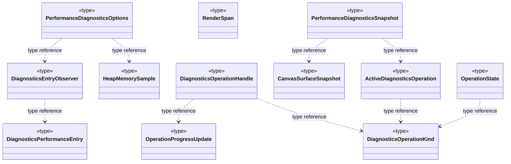
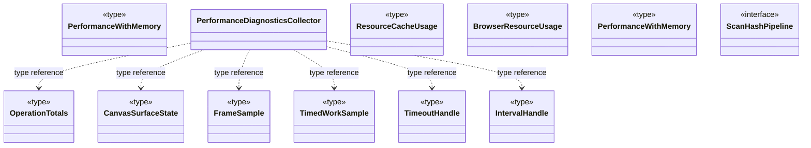
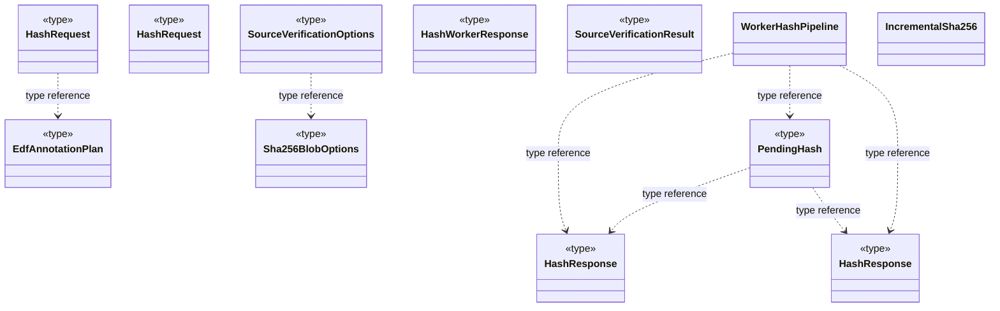

# Diagnostics type model

[All models](README.md) · [Feature contracts](../PROJECT_DOC.md)







## DiagnosticsOperationKind

Source: [app/performance-diagnostics.ts](../../app/performance-diagnostics.ts). Kind: type.

```typescript
export type DiagnosticsOperationKind = "source-read" | "decode";
```

## HeapMemorySample

Source: [app/performance-diagnostics.ts](../../app/performance-diagnostics.ts). Kind: type.

```typescript
export type HeapMemorySample = {
  usedBytes: number;
  allocatedBytes?: number | null;
  limitBytes?: number | null;
};
```

## DiagnosticsPerformanceEntry

Source: [app/performance-diagnostics.ts](../../app/performance-diagnostics.ts). Kind: type.

```typescript
export type DiagnosticsPerformanceEntry = {
  entryType: string;
  startTime: number;
  duration: number;
  name?: string;
  detail?: unknown;
  kind?: unknown;
};
```

## DiagnosticsEntryObserver

Source: [app/performance-diagnostics.ts](../../app/performance-diagnostics.ts). Kind: type.

```typescript
export type DiagnosticsEntryObserver = (
  entryType: "longtask" | "gc",
  onEntries: (entries: readonly DiagnosticsPerformanceEntry[]) => void,
) => (() => void) | null;
```

## PerformanceDiagnosticsOptions

Source: [app/performance-diagnostics.ts](../../app/performance-diagnostics.ts). Kind: type.

```typescript
export type PerformanceDiagnosticsOptions = {
  /** Monotonic milliseconds. Defaults to performance.now(), then Date.now(). */
  now?: () => number;
  /** Subscriber updates are coalesced to this interval. Defaults to 200 ms. */
  notificationIntervalMs?: number;
  /** Event-loop lag probe interval. Set to zero to disable. Defaults to 250 ms. */
  eventLoopSampleIntervalMs?: number;
  /** Rolling interval used for the FPS result. Defaults to 2 seconds. */
  frameWindowMs?: number;
  /** Rolling interval used for the live main-thread headline. Defaults to 10 seconds. */
  mainThreadWindowMs?: number;
  /** Expected animation rate used to estimate dropped frames. Defaults to 60. */
  targetFrameRate?: number;
  /** Gaps beyond this value start a new frame sequence. Defaults to 1 second. */
  frameGapResetMs?: number;
  /** Starts browser observers immediately. Defaults to true only in a window. */
  autoStart?: boolean;
  /** Test/host override for the non-standard performance.memory API. */
  readHeapMemory?: () => HeapMemorySample | null;
  /** Test/host override for PerformanceObserver. */
  observeEntries?: DiagnosticsEntryObserver;
};
```

## OperationProgressUpdate

Source: [app/performance-diagnostics.ts](../../app/performance-diagnostics.ts). Kind: type.

```typescript
export type OperationProgressUpdate = {
  /** Absolute progress. Values lower than prior progress are ignored. */
  completedBytes?: number;
  totalBytes?: number | null;
  phase?: string;
  /** Known temporary allocations not retained by a cache. */
  transientAllocatedBytes?: number;
  /** Exact measured work time when read and decode overlap in one worker. */
  durationMs?: number;
};
```

## DiagnosticsOperationHandle

Source: [app/performance-diagnostics.ts](../../app/performance-diagnostics.ts). Kind: type.

```typescript
export type DiagnosticsOperationHandle = {
  readonly id: string;
  readonly kind: DiagnosticsOperationKind;
  /** Adds completed/read bytes to this operation. */
  advance(bytes: number, phase?: string): void;
  /** Updates absolute progress, phase, or an expected total. */
  update(update: OperationProgressUpdate): void;
  /** Completes the operation and returns its elapsed milliseconds. */
  finish(update?: OperationProgressUpdate): number;
  /** Records an unsuccessful operation and returns its elapsed milliseconds. */
  fail(update?: OperationProgressUpdate): number;
  /** Records a superseded operation and returns its elapsed milliseconds. */
  cancel(update?: OperationProgressUpdate): number;
};
```

## RenderSpan

Source: [app/performance-diagnostics.ts](../../app/performance-diagnostics.ts). Kind: type.

```typescript
export type RenderSpan = {
  /** Completes the timed render and returns its duration in milliseconds. */
  finish(): number;
};
```

## ActiveDiagnosticsOperation

Source: [app/performance-diagnostics.ts](../../app/performance-diagnostics.ts). Kind: type.

```typescript
export type ActiveDiagnosticsOperation = {
  id: string;
  kind: DiagnosticsOperationKind;
  label: string;
  phase: string;
  startedAtMs: number;
  elapsedMs: number;
  completedBytes: number;
  totalBytes: number | null;
  progress: number | null;
  throughputBytesPerSecond: number;
};
```

## CanvasSurfaceSnapshot

Source: [app/performance-diagnostics.ts](../../app/performance-diagnostics.ts). Kind: type.

```typescript
export type CanvasSurfaceSnapshot = {
  id: string;
  width: number;
  height: number;
  bytesPerPixel: number;
  gpuSurfaceCopies: number;
  backingBytes: number;
  estimatedGpuBytes: number;
};
```

## PerformanceDiagnosticsSnapshot

Source: [app/performance-diagnostics.ts](../../app/performance-diagnostics.ts). Kind: type.

```typescript
export type PerformanceDiagnosticsSnapshot = {
  capturedAtMs: number;
  capabilities: {
    heapMemory: boolean;
    longTaskObserver: boolean;
    gcObserver: boolean;
    eventLoopProbe: boolean;
  };
  sourceReads: {
    bytes: number;
    operationsStarted: number;
    operationsCompleted: number;
    operationsFailed: number;
    operationsCancelled: number;
    activeOperations: number;
    durationMs: number;
    throughputBytesPerSecond: number;
  };
  decoding: {
    bytes: number;
    operationsStarted: number;
    operationsCompleted: number;
    operationsFailed: number;
    operationsCancelled: number;
    activeOperations: number;
    durationMs: number;
    throughputBytesPerSecond: number;
  };
  activeOperations: ActiveDiagnosticsOperation[];
  mainThread: {
    observationWindowMs: number;
    eventLoopSamples: number;
    eventLoopDelayMs: number;
    utilizationEstimate: number;
    longTaskCount: number;
    longTaskDurationMs: number;
    longestLongTaskMs: number;
  };
  allocations: {
    /** Caller-reported temporary typed-array/ArrayBuffer allocation volume. */
    reportedTransientBytes: number;
    /** Positive deltas observed from performance.memory; a lower-bound proxy. */
    observedHeapGrowthBytes: number;
    /** Negative deltas observed from performance.memory. */
    observedHeapReleaseBytes: number;
    samples: number;
    currentHeapUsedBytes: number | null;
    currentHeapAllocatedBytes: number | null;
    heapLimitBytes: number | null;
    peakHeapUsedBytes: number | null;
  };
  garbageCollection: {
    supported: boolean;
    count: number;
    durationMs: number;
    longestDurationMs: number;
    byKind: Record<string, number>;
  };
  canvases: {
    count: number;
    backingBytes: number;
    estimatedGpuBytes: number;
    surfaces: CanvasSurfaceSnapshot[];
  };
  rendering: {
    renders: number;
    totalDurationMs: number;
    averageDurationMs: number;
    lastDurationMs: number;
    longestDurationMs: number;
    rollingFps: number;
    rollingFrameSamples: number;
    rollingDroppedFrames: number;
    totalDroppedFrames: number;
  };
};
```

## OperationState

Source: [app/performance-diagnostics.ts](../../app/performance-diagnostics.ts). Kind: type.

```typescript
type OperationState = {
  id: string;
  kind: DiagnosticsOperationKind;
  label: string;
  phase: string;
  startedAtMs: number;
  completedBytes: number;
  totalBytes: number | null;
};
```

## OperationTotals

Source: [app/performance-diagnostics.ts](../../app/performance-diagnostics.ts). Kind: type.

```typescript
type OperationTotals = {
  bytes: number;
  started: number;
  completed: number;
  failed: number;
  cancelled: number;
  finishedDurationMs: number;
};
```

## CanvasSurfaceState

Source: [app/performance-diagnostics.ts](../../app/performance-diagnostics.ts). Kind: type.

```typescript
type CanvasSurfaceState = Omit<CanvasSurfaceSnapshot, "backingBytes" | "estimatedGpuBytes">;
```

## FrameSample

Source: [app/performance-diagnostics.ts](../../app/performance-diagnostics.ts). Kind: type.

```typescript
type FrameSample = { atMs: number; droppedBefore: number };
```

## TimedWorkSample

Source: [app/performance-diagnostics.ts](../../app/performance-diagnostics.ts). Kind: type.

```typescript
type TimedWorkSample = { atMs: number; durationMs: number };
```

## TimeoutHandle

Source: [app/performance-diagnostics.ts](../../app/performance-diagnostics.ts). Kind: type.

```typescript
type TimeoutHandle = ReturnType<typeof setTimeout>;
```

## IntervalHandle

Source: [app/performance-diagnostics.ts](../../app/performance-diagnostics.ts). Kind: type.

```typescript
type IntervalHandle = ReturnType<typeof setInterval>;
```

## PerformanceWithMemory

Source: [app/performance-diagnostics.ts](../../app/performance-diagnostics.ts). Kind: type.

```typescript
type PerformanceWithMemory = Performance & {
  memory?: {
    usedJSHeapSize?: number;
    totalJSHeapSize?: number;
    jsHeapSizeLimit?: number;
  };
};
```

## PerformanceDiagnosticsCollector

Source: [app/performance-diagnostics.ts](../../app/performance-diagnostics.ts). Kind: class.

```typescript
export class PerformanceDiagnosticsCollector {
  private readonly now: () => number;
  private readonly notificationIntervalMs: number;
  private readonly eventLoopSampleIntervalMs: number;
  private readonly frameWindowMs: number;
  private readonly mainThreadWindowMs: number;
  private readonly targetFrameIntervalMs: number;
  private readonly frameGapResetMs: number;
  private readonly readHeapMemory: () => HeapMemorySample | null;
  private readonly observeEntries: DiagnosticsEntryObserver;
  private readonly subscribers = new Set<(snapshot: PerformanceDiagnosticsSnapshot) => void>();
  private readonly activeOperations = new Map<string, OperationState>();
  private readonly sourceTotals = EMPTY_TOTALS();
  private readonly decodeTotals = EMPTY_TOTALS();
  private readonly canvasSurfaces = new Map<string, CanvasSurfaceState>();
  private readonly gcByKind = new Map<string, number>();
  private readonly observerStops: Array<() => void> = [];
  private operationSequence = 0;
  private started = false;
  private disposed = false;
  private startedAtMs = 0;
  private lastNotificationAtMs = Number.NEGATIVE_INFINITY;
  private notificationTimer: TimeoutHandle | null = null;
  private eventLoopTimer: IntervalHandle | null = null;
  private lastEventLoopProbeAtMs = 0;
  private eventLoopSamples = 0;
  private eventLoopDelayMs = 0;
  private longTaskCount = 0;
  private longTaskDurationMs = 0;
  private longestLongTaskMs = 0;
  private reportedTransientBytes = 0;
  private heapSamples = 0;
  private lastHeapUsedBytes: number | null = null;
  private currentHeapUsedBytes: number | null = null;
  private currentHeapAllocatedBytes: number | null = null;
  private heapLimitBytes: number | null = null;
  private peakHeapUsedBytes: number | null = null;
  private observedHeapGrowthBytes = 0;
  private observedHeapReleaseBytes = 0;
  private gcCount = 0;
  private gcDurationMs = 0;
  private longestGcDurationMs = 0;
  private longTaskObserverSupported = false;
  private gcObserverSupported = false;
  private heapMemorySupported = false;
  private renderCount = 0;
  private renderDurationMs = 0;
  private lastRenderDurationMs = 0;
  private longestRenderDurationMs = 0;
  private frameSamples: FrameSample[] = [];
  private lastFrameAtMs: number | null = null;
  private totalDroppedFrames = 0;
  private eventLoopDelaySamples: TimedWorkSample[] = [];
  private longTaskSamples: TimedWorkSample[] = [];

  /** Initializes the instance from the supplied arguments. */
  constructor(options: PerformanceDiagnosticsOptions = {}) ;

  /** Starts observers and the low-frequency event-loop probe. Safe to call twice. */
  start() ;

  /** Releases resources owned by this instance. */
  dispose() ;

  /** Publishes the current snapshot to a new listener and returns its removal callback. */
  subscribe(listener: (snapshot: PerformanceDiagnosticsSnapshot) => void) ;

  /** Combines completed and active measurements into a resource snapshot. */
  snapshot(): PerformanceDiagnosticsSnapshot ;

  /** Begins the source read. */
  beginSourceRead(options: { label?: string; totalBytes?: number | null; phase?: string } = {}) ;

  /** Begins the decode. */
  beginDecode(options: { label?: string; totalBytes?: number | null; phase?: string } = {}) ;

  /** Measures the source read. */
  async measureSourceRead<T>(
    options: { label?: string; totalBytes?: number | null; phase?: string },
    operation: (progress: DiagnosticsOperationHandle) => Promise<T>,
  ) ;

  /** Measures the decode. */
  async measureDecode<T>(
    options: { label?: string; totalBytes?: number | null; phase?: string },
    operation: (progress: DiagnosticsOperationHandle) => Promise<T>,
  ) ;

  /** Records the source read. */
  recordSourceRead(bytes: number, durationMs: number) ;

  /** Records the decode. */
  recordDecode(bytes: number, durationMs: number) ;

  /** Records the transient allocation. */
  recordTransientAllocation(bytes: number) ;

  /** Samples performance.memory when available, or accepts an injected sample. */
  sampleHeapMemory(sample: HeapMemorySample | null = this.readHeapMemory()) ;

  /** Records the long task. */
  recordLongTask(durationMs: number) ;

  /** Records the garbage collection. */
  recordGarbageCollection(durationMs: number, kind = "unspecified") ;

  /** Times a synchronous canvas render. Set frame=true for FPS/drop estimates. */
  beginRender(options: { frame?: boolean; frameTimestampMs?: number } = {}): RenderSpan ;

  /** Records the render. */
  recordRender(durationMs: number) ;

  /** Records one animation-presented frame; render timing is recorded separately. */
  recordFrame(timestampMs = this.now()) ;

  /** Records the canvas surface. */
  recordCanvasSurface(
    id: string,
    surface: { width: number; height: number },
    options: { bytesPerPixel?: number; gpuSurfaceCopies?: number } = {},
  ) ;

  /** Removes the canvas surface. */
  removeCanvasSurface(id: string) ;

  /** Begins the operation. */
  private beginOperation(
    kind: DiagnosticsOperationKind,
    options: { label?: string; totalBytes?: number | null; phase?: string },
  ): DiagnosticsOperationHandle ;

  /** Updates the operation. */
  private updateOperation(operation: OperationState, update: OperationProgressUpdate) ;

  /** Records the completed operation. */
  private recordCompletedOperation(kind: DiagnosticsOperationKind, bytes: number, durationMs: number) ;

  /** Returns the aggregate counters for the requested operation category. */
  private totalsFor(kind: DiagnosticsOperationKind) ;

  /** Copies current operation measurements for diagnostics subscribers. */
  private activeOperationSnapshot(operation: OperationState, capturedAtMs: number): ActiveDiagnosticsOperation ;

  /** Copies aggregate measurements without exposing mutable counters. */
  private operationTotalsSnapshot(totals: OperationTotals, activeOperations: number, durationMs: number) ;

  /** Samples the event loop delay. */
  private sampleEventLoopDelay() ;

  /** Trims the frame samples. */
  private trimFrameSamples(nowMs: number) ;

  /** Trims the main thread samples. */
  private trimMainThreadSamples(nowMs: number) ;

  /** Publishes changed measurements immediately or schedules one throttled notification. */
  private markDirty(immediate = false) ;

  /** Emits the snapshot. */
  private emitSnapshot() ;
}
```

## ResourceCacheUsage

Source: [app/resource-usage-panel.tsx](../../app/resource-usage-panel.tsx). Kind: type.

```typescript
export type ResourceCacheUsage = {
  rawBytes: number;
  rawEntries: number;
  processedBytes: number;
  processedEntries: number;
  envelopeBytes: number;
  envelopeEntries: number;
};
```

## BrowserResourceUsage

Source: [app/resource-usage-panel.tsx](../../app/resource-usage-panel.tsx). Kind: type.

```typescript
type BrowserResourceUsage = {
  heapUsedBytes: number | null;
  heapAllocatedBytes: number | null;
  heapLimitBytes: number | null;
  storageUsedBytes: number | null;
  storageQuotaBytes: number | null;
};
```

## PerformanceWithMemory

Source: [app/resource-usage-panel.tsx](../../app/resource-usage-panel.tsx). Kind: type.

```typescript
type PerformanceWithMemory = Performance & {
  memory?: {
    usedJSHeapSize: number;
    totalJSHeapSize: number;
    jsHeapSizeLimit: number;
  };
};
```

## ScanHashPipeline

Source: [app/scan-hash-worker-client.ts](../../app/scan-hash-worker-client.ts). Kind: interface.

```typescript
export interface ScanHashPipeline {
  readonly workMs: number;
  /** Wait for the previous chunk, then enqueue this chunk and return before it is hashed. */
  write(bytes: Uint8Array): Promise<void>;
  hexDigest(): Promise<string>;
  dispose(): void;
}
```

## HashResponse

Source: [app/scan-hash-worker-client.ts](../../app/scan-hash-worker-client.ts). Kind: type.

```typescript
type HashResponse = { id: number; workMs: number; hash?: string; error?: string };
```

## PendingHash

Source: [app/scan-hash-worker-client.ts](../../app/scan-hash-worker-client.ts). Kind: type.

```typescript
type PendingHash = { id: number; resolve: (response: HashResponse) => void; reject: (error: Error) => void };
```

## WorkerHashPipeline

Source: [app/scan-hash-worker-client.ts](../../app/scan-hash-worker-client.ts). Kind: class.

```typescript
class WorkerHashPipeline implements ScanHashPipeline {
  workMs = 0;
  private nextId = 0;
  private pending: PendingHash | undefined;
  private previous: Promise<HashResponse> | undefined;
  private failure: Error | undefined;
  private readonly worker: Worker;

  /** Initializes the instance from the supplied arguments. */
  constructor(worker: Worker) ;

  /** Waits until the hash worker accepts requests. */
  async ready() ;

  /** Queues a copied byte buffer after the previous hash update completes. */
  async write(bytes: Uint8Array) ;

  /** Returns the completed hash as hexadecimal text. */
  async hexDigest() ;

  /** Releases resources owned by this instance. */
  dispose() ;

  /** Stores the worker failure and rejects its pending request. */
  private fail(error: Error) ;

  /** Sends an ordered hash request and retains any asynchronous failure. */
  private send(type: "ready" | "update" | "digest", buffer?: ArrayBuffer) ;
}
```

## HashRequest

Source: [app/scan-hash-worker.ts](../../app/scan-hash-worker.ts). Kind: type.

```typescript
type HashRequest = { id: number; type: "ready" | "update" | "digest"; buffer?: ArrayBuffer };
```

## EdfAnnotationPlan

Source: [app/source-hash-worker.ts](../../app/source-hash-worker.ts). Kind: type.

```typescript
type EdfAnnotationPlan = {
  headerBytes: number;
  dataRecordCount: number;
  bytesPerDataRecord: number;
  signals: Array<{ byteOffsetInRecord: number; byteLength: number }>;
};
```

## HashRequest

Source: [app/source-hash-worker.ts](../../app/source-hash-worker.ts). Kind: type.

```typescript
type HashRequest = { blob: Blob; edfAnnotationPlan?: EdfAnnotationPlan };
```

## HashResponse

Source: [app/source-hash-worker.ts](../../app/source-hash-worker.ts). Kind: type.

```typescript
type HashResponse =
  | { type: "progress"; bytesHashed: number; totalBytes: number }
  | { type: "complete"; hash: string; edfAnnotations?: { events: SourceEvent[]; warnings: string[] } }
  | { type: "error"; message: string };
```

## HashWorkerResponse

Source: [app/source-integrity-worker-client.ts](../../app/source-integrity-worker-client.ts). Kind: type.

```typescript
type HashWorkerResponse =
  | { type: "progress"; bytesHashed: number; totalBytes: number }
  | { type: "complete"; hash: string; edfAnnotations?: { events: SourceEvent[]; warnings: string[] } }
  | { type: "error"; message: string };
```

## SourceVerificationResult

Source: [app/source-integrity-worker-client.ts](../../app/source-integrity-worker-client.ts). Kind: type.

```typescript
export type SourceVerificationResult = {
  hash: string;
  edfAnnotations?: { events: SourceEvent[]; warnings: string[] };
};
```

## SourceVerificationOptions

Source: [app/source-integrity-worker-client.ts](../../app/source-integrity-worker-client.ts). Kind: type.

```typescript
export type SourceVerificationOptions = Sha256BlobOptions & {
  edfHeader?: EDFHeader;
  fallbackToMainThread?: boolean;
};
```

## IncrementalSha256

Source: [app/source-integrity.ts](../../app/source-integrity.ts). Kind: class.

```typescript
export class IncrementalSha256 {
  private readonly state = new Uint32Array([
    0x6a09e667,
    0xbb67ae85,
    0x3c6ef372,
    0xa54ff53a,
    0x510e527f,
    0x9b05688c,
    0x1f83d9ab,
    0x5be0cd19,
  ]);

  private readonly partialBlock = new Uint8Array(SHA256_BLOCK_BYTES);
  private readonly schedule = new Uint32Array(64);
  private partialLength = 0;
  private byteLengthLow = 0;
  private byteLengthHigh = 0;
  private result: Uint8Array | undefined;

  /** Feeds source bytes into the incremental SHA-256 state before finalization. */
  update(data: ArrayBuffer | ArrayBufferView) ;

  /** Finalizes SHA-256 padding and returns an independent digest copy. */
  digest() ;

  /** Returns the completed hash as hexadecimal text. */
  hexDigest() ;

  /** Updates SHA-256 state with one 64-byte block. */
  private compress(input: Uint8Array, offset: number) ;
}
```

## Sha256BlobOptions

Source: [app/source-integrity.ts](../../app/source-integrity.ts). Kind: type.

```typescript
export type Sha256BlobOptions = {
  chunkSizeBytes?: number;
  signal?: AbortSignal;
  onProgress?: (bytesHashed: number, totalBytes: number) => void;
};
```
