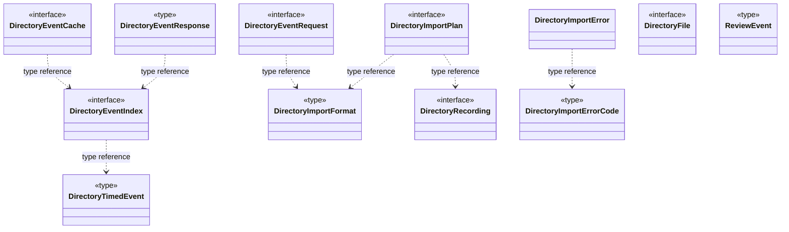
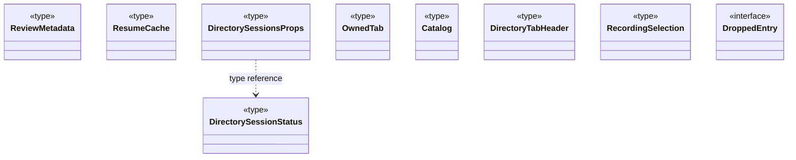

# Directory type model

[All models](README.md) · [Feature contracts](../PROJECT_DOC.md)





## DirectoryEventCache

Source: [app/directory-event-client.ts](../../app/directory-event-client.ts). Kind: interface.

```typescript
export interface DirectoryEventCache {
  entries: Record<string, DirectoryEventIndex>;
  query: string;
}
```

## DirectoryEventIndex

Source: [app/directory-event-index.ts](../../app/directory-event-index.ts). Kind: interface.

```typescript
export interface DirectoryEventIndex {
  state: "ready" | "partial" | "error";
  labels: string[];
  warnings: string[];
  firstEvent?: DirectoryTimedEvent;
}
```

## DirectoryTimedEvent

Source: [app/directory-event-index.ts](../../app/directory-event-index.ts). Kind: type.

```typescript
export type DirectoryTimedEvent = { label: string; timeSec: number };
```

## DirectoryEventRequest

Source: [app/directory-event-index.ts](../../app/directory-event-index.ts). Kind: interface.

```typescript
export interface DirectoryEventRequest {
  format: DirectoryImportFormat;
  /** MAT companion for MAT+DAT; the DAT is never read by the indexer. */
  file: File;
  eventTables: File[];
  /** When present, also return the earliest timed occurrence that matches. */
  eventQuery?: string;
  excludedLabels?: readonly string[];
  datBytes?: number;
}
```

## DirectoryEventResponse

Source: [app/directory-event-worker.ts](../../app/directory-event-worker.ts). Kind: type.

```typescript
export type DirectoryEventResponse = { id: string; result: DirectoryEventIndex };
```

## DirectoryImportFormat

Source: [app/directory-import.ts](../../app/directory-import.ts). Kind: type.

```typescript
export type DirectoryImportFormat = "edf" | "mat" | "mat-dat" | "neurotrace";
```

## DirectoryRecording

Source: [app/directory-import.ts](../../app/directory-import.ts). Kind: interface.

```typescript
export interface DirectoryRecording {
  /** Case-insensitive relative path identity, not a content fingerprint. */
  id: string;
  label: string;
  primary: File;
  /** Only this recording and its exact partner, never another recording. */
  files: File[];
  relativePath: string;
}
```

## DirectoryImportPlan

Source: [app/directory-import.ts](../../app/directory-import.ts). Kind: interface.

```typescript
export interface DirectoryImportPlan {
  format: DirectoryImportFormat;
  recordings: DirectoryRecording[];
  /** Keep the original filename namespace when matching saved reviews. */
  unfilteredRecordings?: readonly DirectoryRecording[];
  eventKeywordFilter?: string;
  /** Shared once, avoiding one full companion-file array per recording. */
  supportingFiles: File[];
}
```

## DirectoryImportErrorCode

Source: [app/directory-import.ts](../../app/directory-import.ts). Kind: type.

```typescript
export type DirectoryImportErrorCode =
  | "EMPTY_DIRECTORY"
  | "INVALID_PATH"
  | "DUPLICATE_PATH"
  | "MIXED_FORMATS"
  | "MISSING_PAIR"
  | "NO_RECORDINGS";
```

## DirectoryImportError

Source: [app/directory-import.ts](../../app/directory-import.ts). Kind: class.

```typescript
export class DirectoryImportError extends Error {
  readonly code: DirectoryImportErrorCode;
  readonly paths: string[];

  /** Initializes the instance from the supplied arguments. */
  constructor(code: DirectoryImportErrorCode, message: string, paths: string[] = []) ;
}
```

## DirectoryFile

Source: [app/directory-import.ts](../../app/directory-import.ts). Kind: interface.

```typescript
interface DirectoryFile {
  file: File;
  path: string;
  key: string;
  extension: string;
  stemKey: string;
}
```

## ReviewEvent

Source: [app/directory-review-resume.ts](../../app/directory-review-resume.ts). Kind: type.

```typescript
export type ReviewEvent = { timeSec: number; label: string };
```

## ReviewMetadata

Source: [app/directory-review-resume.ts](../../app/directory-review-resume.ts). Kind: type.

```typescript
export type ReviewMetadata = { events: ReviewEvent[]; sampleRate?: number; channelCount?: number; durationSec?: number; warnings: string[] };
```

## ResumeCache

Source: [app/directory-review-resume.ts](../../app/directory-review-resume.ts). Kind: type.

```typescript
type ResumeCache = { rows: MatlabAnnotationRow[]; byRecording: Map<string, MatlabAnnotationRow[]>; files: Set<File>; warnings: string[] };
```

## DirectorySessionStatus

Source: [app/directory-sessions.tsx](../../app/directory-sessions.tsx). Kind: type.

```typescript
export type DirectorySessionStatus = {
  state: "opening" | "confirmation" | "loaded" | "error";
  message?: string;
};
```

## DirectorySessionsProps

Source: [app/directory-sessions.tsx](../../app/directory-sessions.tsx). Kind: type.

```typescript
type DirectorySessionsProps = {
  plan: DirectoryImportPlan;
  busy: boolean;
  statuses: Record<string, DirectorySessionStatus>;
  onOpen(recording: DirectoryRecording): void;
  onFilter?(plan: DirectoryImportPlan): void;
  reviewMode?: boolean;
  reviewProgress?(recording: DirectoryRecording): string | undefined;
  canOpen?(recording: DirectoryRecording): boolean;
  onClose(): void;
  onClear(): void;
};
```

## OwnedTab

Source: [app/directory-tab-layout.ts](../../app/directory-tab-layout.ts). Kind: type.

```typescript
type OwnedTab = { id: string; directoryId?: string; directoryRecordingId?: string };
```

## Catalog

Source: [app/directory-tab-layout.ts](../../app/directory-tab-layout.ts). Kind: type.

```typescript
type Catalog = { id: string; plan: DirectoryImportPlan };
```

## DirectoryTabHeader

Source: [app/directory-tab-layout.ts](../../app/directory-tab-layout.ts). Kind: type.

```typescript
export type DirectoryTabHeader = {
  key: string;
  catalogId: string;
  label: string;
  total: number;
  column: number;
  span: number;
  sessionIds: string[];
};
```

## RecordingSelection

Source: [app/import-selection.ts](../../app/import-selection.ts). Kind: type.

```typescript
export type RecordingSelection =
  | { kind: "directory"; plan: DirectoryImportPlan }
  | { kind: "files"; files: File[] };
```

## DroppedEntry

Source: [app/import-selection.ts](../../app/import-selection.ts). Kind: interface.

```typescript
interface DroppedEntry {
  readonly name: string;
  readonly isFile: boolean;
  readonly isDirectory: boolean;
  file?: (success: (file: File) => void, error?: (error: DOMException) => void) => void;
  createReader?: () => { readEntries(success: (entries: DroppedEntry[]) => void, error?: (error: DOMException) => void): void };
}
```
