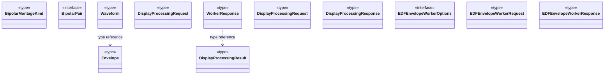
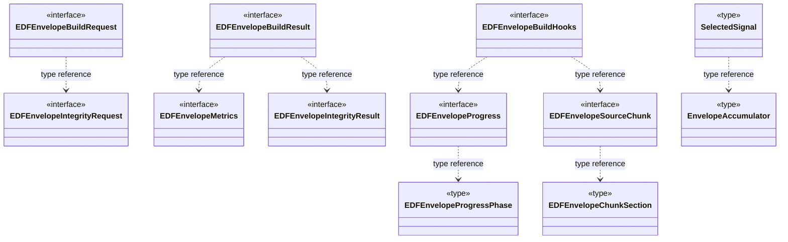
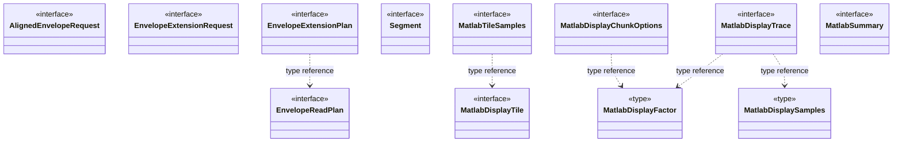
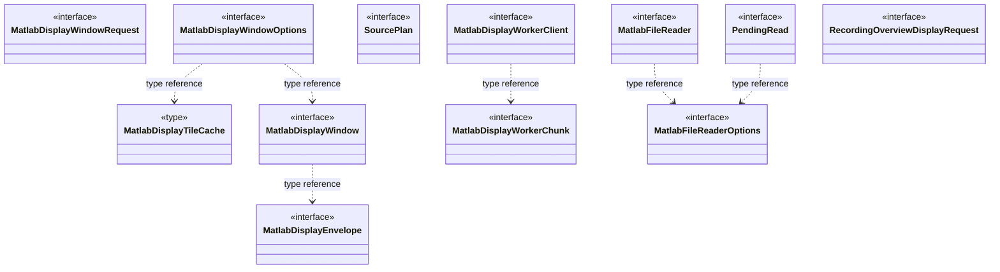
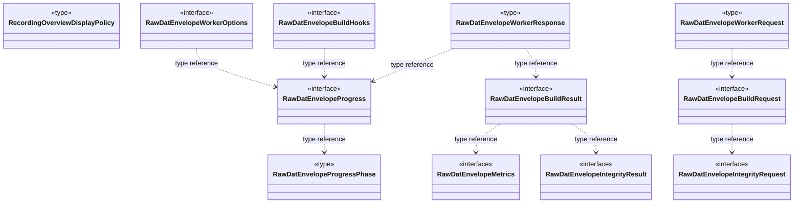
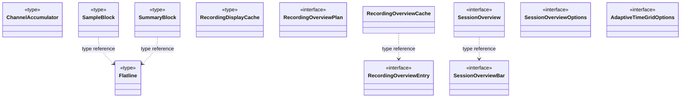

# Display type model

[All models](README.md) · [Feature contracts](../PROJECT_DOC.md)

```mermaid
classDiagram
  class T0["TimeGridLineBudgetOptions"]
  <<interface>> T0
  class T1["TimelineDensityAnnotation"]
  <<interface>> T1
  class T2["TimelineDensityRange"]
  <<interface>> T2
  class T3["TimelineDensityBin"]
  <<interface>> T3
  class T4["TrackAccumulator"]
  <<type>> T4
  class T5["TraceCenterWindow"]
  <<type>> T5
  class T6["TraceGeometryProjection"]
  <<interface>> T6
  class T7["WaveformGeometrySummary"]
  <<interface>> T7
  class T8["WaveformGeometryBudget"]
  <<interface>> T8
  class T9["EnvelopeTraceRenderMode"]
  <<type>> T9
  class T10["GroupedExtremaVisitor"]
  <<type>> T10
  class T11["NormalizedVerticalViewport"]
  <<interface>> T11
```















## BipolarMontageKind

Source: [app/bipolar-montage.ts](../../app/bipolar-montage.ts). Kind: type.

```typescript
export type BipolarMontageKind = "scalp" | "anatomical" | "mixed" | "unavailable";
```

## BipolarPair

Source: [app/bipolar-montage.ts](../../app/bipolar-montage.ts). Kind: interface.

```typescript
export interface BipolarPair {
  first: number;
  second: number;
  label: string;
}
```

## Envelope

Source: [app/display-overlap.ts](../../app/display-overlap.ts). Kind: type.

```typescript
type Envelope = { startSec: number; bucketDurationSec: number; minima: Float32Array | Float64Array;
  maxima: Float32Array | Float64Array; gaps: Uint8Array; variation?: Float32Array };
```

## Waveform

Source: [app/display-overlap.ts](../../app/display-overlap.ts). Kind: type.

```typescript
type Waveform = {
  settingsKey?: string;
  recordingAnchored?: boolean;
  data: (Float32Array | Float64Array)[];
  labels: string[];
  units: string[];
  sourceIndices: number[][];
  primarySourceIndices: number[];
  startSecs: number[];
  sampleRates: number[];
  traceBaselines: number[];
  envelopes: (Envelope | null)[];
};
```

## DisplayProcessingRequest

Source: [app/display-processing-worker-client.ts](../../app/display-processing-worker-client.ts). Kind: type.

```typescript
export type DisplayProcessingRequest = {
  data: Float32Array[];
  sampleRates: number[];
  filters: DisplayFilterSettings;
  pixelCount: number;
  sourceStartSampleIndices: number[];
};
```

## DisplayProcessingResult

Source: [app/display-processing-worker-client.ts](../../app/display-processing-worker-client.ts). Kind: type.

```typescript
export type DisplayProcessingResult = {
  data: Float32Array[];
  sampleRates: number[];
  factors: number[];
  outputStartSampleIndices: number[];
};
```

## WorkerResponse

Source: [app/display-processing-worker-client.ts](../../app/display-processing-worker-client.ts). Kind: type.

```typescript
type WorkerResponse =
  | ({ type: "complete" } & DisplayProcessingResult)
  | { type: "error"; message: string };
```

## DisplayProcessingRequest

Source: [app/display-processing-worker.ts](../../app/display-processing-worker.ts). Kind: type.

```typescript
type DisplayProcessingRequest = {
  data: Float32Array[];
  sampleRates: number[];
  filters: DisplayFilterSettings;
  pixelCount: number;
  sourceStartSampleIndices: number[];
};
```

## DisplayProcessingResponse

Source: [app/display-processing-worker.ts](../../app/display-processing-worker.ts). Kind: type.

```typescript
type DisplayProcessingResponse =
  | {
    type: "complete";
    data: Float32Array[];
    sampleRates: number[];
    factors: number[];
    outputStartSampleIndices: number[];
  }
  | { type: "error"; message: string };
```

## EDFEnvelopeWorkerOptions

Source: [app/edf-envelope-worker-client.ts](../../app/edf-envelope-worker-client.ts). Kind: interface.

```typescript
export interface EDFEnvelopeWorkerOptions {
  signal?: AbortSignal;
  onProgress?: (progress: EDFEnvelopeProgress) => void;
  /** Independent exact prefixes when request.overviewIntervalMs is enabled. */
  onOverview?: (window: EnvelopeWindowData) => void;
  /** Defaults to true for compatibility when module workers are unavailable. */
  fallbackToMainThread?: boolean;
}
```

## EDFEnvelopeWorkerRequest

Source: [app/edf-envelope-worker.ts](../../app/edf-envelope-worker.ts). Kind: type.

```typescript
export type EDFEnvelopeWorkerRequest = {
  type: "build";
  requestId: number;
  request: EDFEnvelopeBuildRequest;
};
```

## EDFEnvelopeWorkerResponse

Source: [app/edf-envelope-worker.ts](../../app/edf-envelope-worker.ts). Kind: type.

```typescript
export type EDFEnvelopeWorkerResponse =
  | { type: "progress"; requestId: number; progress: EDFEnvelopeProgress }
  | { type: "overview"; requestId: number; window: EnvelopeWindowData }
  | { type: "complete"; requestId: number; result: EDFEnvelopeBuildResult }
  | { type: "error"; requestId: number; name: string; message: string };
```

## EDFEnvelopeProgressPhase

Source: [app/edf-envelope.ts](../../app/edf-envelope.ts). Kind: type.

```typescript
export type EDFEnvelopeProgressPhase = "reading" | "decoding" | "complete";
```

## EDFEnvelopeProgress

Source: [app/edf-envelope.ts](../../app/edf-envelope.ts). Kind: interface.

```typescript
export interface EDFEnvelopeProgress {
  phase: EDFEnvelopeProgressPhase;
  bytesRead: number;
  totalBytes: number;
  recordsRead: number;
  totalRecords: number;
  samplesDecoded: number;
  chunksRead: number;
  elapsedMs: number;
  readMs: number;
  decodeMs: number;
  integrityMs: number;
}
```

## EDFEnvelopeMetrics

Source: [app/edf-envelope.ts](../../app/edf-envelope.ts). Kind: interface.

```typescript
export interface EDFEnvelopeMetrics {
  backend: "worker" | "direct";
  bytesRead: number;
  totalBytes: number;
  recordsRead: number;
  totalRecords: number;
  samplesDecoded: number;
  chunksRead: number;
  elapsedMs: number;
  readMs: number;
  decodeMs: number;
  integrityMs: number;
}
```

## EDFEnvelopeIntegrityRequest

Source: [app/edf-envelope.ts](../../app/edf-envelope.ts). Kind: interface.

```typescript
export interface EDFEnvelopeIntegrityRequest {
  /** Compute an exact SHA-256 over every byte, including header and trailing bytes. */
  sha256?: boolean;
  /** Extract and de-duplicate EDF+ TAL annotations during the record pass. */
  edfAnnotations?: boolean;
}
```

## EDFEnvelopeIntegrityResult

Source: [app/edf-envelope.ts](../../app/edf-envelope.ts). Kind: interface.

```typescript
export interface EDFEnvelopeIntegrityResult {
  hash?: string;
  edfAnnotations?: {
    events: SourceEvent[];
    warnings: string[];
  };
}
```

## EDFEnvelopeBuildRequest

Source: [app/edf-envelope.ts](../../app/edf-envelope.ts). Kind: interface.

```typescript
export interface EDFEnvelopeBuildRequest {
  blob: Blob;
  header: EDFHeader;
  startSec: number;
  durationSec: number;
  bucketCount: number;
  /** Indices refer to display signals (annotation channels are excluded). */
  channelIndices?: readonly number[];
  chunkSizeBytes?: number;
  integrity?: EDFEnvelopeIntegrityRequest;
  /** Publish exact, completed prefixes at this interval; omitted disables previews. */
  overviewIntervalMs?: number;
  /**
   * When set, build conservative full-coverage envelope levels down to this
   * approximate bucket count before returning from the worker. The first
   * returned level is the exact `window`; later levels are progressively
   * coarser and retain exact extrema/gap coverage.
   */
  pyramidMinimumBucketCount?: number;
}
```

## EDFEnvelopeBuildResult

Source: [app/edf-envelope.ts](../../app/edf-envelope.ts). Kind: interface.

```typescript
export interface EDFEnvelopeBuildResult {
  window: EnvelopeWindowData;
  /** Finest-to-coarsest levels, present only when a pyramid was requested. */
  pyramidLevels?: EnvelopeWindowData[];
  metrics: EDFEnvelopeMetrics;
  integrity?: EDFEnvelopeIntegrityResult;
}
```

## EDFEnvelopeChunkSection

Source: [app/edf-envelope.ts](../../app/edf-envelope.ts). Kind: type.

```typescript
export type EDFEnvelopeChunkSection = "prefix" | "records" | "suffix";
```

## EDFEnvelopeSourceChunk

Source: [app/edf-envelope.ts](../../app/edf-envelope.ts). Kind: interface.

```typescript
export interface EDFEnvelopeSourceChunk {
  bytes: Uint8Array;
  byteStart: number;
  byteEnd: number;
  section: EDFEnvelopeChunkSection;
  firstRecord?: number;
  recordCount?: number;
}
```

## EDFEnvelopeBuildHooks

Source: [app/edf-envelope.ts](../../app/edf-envelope.ts). Kind: interface.

```typescript
export interface EDFEnvelopeBuildHooks {
  signal?: AbortSignal;
  onProgress?: (progress: EDFEnvelopeProgress) => void;
  /** Independent snapshots containing completed prefix buckets only. */
  onOverview?: (window: EnvelopeWindowData) => void;
  /** Allows hashing/indexing to piggyback on the exact same sequential reads. */
  onSourceChunk?: (chunk: EDFEnvelopeSourceChunk) => void | Promise<void>;
  /** Read every declared EDF record even if the display window is smaller. */
  scanAllRecords?: boolean;
  /** Read header and trailing bytes too. Implies `scanAllRecords`. */
  scanWholeBlob?: boolean;
  backend?: "worker" | "direct";
}
```

## EnvelopeAccumulator

Source: [app/edf-envelope.ts](../../app/edf-envelope.ts). Kind: type.

```typescript
type EnvelopeAccumulator = {
  minima: Float32Array;
  maxima: Float32Array;
  gaps: Uint8Array;
  data: Float32Array;
  variation: Float32Array;
  counts: Uint32Array;
  previousBucket: number;
  previousValue: number;
};
```

## SelectedSignal

Source: [app/edf-envelope.ts](../../app/edf-envelope.ts). Kind: type.

```typescript
type SelectedSignal = {
  signal: EDFSignalHeader;
  firstSample: number;
  endSample: number;
  requestStartSample: number;
  bucketScale: number;
  scale: number;
  offset: number;
  unitScale: number;
  unit: string;
  accumulator: EnvelopeAccumulator;
};
```

## EnvelopeReadPlan

Source: [app/envelope-cache.ts](../../app/envelope-cache.ts). Kind: interface.

```typescript
export interface EnvelopeReadPlan {
  startSec: number;
  durationSec: number;
  bucketCount: number;
}
```

## AlignedEnvelopeRequest

Source: [app/envelope-cache.ts](../../app/envelope-cache.ts). Kind: interface.

```typescript
export interface AlignedEnvelopeRequest {
  startSec: number;
  endSec: number;
  bucketCount: number;
  sampleRate: number;
  recordingDurationSec: number;
  maxBucketCount?: number;
  /** Optional display-resolution ceiling when a finer planned grid exceeds the cache cap. */
  maximumBucketDurationSec?: number;
}
```

## EnvelopeExtensionRequest

Source: [app/envelope-cache.ts](../../app/envelope-cache.ts). Kind: interface.

```typescript
export interface EnvelopeExtensionRequest {
  /** Caller must first establish that this base contains the requested channels. */
  base: EnvelopeWindowData;
  startSec: number;
  endSec: number;
  requiredBucketDurationSec: number;
  sampleRate: number;
  recordingDurationSec: number;
  /** Budget for the finest level alone; reserve separate space for its pyramid. */
  maxBaseBytes: number;
}
```

## EnvelopeExtensionPlan

Source: [app/envelope-cache.ts](../../app/envelope-cache.ts). Kind: interface.

```typescript
export interface EnvelopeExtensionPlan extends EnvelopeReadPlan {
  /** Unchanged cached buckets, possibly cropped to bound retained coverage. */
  base: EnvelopeWindowData;
  /** Missing left and/or right intervals, in time order, on the base grid. */
  missing: EnvelopeReadPlan[];
}
```

## Segment

Source: [app/matlab-cached-display.ts](../../app/matlab-cached-display.ts). Kind: interface.

```typescript
interface Segment { start: number; count: number; stable: boolean; key: string }
```

## MatlabTileSamples

Source: [app/matlab-cached-display.ts](../../app/matlab-cached-display.ts). Kind: interface.

```typescript
export interface MatlabTileSamples {
  rows: Float64Array[];
  flatlines: MatlabDisplayTile["flatlines"];
}
```

## MatlabDisplaySamples

Source: [app/matlab-display-processing.ts](../../app/matlab-display-processing.ts). Kind: type.

```typescript
export type MatlabDisplaySamples = Float32Array | Float64Array;
```

## MatlabDisplayFactor

Source: [app/matlab-display-processing.ts](../../app/matlab-display-processing.ts). Kind: type.

```typescript
export type MatlabDisplayFactor = 1 | 2;
```

## MatlabDisplayChunkOptions

Source: [app/matlab-display-processing.ts](../../app/matlab-display-processing.ts). Kind: interface.

```typescript
export interface MatlabDisplayChunkOptions {
  /** Length of the entire loaded MATLAB window, not this worker/read chunk. */
  inputSampleCount: number;
  factor: MatlabDisplayFactor;
  /** First supplied sample's index relative to the entire loaded window. */
  inputStartIndex?: number;
  /** First requested output's index within dPlot. */
  outputStartIndex?: number;
  outputSampleCount?: number;
}
```

## MatlabDisplayTrace

Source: [app/matlab-display-processing.ts](../../app/matlab-display-processing.ts). Kind: interface.

```typescript
export interface MatlabDisplayTrace {
  data: MatlabDisplaySamples;
  factor: MatlabDisplayFactor;
  sampleRate: number;
  /** First retained sample's absolute source index, before the time-axis offset. */
  outputStartSampleIndex: number;
  /** MATLAB ts_EEG starts at 1/fs, even when dPlot is downsampled by two. */
  sampleTimeOffsetSec: number;
  compensatedGroupDelaySamples: number;
}
```

## MatlabSummary

Source: [app/matlab-display-tiles.ts](../../app/matlab-display-tiles.ts). Kind: interface.

```typescript
export interface MatlabSummary {
  minima: Float64Array[];
  maxima: Float64Array[];
  last: Float64Array[];
  gaps: Uint8Array[];
}
```

## MatlabDisplayTile

Source: [app/matlab-display-tiles.ts](../../app/matlab-display-tiles.ts). Kind: interface.

```typescript
export interface MatlabDisplayTile {
  levels: { minima: Float64Array; maxima: Float64Array; last: Float64Array; gaps: Uint8Array; binCount: number }[];
  flatlines: { startSample: number; endSample: number }[];
  byteLength: number;
}
```

## MatlabDisplayTileCache

Source: [app/matlab-display-tiles.ts](../../app/matlab-display-tiles.ts). Kind: type.

```typescript
export type MatlabDisplayTileCache = ReturnType<typeof createMatlabDisplayTileCache>;
```

## MatlabDisplayEnvelope

Source: [app/matlab-display-window.ts](../../app/matlab-display-window.ts). Kind: interface.

```typescript
export interface MatlabDisplayEnvelope {
  minima: Float64Array;
  maxima: Float64Array;
  gaps: Uint8Array;
  startSec: number;
  bucketDurationSec: number;
}
```

## MatlabDisplayWindow

Source: [app/matlab-display-window.ts](../../app/matlab-display-window.ts). Kind: interface.

```typescript
export interface MatlabDisplayWindow {
  data: Float64Array[];
  /** Fixed recording reference when using recording-aligned preparation. */
  traceBaselines?: number[];
  recordingAnchored?: boolean;
  envelopes: (MatlabDisplayEnvelope | null)[];
  labels: string[];
  units: string[];
  /** Actual MATLAB retained rates, not the screen-envelope bucket rates. */
  sampleRates: number[];
  sourceSampleRates: number[];
  factors: MatlabDisplayFactor[];
  retainedSampleCounts: number[];
  /** Raw traces include MATLAB's 1/fs offset; envelopes have their bucket origin. */
  startSecs: number[];
  sourceStartSampleIndices: number[];
  /** All indices in these fields refer to the recording's channel catalog. */
  sourceIndices: number[][];
  primarySourceIndices: number[];
  warnings: string[];
  flatlineRegions: { startSec: number; endSec: number }[];
  byteLength: number;
}
```

## MatlabDisplayWindowRequest

Source: [app/matlab-display-window.ts](../../app/matlab-display-window.ts). Kind: interface.

```typescript
export interface MatlabDisplayWindowRequest {
  source: SignalSource;
  startSec: number;
  durationSec: number;
  pixelWidth: number;
  channelIndices: readonly number[];
  montage: MontageMode;
  /** Global sample phase and block context for stable browser panning. */
  recordingAnchored?: boolean;
  displayFilters?: DisplayFilterSettings;
  allChannelLabels?: readonly string[];
  bipolarKind?: BipolarMontageKind;
  /** Recording-global source indices or exact names, not chunk-local positions. */
  excludedChannels?: ReadonlySet<number | string>;
}
```

## MatlabDisplayWindowOptions

Source: [app/matlab-display-window.ts](../../app/matlab-display-window.ts). Kind: interface.

```typescript
export interface MatlabDisplayWindowOptions extends SignalReadOptions {
  recordingCache?: RecordingDisplayCache;
  /** Injectable existing file-worker adapter. It must return calibrated source samples. */
  readWindow?: (
    startSec: number, durationSec: number, channelIndices: readonly number[], options: SignalReadOptions,
  ) => Promise<WindowData>;
  onProgress?: (progress: { completedSamples: number; totalSamples: number; fraction: number }) => void;
  /** Defaults to thirty seconds and ~2 MB of input doubles plus FIR context. */
  maxChunkDurationSec?: number;
  maxChunkBytes?: number;
  /** Explicit test/non-browser fallback only; browser processing requires a worker. */
  fallbackToMainThread?: boolean;
  /** Bounded channel-parallel FIR workers; defaults to at most four. */
  workerCount?: number;
  cache?: MatlabDisplayTileCache;
  /** Immutable completed prefix; missing bins remain NaN until calculated. */
  onPartial?: (window: MatlabDisplayWindow, completedThroughSec: number) => void;
}
```

## SourcePlan

Source: [app/matlab-display-window.ts](../../app/matlab-display-window.ts). Kind: interface.

```typescript
interface SourcePlan {
  position: number;
  sourceIndex: number;
  rate: number;
  firstSample: number;
  inputCount: number;
  factor: MatlabDisplayFactor;
  outputCount: number;
}
```

## MatlabDisplayWorkerChunk

Source: [app/matlab-display-worker-client.ts](../../app/matlab-display-worker-client.ts). Kind: interface.

```typescript
export interface MatlabDisplayWorkerChunk {
  data: MatlabDisplaySamples;
  options: MatlabDisplayChunkOptions;
}
```

## MatlabDisplayWorkerClient

Source: [app/matlab-display-worker-client.ts](../../app/matlab-display-worker-client.ts). Kind: interface.

```typescript
export interface MatlabDisplayWorkerClient {
  process(channels: readonly MatlabDisplayWorkerChunk[]): Promise<MatlabDisplaySamples[]>;
  close(): void;
}
```

## MatlabFileReaderOptions

Source: [app/matlab-file-reader.ts](../../app/matlab-file-reader.ts). Kind: interface.

```typescript
export interface MatlabFileReaderOptions {
  signal?: AbortSignal;
  onProgress?: (progress: FileWindowProgress) => void;
  onComplete?: (metrics: FileWindowMetrics) => void;
}
```

## MatlabFileReader

Source: [app/matlab-file-reader.ts](../../app/matlab-file-reader.ts). Kind: interface.

```typescript
export interface MatlabFileReader {
  readWindow(startSec: number, durationSec: number, channelIndices?: readonly number[], options?: MatlabFileReaderOptions): Promise<WindowData>;
  dispose(): void;
}
```

## PendingRead

Source: [app/matlab-file-reader.ts](../../app/matlab-file-reader.ts). Kind: interface.

```typescript
interface PendingRead {
  id: number;
  startSec: number;
  durationSec: number;
  channelIndices?: readonly number[];
  options: MatlabFileReaderOptions;
  removeAbort(): void;
  resolve(value: WindowData): void;
  reject(error: unknown): void;
}
```

## RecordingOverviewDisplayRequest

Source: [app/overview-display-policy.ts](../../app/overview-display-policy.ts). Kind: interface.

```typescript
export interface RecordingOverviewDisplayRequest {
  recordingDurationSec: number;
  overviewBucketDurationSec: number;
  viewDurationSec: number;
  waveformWidthPx: number;
  /** Original sample rates of the currently enabled source channels. */
  sourceSampleRates: readonly number[];
  filtersEnabled: boolean;
  montage: string;
}
```

## RecordingOverviewDisplayPolicy

Source: [app/overview-display-policy.ts](../../app/overview-display-policy.ts). Kind: type.

```typescript
export type RecordingOverviewDisplayPolicy = "none" | "preview" | "final";
```

## RawDatEnvelopeWorkerOptions

Source: [app/raw-dat-envelope-worker-client.ts](../../app/raw-dat-envelope-worker-client.ts). Kind: interface.

```typescript
export interface RawDatEnvelopeWorkerOptions {
  signal?: AbortSignal;
  onProgress?: (progress: RawDatEnvelopeProgress) => void;
  /** Independent exact prefixes when request.overviewIntervalMs is enabled. */
  onOverview?: (window: EnvelopeWindowData) => void;
  /** Defaults to true for compatibility when module workers are unavailable. */
  fallbackToMainThread?: boolean;
}
```

## RawDatEnvelopeWorkerRequest

Source: [app/raw-dat-envelope-worker.ts](../../app/raw-dat-envelope-worker.ts). Kind: type.

```typescript
export type RawDatEnvelopeWorkerRequest = {
  type: "build";
  requestId: number;
  request: RawDatEnvelopeBuildRequest;
};
```

## RawDatEnvelopeWorkerResponse

Source: [app/raw-dat-envelope-worker.ts](../../app/raw-dat-envelope-worker.ts). Kind: type.

```typescript
export type RawDatEnvelopeWorkerResponse =
  | { type: "progress"; requestId: number; progress: RawDatEnvelopeProgress }
  | { type: "overview"; requestId: number; window: EnvelopeWindowData }
  | { type: "complete"; requestId: number; result: RawDatEnvelopeBuildResult }
  | { type: "error"; requestId: number; name: string; message: string };
```

## RawDatEnvelopeProgressPhase

Source: [app/raw-dat-envelope.ts](../../app/raw-dat-envelope.ts). Kind: type.

```typescript
export type RawDatEnvelopeProgressPhase = "reading" | "decoding" | "complete";
```

## RawDatEnvelopeProgress

Source: [app/raw-dat-envelope.ts](../../app/raw-dat-envelope.ts). Kind: interface.

```typescript
export interface RawDatEnvelopeProgress {
  phase: RawDatEnvelopeProgressPhase;
  bytesRead: number;
  totalBytes: number;
  framesRead: number;
  totalFrames: number;
  samplesDecoded: number;
  chunksRead: number;
  elapsedMs: number;
  readMs: number;
  decodeMs: number;
  integrityMs: number;
}
```

## RawDatEnvelopeMetrics

Source: [app/raw-dat-envelope.ts](../../app/raw-dat-envelope.ts). Kind: interface.

```typescript
export interface RawDatEnvelopeMetrics {
  backend: "worker" | "direct";
  decoder: "int16-array" | "data-view";
  bytesRead: number;
  totalBytes: number;
  framesRead: number;
  totalFrames: number;
  samplesDecoded: number;
  chunksRead: number;
  elapsedMs: number;
  readMs: number;
  decodeMs: number;
  integrityMs: number;
}
```

## RawDatEnvelopeIntegrityRequest

Source: [app/raw-dat-envelope.ts](../../app/raw-dat-envelope.ts). Kind: interface.

```typescript
export interface RawDatEnvelopeIntegrityRequest {
  /** Compute exact SHA-256 over every byte, including incomplete trailing data. */
  sha256?: boolean;
}
```

## RawDatEnvelopeIntegrityResult

Source: [app/raw-dat-envelope.ts](../../app/raw-dat-envelope.ts). Kind: interface.

```typescript
export interface RawDatEnvelopeIntegrityResult {
  hash?: string;
}
```

## RawDatEnvelopeBuildRequest

Source: [app/raw-dat-envelope.ts](../../app/raw-dat-envelope.ts). Kind: interface.

```typescript
export interface RawDatEnvelopeBuildRequest {
  blob: Blob;
  sampleRate: number;
  channelCount: number;
  channelLabels: readonly string[];
  channelUnits: readonly string[];
  /** Physical units per signed digital count, one value per source channel. */
  physicalScales: readonly number[];
  /** Physical offset after scaling, one value per source channel. */
  physicalOffsets: readonly number[];
  startSec: number;
  durationSec: number;
  bucketCount: number;
  channelIndices?: readonly number[];
  chunkSizeBytes?: number;
  integrity?: RawDatEnvelopeIntegrityRequest;
  /** Publish exact, completed prefixes at this interval; omitted disables previews. */
  overviewIntervalMs?: number;
  /**
   * When set, build conservative full-coverage envelope levels down to this
   * approximate bucket count before returning from the worker.
   */
  pyramidMinimumBucketCount?: number;
}
```

## RawDatEnvelopeBuildResult

Source: [app/raw-dat-envelope.ts](../../app/raw-dat-envelope.ts). Kind: interface.

```typescript
export interface RawDatEnvelopeBuildResult {
  window: EnvelopeWindowData;
  /** Finest-to-coarsest levels, present only when a pyramid was requested. */
  pyramidLevels?: EnvelopeWindowData[];
  metrics: RawDatEnvelopeMetrics;
  integrity?: RawDatEnvelopeIntegrityResult;
}
```

## RawDatEnvelopeBuildHooks

Source: [app/raw-dat-envelope.ts](../../app/raw-dat-envelope.ts). Kind: interface.

```typescript
export interface RawDatEnvelopeBuildHooks {
  signal?: AbortSignal;
  onProgress?: (progress: RawDatEnvelopeProgress) => void;
  /** Independent snapshots containing completed prefix buckets only. */
  onOverview?: (window: EnvelopeWindowData) => void;
  backend?: "worker" | "direct";
  /** Retains the portable decoder for parity tests and unusual environments. */
  decoder?: "auto" | "portable-data-view";
  /** Caller-owned ordered hasher; permits CPU hashing to overlap sample decoding. */
  hashPipeline?: ScanHashPipeline;
}
```

## ChannelAccumulator

Source: [app/raw-dat-envelope.ts](../../app/raw-dat-envelope.ts). Kind: type.

```typescript
type ChannelAccumulator = {
  sourceIndex: number;
  byteOffset: number;
  scale: number;
  offset: number;
  data: Float32Array;
  minima: Float32Array;
  maxima: Float32Array;
  gaps: Uint8Array;
  variation: Float32Array;
  counts: Uint32Array;
  previousBucket: number;
  previousValue: number;
};
```

## Flatline

Source: [app/recording-display-window.ts](../../app/recording-display-window.ts). Kind: type.

```typescript
type Flatline = { startSec: number; endSec: number };
```

## SampleBlock

Source: [app/recording-display-window.ts](../../app/recording-display-window.ts). Kind: type.

```typescript
type SampleBlock = { data: Float64Array[]; flatlines: Flatline[]; byteLength: number };
```

## SummaryBlock

Source: [app/recording-display-window.ts](../../app/recording-display-window.ts). Kind: type.

```typescript
type SummaryBlock = { summary: MatlabDisplayTile; flatlines: Flatline[]; byteLength: number };
```

## RecordingDisplayCache

Source: [app/recording-display-window.ts](../../app/recording-display-window.ts). Kind: type.

```typescript
export type RecordingDisplayCache = ReturnType<typeof createRecordingDisplayCache>;
```

## RecordingOverviewPlan

Source: [app/recording-overview.ts](../../app/recording-overview.ts). Kind: interface.

```typescript
export interface RecordingOverviewPlan {
  startSec: 0;
  durationSec: number;
  bucketCount: number;
  channelIndices: number[];
}
```

## RecordingOverviewEntry

Source: [app/recording-overview.ts](../../app/recording-overview.ts). Kind: interface.

```typescript
export interface RecordingOverviewEntry {
  /** Immutable after publication; incomplete entries contain no unread tail. */
  window: EnvelopeWindowData;
  totalDurationSec: number;
  complete: boolean;
  byteLength: number;
}
```

## RecordingOverviewCache

Source: [app/recording-overview.ts](../../app/recording-overview.ts). Kind: class.

```typescript
export class RecordingOverviewCache {
  private readonly entries = new Map<SignalSource, RecordingOverviewEntry>();
  private retainedBytes = 0;
  private readonly maxBytes: number;

  /** Initializes the instance from the supplied arguments. */
  constructor(maxBytes = RECORDING_OVERVIEW_CACHE_BYTES) ;

  /** Returns the retained byte count. */
  get byteLength(): number ;
  /** Returns the current collection size. */
  get size(): number ;

  /** Returns the requested entry. */
  get(source: SignalSource): RecordingOverviewEntry | undefined ;

  /**
   * Publishes only shape-checked all-channel prefixes or complete indexes.
   * A stale shorter prefix cannot replace newer coverage, and an incomplete
   * snapshot cannot replace a complete index. Rejection leaves the old cache
   * untouched; callers may continue ordinary loading after a false result.
   */
  put(source: SignalSource, window: EnvelopeWindowData, options: { complete: boolean }): boolean ;

  /** Clears the owned collection. */
  clear(): void ;
}
```

## SessionOverviewBar

Source: [app/session-overview.ts](../../app/session-overview.ts). Kind: interface.

```typescript
export interface SessionOverviewBar {
  startSec: number;
  endSec: number;
  /** Raw maximum minus minimum over this bin; null means not fully known. */
  peakToPeak: number | null;
  /** Linear fraction of scaleMax, not a clinical sensitivity or seizure score. */
  heightFraction: number | null;
  state: "ready" | "partial" | "gap" | "unread";
}
```

## SessionOverview

Source: [app/session-overview.ts](../../app/session-overview.ts). Kind: interface.

```typescript
export interface SessionOverview {
  bars: SessionOverviewBar[];
  status: "ready" | "partial" | "loading" | "unavailable";
  channelIndex: number | null;
  channelLabel: string | null;
  channelUnit: string | null;
  scaleMax: number | null;
  /** End of the indexed prefix, which can itself contain recording gaps. */
  coverageEndSec: number;
  coverageFraction: number;
  complete: boolean;
  description: string;
}
```

## SessionOverviewOptions

Source: [app/session-overview.ts](../../app/session-overview.ts). Kind: interface.

```typescript
export interface SessionOverviewOptions {
  durationSec: number;
  /** Prefer an explicit source EEG channel; omission uses the first index channel. */
  channelIndex?: number;
  barCount?: number;
  /** Distinguishes an index still being built from one unavailable/evicted. */
  loading?: boolean;
}
```

## AdaptiveTimeGridOptions

Source: [app/time-grid.ts](../../app/time-grid.ts). Kind: interface.

```typescript
export interface AdaptiveTimeGridOptions {
  /** Event-relative review keeps sample-friendly one-second ticks when close in. */
  candidateRelative?: boolean;
  /** Approximate maximum grid intervals across a wide viewport. Defaults to 24. */
  targetGridLines?: number;
}
```

## TimeGridLineBudgetOptions

Source: [app/time-grid.ts](../../app/time-grid.ts). Kind: interface.

```typescript
export interface TimeGridLineBudgetOptions {
  /** Minimum clear space between adjacent labels. Defaults to 12 CSS pixels. */
  minimumLabelGapPx?: number;
  /** Upper bound retained for very wide viewports. Defaults to 24. */
  maximumGridLines?: number;
}
```

## TimelineDensityAnnotation

Source: [app/timeline-density.ts](../../app/timeline-density.ts). Kind: interface.

```typescript
export interface TimelineDensityAnnotation<TTrack extends string = string> {
  id: string;
  track: TTrack;
  start: number;
  end: number;
}
```

## TimelineDensityRange

Source: [app/timeline-density.ts](../../app/timeline-density.ts). Kind: interface.

```typescript
export interface TimelineDensityRange {
  start: number;
  end: number;
}
```

## TimelineDensityBin

Source: [app/timeline-density.ts](../../app/timeline-density.ts). Kind: interface.

```typescript
export interface TimelineDensityBin<TTrack extends string = string> {
  track: TTrack;
  start: number;
  end: number;
  /** Unique annotations on this track whose visible coverage touches the bin. */
  count: number;
}
```

## TrackAccumulator

Source: [app/timeline-density.ts](../../app/timeline-density.ts). Kind: type.

```typescript
type TrackAccumulator = {
  delta: Float64Array;
  seenIds: Set<string>;
};
```

## TraceCenterWindow

Source: [app/trace-centering.ts](../../app/trace-centering.ts). Kind: type.

```typescript
type TraceCenterWindow = {
  data: (Float32Array | Float64Array)[];
  traceBaselines: number[];
  recordingAnchored?: boolean;
  startSecs: number[];
  sampleRates: number[];
  envelopes: ({ startSec: number; bucketDurationSec: number; gaps: Uint8Array } | null)[];
  viewStart?: number;
  viewDuration?: number;
};
```

## TraceGeometryProjection

Source: [app/waveform-geometry.ts](../../app/waveform-geometry.ts). Kind: interface.

```typescript
export interface TraceGeometryProjection {
  widthPx: number;
  rowHeightPx: number;
  /** Signal value placed at the vertical center of the row. */
  baseline: number;
  /** Positive screen pixels per signal unit. */
  pixelsPerUnit: number;
}
```

## WaveformGeometrySummary

Source: [app/waveform-geometry.ts](../../app/waveform-geometry.ts). Kind: interface.

```typescript
export interface WaveformGeometrySummary {
  /** Finite points or vertical extrema strokes accepted by the path. */
  pointCount: number;
  /** Canvas moveTo calls needed to begin disconnected path runs. */
  moveCommands: number;
  /** Canvas lineTo calls emitted after moveTo. */
  lineCommands: number;
  /** Total absolute vertical travel after confinement to the channel row. */
  verticalTravelPx: number;
  /** Total Euclidean path/stroke length after confinement to the row. */
  strokeLengthPx: number;
  /** Longest single confined segment. */
  longestSegmentPx: number;
}
```

## WaveformGeometryBudget

Source: [app/waveform-geometry.ts](../../app/waveform-geometry.ts). Kind: interface.

```typescript
export interface WaveformGeometryBudget {
  maxCommands: number;
  maxStrokeLengthPx: number;
}
```

## EnvelopeTraceRenderMode

Source: [app/waveform-geometry.ts](../../app/waveform-geometry.ts). Kind: type.

```typescript
export type EnvelopeTraceRenderMode = "detailed" | "midpoint" | "grouped-extrema";
```

## GroupedExtremaVisitor

Source: [app/waveform-geometry.ts](../../app/waveform-geometry.ts). Kind: type.

```typescript
export type GroupedExtremaVisitor = (
  startIndex: number,
  endIndex: number,
  minimum: number,
  maximum: number,
  interrupted: boolean,
  representativeMean: number,
) => void;
```

## NormalizedVerticalViewport

Source: [app/waveform-viewport.ts](../../app/waveform-viewport.ts). Kind: interface.

```typescript
export interface NormalizedVerticalViewport {
  top: number;
  bottom: number;
}
```
