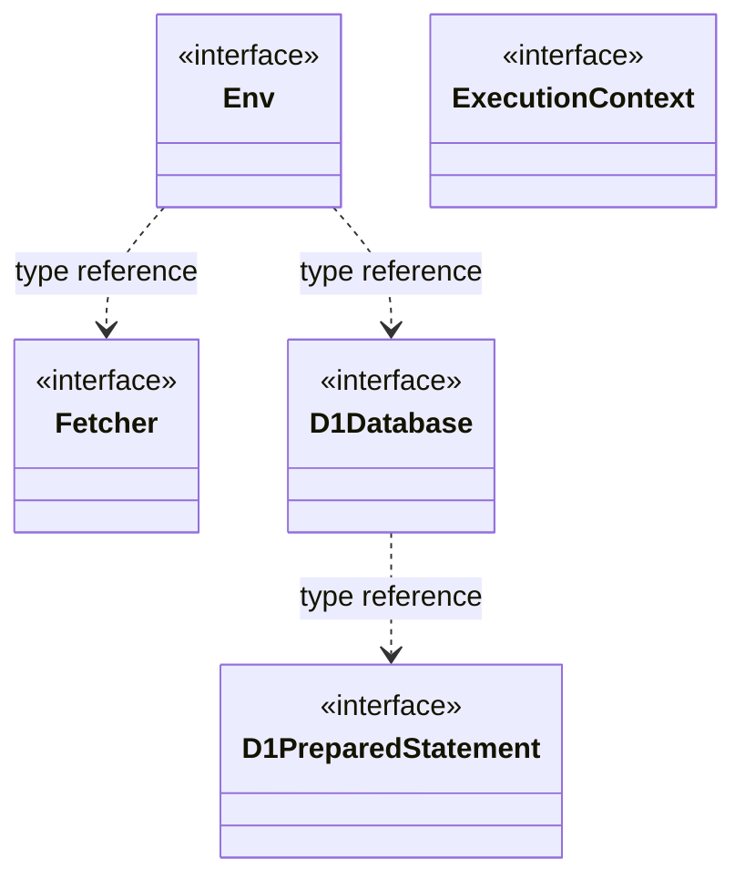

# Hosting type model

[All models](README.md) · [Feature contracts](../PROJECT_DOC.md)



## Fetcher

Source: [cloudflare-env.d.ts](../../cloudflare-env.d.ts). Kind: interface.

```typescript
interface Fetcher {
  fetch(input: Request | string, init?: RequestInit): Promise<Response>;
}
```

## D1PreparedStatement

Source: [cloudflare-env.d.ts](../../cloudflare-env.d.ts). Kind: interface.

```typescript
interface D1PreparedStatement {
  bind(...values: unknown[]): D1PreparedStatement;
  first<T = unknown>(): Promise<T | null>;
  all<T = unknown>(): Promise<{ results: T[] }>;
  run(): Promise<unknown>;
}
```

## D1Database

Source: [cloudflare-env.d.ts](../../cloudflare-env.d.ts). Kind: interface.

```typescript
interface D1Database {
  prepare(query: string): D1PreparedStatement;
  batch<T = unknown>(statements: D1PreparedStatement[]): Promise<T[]>;
  exec(query: string): Promise<unknown>;
  dump(): Promise<ArrayBuffer>;
}
```

## Env

Source: [worker/index.ts](../../worker/index.ts). Kind: interface.

```typescript
interface Env {
  ASSETS: Fetcher;
  DB: D1Database;
  IMAGES: {
    input(stream: ReadableStream): {
      transform(options: Record<string, unknown>): {
        output(options: { format: string; quality: number }): Promise<{ response(): Response }>;
      };
    };
  };
}
```

## ExecutionContext

Source: [worker/index.ts](../../worker/index.ts). Kind: interface.

```typescript
interface ExecutionContext {
  waitUntil(promise: Promise<unknown>): void;
  passThroughOnException(): void;
}
```
