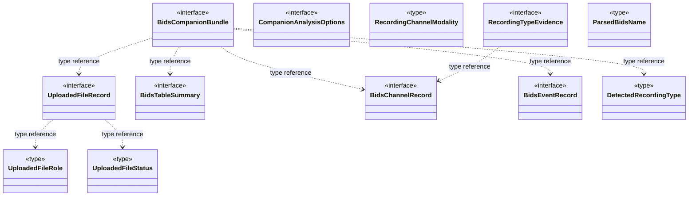
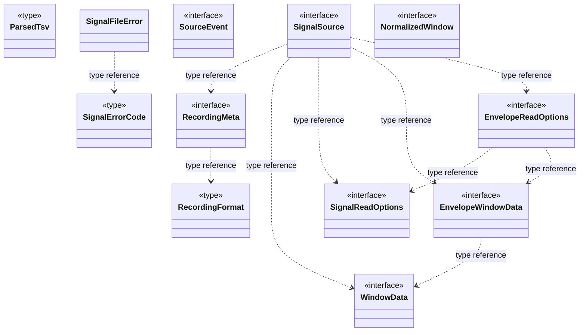
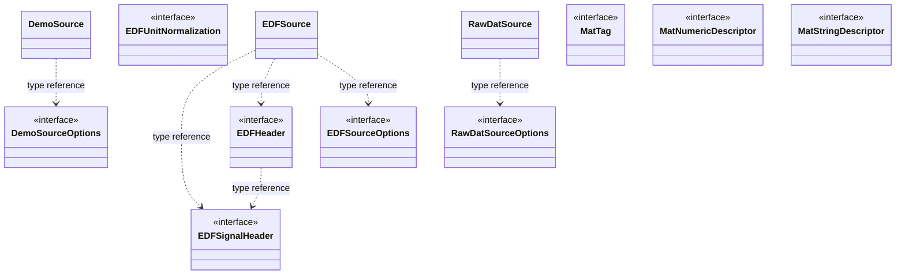
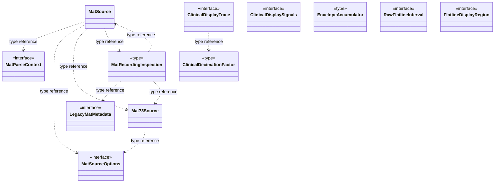
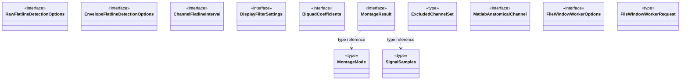
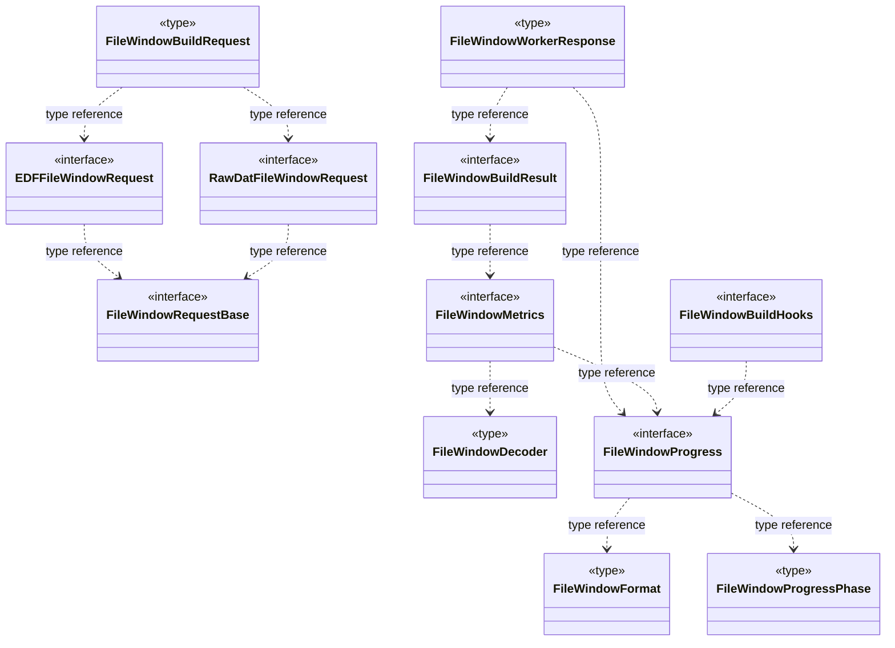
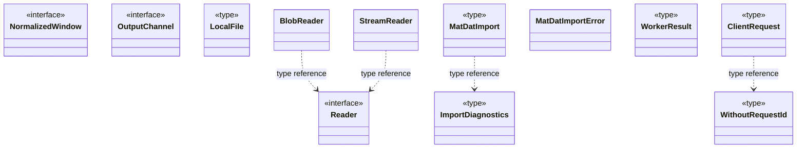
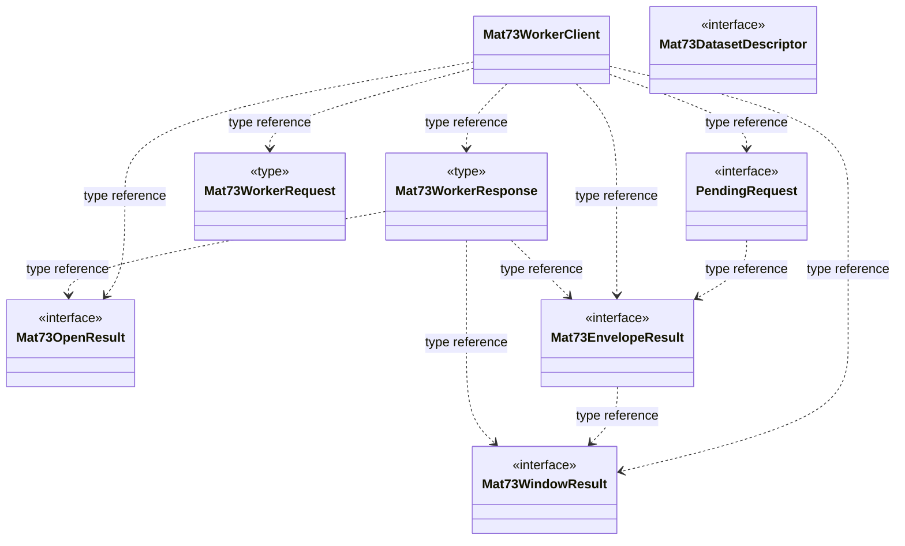

# Recording type model

[All models](README.md) · [Feature contracts](../PROJECT_DOC.md)

















## UploadedFileRole

Source: [app/bids-companions.ts](../../app/bids-companions.ts). Kind: type.

```typescript
export type UploadedFileRole =
  | "recording"
  | "recording-companion"
  | "metadata"
  | "events"
  | "channels"
  | "electrodes"
  | "table"
  | "other";
```

## UploadedFileStatus

Source: [app/bids-companions.ts](../../app/bids-companions.ts). Kind: type.

```typescript
export type UploadedFileStatus = "primary" | "applied" | "catalogued" | "available" | "error";
```

## UploadedFileRecord

Source: [app/bids-companions.ts](../../app/bids-companions.ts). Kind: interface.

```typescript
export interface UploadedFileRecord {
  key: string;
  name: string;
  path: string;
  size: number;
  lastModified: number;
  extension: string;
  role: UploadedFileRole;
  status: UploadedFileStatus;
  detail: string;
}
```

## BidsTableSummary

Source: [app/bids-companions.ts](../../app/bids-companions.ts). Kind: interface.

```typescript
export interface BidsTableSummary {
  path: string;
  kind: string;
  columns: string[];
  rowCount: number;
  applied: boolean;
}
```

## BidsChannelRecord

Source: [app/bids-companions.ts](../../app/bids-companions.ts). Kind: interface.

```typescript
export interface BidsChannelRecord {
  name: string;
  type: string;
  units: string;
  description: string;
  samplingFrequency: number | null;
  reference: string;
}
```

## BidsEventRecord

Source: [app/bids-companions.ts](../../app/bids-companions.ts). Kind: interface.

```typescript
export interface BidsEventRecord {
  id: string;
  sourcePath: string;
  rowIndex: number;
  onset: number;
  duration: number;
  label: string;
  description: string;
  channels: string[];
  values: Record<string, string>;
}
```

## BidsCompanionBundle

Source: [app/bids-companions.ts](../../app/bids-companions.ts). Kind: interface.

```typescript
export interface BidsCompanionBundle {
  files: UploadedFileRecord[];
  metadata: Record<string, unknown>;
  metadataSources: string[];
  tables: BidsTableSummary[];
  channels: BidsChannelRecord[];
  events: BidsEventRecord[];
  subjectId: string | null;
  sessionId: string | null;
  recordingType: DetectedRecordingType | null;
  warnings: string[];
}
```

## CompanionAnalysisOptions

Source: [app/bids-companions.ts](../../app/bids-companions.ts). Kind: interface.

```typescript
export interface CompanionAnalysisOptions {
  recordingFile?: File | null;
  channelCount?: number;
  channelLabels?: readonly string[];
}
```

## DetectedRecordingType

Source: [app/bids-companions.ts](../../app/bids-companions.ts). Kind: type.

```typescript
export type DetectedRecordingType =
  | "Scalp EEG"
  | "SEEG / iEEG"
  | "Simultaneous scalp + iEEG"
  | "Unknown recording type";
```

## RecordingChannelModality

Source: [app/bids-companions.ts](../../app/bids-companions.ts). Kind: type.

```typescript
export type RecordingChannelModality = "scalp" | "intracranial" | "unknown";
```

## RecordingTypeEvidence

Source: [app/bids-companions.ts](../../app/bids-companions.ts). Kind: interface.

```typescript
export interface RecordingTypeEvidence {
  recordingPath?: string;
  metadata?: Readonly<Record<string, unknown>>;
  channels?: readonly Pick<BidsChannelRecord, "name" | "type">[];
  channelLabels?: readonly string[];
}
```

## ParsedBidsName

Source: [app/bids-companions.ts](../../app/bids-companions.ts). Kind: type.

```typescript
type ParsedBidsName = {
  entities: Record<string, string>;
  suffix: string;
};
```

## ParsedTsv

Source: [app/bids-companions.ts](../../app/bids-companions.ts). Kind: type.

```typescript
type ParsedTsv = {
  columns: string[];
  rows: Array<Record<string, string>>;
};
```

## RecordingFormat

Source: [app/eeg-core.ts](../../app/eeg-core.ts). Kind: type.

```typescript
export type RecordingFormat =
  | "demo"
  | "edf"
  | "edf+"
  | "mat-v5"
  | "mat-v7.3"
  | "raw-int16-le";
```

## RecordingMeta

Source: [app/eeg-core.ts](../../app/eeg-core.ts). Kind: interface.

```typescript
export interface RecordingMeta {
  id: string;
  name: string;
  /** Compatibility alias used throughout the viewer UI. */
  fileName: string;
  format: RecordingFormat;
  durationSec: number;
  channelCount: number;
  channelLabels: string[];
  channelUnits: string[];
  /** Compatibility alias for channelUnits. */
  units: string[];
  sampleRates: number[];
  /** Nominal/default display rate (the first signal rate for mixed-rate EDF). */
  sampleRate: number;
  /** Conservative source-channel indices recommended for the initial display. */
  recommendedDisplayChannels?: number[];
  byteLength?: number;
  patientId?: string;
  recordingId?: string;
  startedAt?: Date;
  /** ISO timestamp compatibility alias for serializable exports. */
  startDateTime?: string;
  warnings: string[];
  assumptions?: string[];
  details?: Readonly<Record<string, string | number | boolean>>;
}
```

## WindowData

Source: [app/eeg-core.ts](../../app/eeg-core.ts). Kind: interface.

```typescript
export interface WindowData {
  /** Channel-major physical samples. */
  data: Float32Array[];
  /** One sample rate for each returned channel. */
  sampleRates: number[];
  /** Absolute time of the first returned sample for each channel. */
  channelStartSecs: number[];
  startSec: number;
  durationSec: number;
  channelIndices: number[];
  channelLabels: string[];
  channelUnits: string[];
}
```

## SignalReadOptions

Source: [app/eeg-core.ts](../../app/eeg-core.ts). Kind: interface.

```typescript
export interface SignalReadOptions {
  /** Stops a superseded file-backed read between bounded chunks. */
  signal?: AbortSignal;
}
```

## EnvelopeWindowData

Source: [app/eeg-core.ts](../../app/eeg-core.ts). Kind: interface.

```typescript
export interface EnvelopeWindowData extends WindowData {
  minima: Float32Array[];
  maxima: Float32Array[];
  gaps: Uint8Array[];
  /** Sum of absolute sample-to-sample changes inside each bucket. */
  variation?: Float32Array[];
  bucketDurationSec: number;
}
```

## EnvelopeReadOptions

Source: [app/eeg-core.ts](../../app/eeg-core.ts). Kind: interface.

```typescript
export interface EnvelopeReadOptions extends SignalReadOptions {
  /** Opt-in minimum delay between independently owned, complete-prefix previews. */
  overviewIntervalMs?: number;
  /** Preview data is exact only for its returned time range, never unread future data. */
  onOverview?: (window: EnvelopeWindowData) => void;
}
```

## SignalSource

Source: [app/eeg-core.ts](../../app/eeg-core.ts). Kind: interface.

```typescript
export interface SignalSource {
  readonly meta: RecordingMeta;
  /** Release an unopened/rejected worker-backed source. */
  dispose?(): void;
  /** Known recording-system labels; never implies machine versus human authorship. */
  readonly recordingLabels?: readonly RecordingLabel[];
  getWindow(
    startSec: number,
    durationSec: number,
    channelIndices?: readonly number[],
    options?: SignalReadOptions,
  ): Promise<WindowData>;
  getEnvelopeWindow?(
    startSec: number,
    durationSec: number,
    bucketCount: number,
    channelIndices?: readonly number[],
    options?: EnvelopeReadOptions,
  ): Promise<EnvelopeWindowData>;
}
```

## SourceEvent

Source: [app/eeg-core.ts](../../app/eeg-core.ts). Kind: interface.

```typescript
export interface SourceEvent {
  label: string;
  timeSec: number;
  durationSec?: number;
  source: "edf+" | "mat";
}
```

## SignalErrorCode

Source: [app/eeg-core.ts](../../app/eeg-core.ts). Kind: type.

```typescript
export type SignalErrorCode =
  | "UNSUPPORTED_FORMAT"
  | "INVALID_HEADER"
  | "TRUNCATED_FILE"
  | "INVALID_WINDOW"
  | "DECOMPRESSION_UNAVAILABLE"
  | "NO_SIGNAL_MATRIX";
```

## SignalFileError

Source: [app/eeg-core.ts](../../app/eeg-core.ts). Kind: class.

```typescript
export class SignalFileError extends Error {
  readonly code: SignalErrorCode;

  /** Initializes the instance from the supplied arguments. */
  constructor(code: SignalErrorCode, message: string, options?: ErrorOptions) ;
}
```

## NormalizedWindow

Source: [app/eeg-core.ts](../../app/eeg-core.ts). Kind: interface.

```typescript
interface NormalizedWindow {
  startSec: number;
  endSec: number;
  durationSec: number;
  channelIndices: number[];
}
```

## DemoSourceOptions

Source: [app/eeg-core.ts](../../app/eeg-core.ts). Kind: interface.

```typescript
export interface DemoSourceOptions {
  name?: string;
  durationSec?: number;
  sampleRate?: number;
  channelLabels?: readonly string[];
  lineFrequency?: 50 | 60;
}
```

## DemoSource

Source: [app/eeg-core.ts](../../app/eeg-core.ts). Kind: class.

```typescript
export class DemoSource implements SignalSource {
  readonly meta: RecordingMeta;
  private readonly lineFrequency: 50 | 60;

  /** Initializes the instance from the supplied arguments. */
  constructor(options: DemoSourceOptions = {}) ;

  /** Returns the window. */
  async getWindow(
    startSec: number,
    durationSec: number,
    channelIndices?: readonly number[],
    options: SignalReadOptions = {},
  ): Promise<WindowData> ;
}
```

## EDFSignalHeader

Source: [app/eeg-core.ts](../../app/eeg-core.ts). Kind: interface.

```typescript
export interface EDFSignalHeader {
  index: number;
  label: string;
  transducer: string;
  physicalDimension: string;
  physicalMinimum: number;
  physicalMaximum: number;
  digitalMinimum: number;
  digitalMaximum: number;
  prefilter: string;
  samplesPerRecord: number;
  sampleRate: number;
  reserved: string;
  isAnnotation: boolean;
  byteOffsetInRecord: number;
}
```

## EDFHeader

Source: [app/eeg-core.ts](../../app/eeg-core.ts). Kind: interface.

```typescript
export interface EDFHeader {
  version: string;
  patientIdentification: string;
  recordingIdentification: string;
  startDateText: string;
  startTimeText: string;
  startedAt?: Date;
  headerBytes: number;
  reserved: string;
  declaredDataRecordCount: number;
  dataRecordCount: number;
  dataRecordDurationSec: number;
  signalCount: number;
  signals: EDFSignalHeader[];
  bytesPerDataRecord: number;
  isEDFPlus: boolean;
  isDiscontinuous: boolean;
  warnings: string[];
}
```

## EDFUnitNormalization

Source: [app/eeg-core.ts](../../app/eeg-core.ts). Kind: interface.

```typescript
export interface EDFUnitNormalization {
  /** Unit exposed to the display and exported window metadata. */
  unit: string;
  /** Multiplier applied after EDF digital-to-physical calibration. */
  scale: number;
  isVoltage: boolean;
}
```

## EDFSourceOptions

Source: [app/eeg-core.ts](../../app/eeg-core.ts). Kind: interface.

```typescript
export interface EDFSourceOptions {
  /** Defaults to true. Interactive imports can read the header before annotation metadata. */
  parseAnnotations?: boolean;
}
```

## EDFSource

Source: [app/eeg-core.ts](../../app/eeg-core.ts). Kind: class.

```typescript
export class EDFSource implements SignalSource {
  readonly meta: RecordingMeta;
  readonly header: EDFHeader;
  readonly events: SourceEvent[];
  private readonly file: File;
  private readonly displaySignals: EDFSignalHeader[];
  private readonly physicalUnitScaleBySignalIndex: number[];
  private annotationsLoaded: boolean;
  private annotationLoadPromise: Promise<readonly SourceEvent[]> | null = null;

  /** Initializes the instance from the supplied arguments. */
  private constructor(
    file: File,
    header: EDFHeader,
    events: SourceEvent[],
    annotationWarnings: string[],
    annotationsLoaded: boolean,
  ) ;

  /** Constructs the source using the supplied metadata. */
  static async create(file: File, options: EDFSourceOptions = {}): Promise<EDFSource> ;

  /**
   * Read-only access for the dedicated envelope worker. The browser still owns
   * the local File; passing it to a worker does not upload or duplicate the
   * recording and lets decoding stay off the UI thread.
   */
  get sourceBlob(): Blob ;

  /** Loads the annotations. */
  async loadAnnotations(options: SignalReadOptions = {}): Promise<readonly SourceEvent[]> ;

  /** Applies the verified annotations. */
  applyVerifiedAnnotations(events: readonly SourceEvent[], warnings: readonly string[] = []) ;

  /** Returns the window. */
  async getWindow(
    startSec: number,
    durationSec: number,
    channelIndices?: readonly number[],
    options: SignalReadOptions = {},
  ): Promise<WindowData> ;

  /** Returns the envelope window. */
  async getEnvelopeWindow(
    startSec: number,
    durationSec: number,
    bucketCount: number,
    channelIndices?: readonly number[],
    options: SignalReadOptions = {},
  ): Promise<EnvelopeWindowData> ;
}
```

## RawDatSourceOptions

Source: [app/eeg-core.ts](../../app/eeg-core.ts). Kind: interface.

```typescript
export interface RawDatSourceOptions {
  sampleRate: number;
  channelCount: number;
  channelLabels?: readonly string[];
  /** Physical units per digital count. May be scalar or one value per channel. */
  physicalScale?: number | readonly number[];
  /** Physical offset after scaling. May be scalar or one value per channel. */
  physicalOffset?: number | readonly number[];
  channelUnits?: string | readonly string[];
  name?: string;
  warnings?: readonly string[];
  assumptions?: readonly string[];
  recordingLabels?: readonly RecordingLabel[];
}
```

## RawDatSource

Source: [app/eeg-core.ts](../../app/eeg-core.ts). Kind: class.

```typescript
export class RawDatSource implements SignalSource {
  readonly meta: RecordingMeta;
  readonly recordingLabels: readonly RecordingLabel[];
  private readonly file: File;
  private readonly scale: number[];
  private readonly physicalOffset: number[];
  private readonly totalSamples: number;

  /** Initializes the instance from the supplied arguments. */
  private constructor(file: File, options: RawDatSourceOptions) ;

  /** Constructs the source using the supplied metadata. */
  static async create(file: File, options: RawDatSourceOptions): Promise<RawDatSource> ;

  /** Serializable inputs used by the dedicated DAT envelope worker. */
  get envelopeWorkerSource() ;

  /** Returns the window. */
  async getWindow(
    startSec: number,
    durationSec: number,
    channelIndices?: readonly number[],
    options: SignalReadOptions = {},
  ): Promise<WindowData> ;

  /** Returns the envelope window. */
  async getEnvelopeWindow(
    startSec: number,
    durationSec: number,
    bucketCount: number,
    channelIndices?: readonly number[],
    options: SignalReadOptions = {},
  ): Promise<EnvelopeWindowData> ;
}
```

## MatTag

Source: [app/eeg-core.ts](../../app/eeg-core.ts). Kind: interface.

```typescript
interface MatTag {
  type: number;
  byteLength: number;
  data: Uint8Array;
  nextOffset: number;
  small: boolean;
}
```

## MatNumericDescriptor

Source: [app/eeg-core.ts](../../app/eeg-core.ts). Kind: interface.

```typescript
interface MatNumericDescriptor {
  name: string;
  dimensions: number[];
  elementCount: number;
  dataType: number;
  bytes: Uint8Array;
  littleEndian: boolean;
  complex: boolean;
}
```

## MatStringDescriptor

Source: [app/eeg-core.ts](../../app/eeg-core.ts). Kind: interface.

```typescript
interface MatStringDescriptor {
  name: string;
  dimensions: number[];
  values: string[];
}
```

## MatParseContext

Source: [app/eeg-core.ts](../../app/eeg-core.ts). Kind: interface.

```typescript
interface MatParseContext {
  littleEndian: boolean;
  numeric: MatNumericDescriptor[];
  strings: MatStringDescriptor[];
  structures: Array<{ name: string; fieldNames: string[]; elementCount: number }>;
  warnings: string[];
}
```

## LegacyMatMetadata

Source: [app/eeg-core.ts](../../app/eeg-core.ts). Kind: interface.

```typescript
export interface LegacyMatMetadata {
  sampleRate?: number;
  channelCount?: number;
  /** Number of Channel struct entries, independent of the number of decoded text rows. */
  channelEntryCount?: number;
  channelLabels: string[];
  events: Array<{ label: string; timeSec: number }>;
  /** All occurrences, including non-seizure labels and extended intervals. */
  recordingLabels: RecordingLabel[];
  warnings: string[];
}
```

## MatSourceOptions

Source: [app/eeg-core.ts](../../app/eeg-core.ts). Kind: interface.

```typescript
export interface MatSourceOptions {
  /** Overrides a scalar Fs/sample_rate variable found in the file. */
  sampleRate?: number;
  channelLabels?: readonly string[];
  channelUnits?: string | readonly string[];
}
```

## Mat73Source

Source: [app/eeg-core.ts](../../app/eeg-core.ts). Kind: class.

```typescript
export class Mat73Source implements SignalSource {
  readonly meta: RecordingMeta;
  readonly matrixName: string;
  private readonly client: Mat73WorkerClient;
  private readonly sampleCount: number;

  /** Releases resources owned by this instance. */
  dispose(): void ;

  /** Initializes the instance from the supplied arguments. */
  private constructor(
    file: File,
    client: Mat73WorkerClient,
    opened: Awaited<ReturnType<typeof Mat73WorkerClient.create>>["metadata"],
    options: MatSourceOptions,
  ) ;

  /** Constructs the source using the supplied metadata. */
  static async create(file: File, options: MatSourceOptions = {}) ;

  /** Returns the window. */
  async getWindow(
    startSec: number,
    durationSec: number,
    channelIndices?: readonly number[],
    options: SignalReadOptions = {},
  ): Promise<WindowData> ;

  /** Returns the envelope window. */
  async getEnvelopeWindow(
    startSec: number,
    durationSec: number,
    bucketCount: number,
    channelIndices?: readonly number[],
    options: EnvelopeReadOptions = {},
  ): Promise<EnvelopeWindowData> ;
}
```

## MatSource

Source: [app/eeg-core.ts](../../app/eeg-core.ts). Kind: class.

```typescript
export class MatSource implements SignalSource {
  readonly meta: RecordingMeta;
  readonly recordingLabels: readonly RecordingLabel[];
  readonly matrixName: string;
  private readonly data: Float32Array[];

  /** Initializes the instance from the supplied arguments. */
  private constructor(
    file: File,
    descriptor: MatNumericDescriptor,
    decoded: ReturnType<typeof decodeMatSignalMatrix>,
    sampleRate: number,
    sampleRateSource: string,
    options: MatSourceOptions,
    parserWarnings: string[],
    recordingLabels: readonly RecordingLabel[],
  ) ;

  /** Constructs the source using the supplied metadata. */
  static async create(file: File, options: MatSourceOptions = {}): Promise<MatSource | Mat73Source> ;

  /** Identifies legacy metadata before choosing a waveform matrix, decoding Level-5 data only once. */
  static async inspectRecording(file: File, options: MatSourceOptions = {}): Promise<MatRecordingInspection> ;

  /** Constructs from the parsed context. */
  private static fromParsedContext(file: File, context: MatParseContext, options: MatSourceOptions): MatSource ;

  /** Returns the window. */
  async getWindow(
    startSec: number,
    durationSec: number,
    channelIndices?: readonly number[],
  ): Promise<WindowData> ;

  /**
   * Builds exact overview extrema directly from decoded MAT samples without
   * copying the full requested window. Bounded batches yield to navigation and
   * cancellation; only screen-resolution accumulators are allocated. Each time
   * chunk covers every selected channel before publishing a completed prefix.
   */
  async getEnvelopeWindow(
    startSec: number,
    durationSec: number,
    bucketCount: number,
    channelIndices?: readonly number[],
    options: EnvelopeReadOptions = {},
  ): Promise<EnvelopeWindowData> ;
}
```

## MatRecordingInspection

Source: [app/eeg-core.ts](../../app/eeg-core.ts). Kind: type.

```typescript
export type MatRecordingInspection =
  | { kind: "legacy"; metadata: LegacyMatMetadata }
  | { kind: "standalone"; source: MatSource | Mat73Source };
```

## ClinicalDecimationFactor

Source: [app/eeg-core.ts](../../app/eeg-core.ts). Kind: type.

```typescript
export type ClinicalDecimationFactor = 1 | 2;
```

## ClinicalDisplayTrace

Source: [app/eeg-core.ts](../../app/eeg-core.ts). Kind: interface.

```typescript
export interface ClinicalDisplayTrace {
  data: Float32Array;
  sampleRate: number;
  factor: ClinicalDecimationFactor;
  /** Local input offset retained first so factor-2 output stays on global even samples. */
  retainedInputSampleOffset: 0 | 1;
  /** Recording-global source sample represented by output sample zero. */
  outputStartSampleIndex: number;
  /** Output sample-zero offset relative to this input window's source origin. */
  outputStartOffsetSec: number;
  /** Fixed input-rate delay removed before the 2× output is retained. */
  compensatedGroupDelaySamples: number;
  /** Time correction for the retained filtered samples before pairing with source time. */
  retainedSampleTimeCorrectionSec: number;
}
```

## ClinicalDisplaySignals

Source: [app/eeg-core.ts](../../app/eeg-core.ts). Kind: interface.

```typescript
export interface ClinicalDisplaySignals {
  data: Float32Array[];
  sampleRates: number[];
  factors: number[];
  retainedInputSampleOffsets: Array<0 | 1>;
  outputStartSampleIndices: number[];
  outputStartOffsetSecs: number[];
  compensatedGroupDelaySamples: number[];
  retainedSampleTimeCorrectionSec: number[];
}
```

## EnvelopeAccumulator

Source: [app/eeg-core.ts](../../app/eeg-core.ts). Kind: type.

```typescript
type EnvelopeAccumulator = {
  minima: Float32Array;
  maxima: Float32Array;
  gaps: Uint8Array;
  data: Float32Array;
  variation: Float32Array;
  counts: Uint32Array;
  previousBucket: number;
  previousValue: number;
};
```

## RawFlatlineInterval

Source: [app/eeg-core.ts](../../app/eeg-core.ts). Kind: interface.

```typescript
export interface RawFlatlineInterval {
  startSec: number;
  endSec: number;
  durationSec: number;
  minimumFlatChannelCount: number;
  totalChannelCount: number;
}
```

## FlatlineDisplayRegion

Source: [app/eeg-core.ts](../../app/eeg-core.ts). Kind: interface.

```typescript
export interface FlatlineDisplayRegion {
  startSec: number;
  endSec: number;
}
```

## RawFlatlineDetectionOptions

Source: [app/eeg-core.ts](../../app/eeg-core.ts). Kind: interface.

```typescript
export interface RawFlatlineDetectionOptions {
  startSec?: number;
  /** Optional absolute origin for each channel when raw windows are offset. */
  channelStartSecs?: readonly number[];
  thresholdFraction?: number;
  minimumDurationSec?: number;
  absoluteTolerance?: number;
}
```

## EnvelopeFlatlineDetectionOptions

Source: [app/eeg-core.ts](../../app/eeg-core.ts). Kind: interface.

```typescript
export interface EnvelopeFlatlineDetectionOptions {
  startSec?: number;
  thresholdFraction?: number;
  minimumDurationSec?: number;
  absoluteTolerance?: number;
}
```

## ChannelFlatlineInterval

Source: [app/eeg-core.ts](../../app/eeg-core.ts). Kind: interface.

```typescript
interface ChannelFlatlineInterval {
  startSec: number;
  endSec: number;
}
```

## DisplayFilterSettings

Source: [app/eeg-core.ts](../../app/eeg-core.ts). Kind: interface.

```typescript
export interface DisplayFilterSettings {
  enabled: boolean;
  highPassHz: number;
  lowPassHz: number;
  /** Zero disables the line-frequency notch. */
  notchHz: 0 | 50 | 60;
  notchQ?: number;
  /** Forward-backward filtering removes display phase delay. Defaults to true. */
  zeroPhase?: boolean;
}
```

## BiquadCoefficients

Source: [app/eeg-core.ts](../../app/eeg-core.ts). Kind: interface.

```typescript
interface BiquadCoefficients {
  b0: number;
  b1: number;
  b2: number;
  a1: number;
  a2: number;
}
```

## MontageMode

Source: [app/eeg-core.ts](../../app/eeg-core.ts). Kind: type.

```typescript
export type MontageMode = "referential" | "average" | "average-reference" | "bipolar";
```

## SignalSamples

Source: [app/eeg-core.ts](../../app/eeg-core.ts). Kind: type.

```typescript
export type SignalSamples = Float32Array | Float64Array;
```

## MontageResult

Source: [app/eeg-core.ts](../../app/eeg-core.ts). Kind: interface.

```typescript
export interface MontageResult<T extends SignalSamples = Float32Array> {
  data: T[];
  labels: string[];
  /** Optional compatibility field; callers may retain source window rates. */
  sampleRates?: number[];
  /** Absolute time represented by sample zero of each returned channel. */
  sampleStartSecs?: number[];
  /** Original zero-based source indices contributing to each derived channel. */
  sourceIndices: number[][];
  /** Source index represented by the row before any reference contribution. */
  primarySourceIndices: number[];
  mode: MontageMode;
  warnings: string[];
}
```

## ExcludedChannelSet

Source: [app/eeg-core.ts](../../app/eeg-core.ts). Kind: type.

```typescript
type ExcludedChannelSet = ReadonlySet<number | string>;
```

## MatlabAnatomicalChannel

Source: [app/eeg-core.ts](../../app/eeg-core.ts). Kind: interface.

```typescript
interface MatlabAnatomicalChannel {
  sourceIndex: number;
  actualLabel: string;
  group: string;
  contactText: string;
}
```

## FileWindowWorkerOptions

Source: [app/file-window-worker-client.ts](../../app/file-window-worker-client.ts). Kind: interface.

```typescript
export interface FileWindowWorkerOptions {
  signal?: AbortSignal;
  onProgress?: (progress: FileWindowProgress) => void;
  /** Defaults to true for compatibility when module workers are unavailable. */
  fallbackToMainThread?: boolean;
}
```

## FileWindowWorkerRequest

Source: [app/file-window-worker.ts](../../app/file-window-worker.ts). Kind: type.

```typescript
export type FileWindowWorkerRequest = {
  type: "build";
  requestId: number;
  request: FileWindowBuildRequest;
};
```

## FileWindowWorkerResponse

Source: [app/file-window-worker.ts](../../app/file-window-worker.ts). Kind: type.

```typescript
export type FileWindowWorkerResponse =
  | { type: "progress"; requestId: number; progress: FileWindowProgress }
  | { type: "complete"; requestId: number; result: FileWindowBuildResult }
  | {
    type: "error";
    requestId: number;
    name: string;
    message: string;
    code?: string;
  };
```

## FileWindowFormat

Source: [app/file-window.ts](../../app/file-window.ts). Kind: type.

```typescript
export type FileWindowFormat = "edf" | "raw-dat";
```

## FileWindowProgressPhase

Source: [app/file-window.ts](../../app/file-window.ts). Kind: type.

```typescript
export type FileWindowProgressPhase = "reading" | "decoding" | "complete";
```

## FileWindowDecoder

Source: [app/file-window.ts](../../app/file-window.ts). Kind: type.

```typescript
export type FileWindowDecoder = "int16-array" | "data-view";
```

## FileWindowRequestBase

Source: [app/file-window.ts](../../app/file-window.ts). Kind: interface.

```typescript
interface FileWindowRequestBase {
  blob: Blob;
  startSec: number;
  durationSec: number;
  channelIndices?: readonly number[];
  chunkSizeBytes?: number;
}
```

## EDFFileWindowRequest

Source: [app/file-window.ts](../../app/file-window.ts). Kind: interface.

```typescript
export interface EDFFileWindowRequest extends FileWindowRequestBase {
  format: "edf";
  header: EDFHeader;
}
```

## RawDatFileWindowRequest

Source: [app/file-window.ts](../../app/file-window.ts). Kind: interface.

```typescript
export interface RawDatFileWindowRequest extends FileWindowRequestBase {
  format: "raw-dat";
  sampleRate: number;
  channelCount: number;
  channelLabels: readonly string[];
  channelUnits: readonly string[];
  physicalScales: readonly number[];
  physicalOffsets: readonly number[];
}
```

## FileWindowBuildRequest

Source: [app/file-window.ts](../../app/file-window.ts). Kind: type.

```typescript
export type FileWindowBuildRequest = EDFFileWindowRequest | RawDatFileWindowRequest;
```

## FileWindowProgress

Source: [app/file-window.ts](../../app/file-window.ts). Kind: interface.

```typescript
export interface FileWindowProgress {
  phase: FileWindowProgressPhase;
  format: FileWindowFormat;
  bytesRead: number;
  totalBytes: number;
  samplesDecoded: number;
  totalSamples: number;
  chunksRead: number;
  elapsedMs: number;
  readMs: number;
  decodeMs: number;
}
```

## FileWindowMetrics

Source: [app/file-window.ts](../../app/file-window.ts). Kind: interface.

```typescript
export interface FileWindowMetrics extends Omit<FileWindowProgress, "phase"> {
  backend: "worker" | "direct";
  decoder: FileWindowDecoder;
}
```

## FileWindowBuildResult

Source: [app/file-window.ts](../../app/file-window.ts). Kind: interface.

```typescript
export interface FileWindowBuildResult {
  window: WindowData;
  metrics: FileWindowMetrics;
}
```

## FileWindowBuildHooks

Source: [app/file-window.ts](../../app/file-window.ts). Kind: interface.

```typescript
export interface FileWindowBuildHooks {
  signal?: AbortSignal;
  onProgress?: (progress: FileWindowProgress) => void;
  backend?: "worker" | "direct";
  /** Test-only portability override for Raw DAT and EDF little-endian reads. */
  decoder?: "automatic" | "portable-data-view";
}
```

## NormalizedWindow

Source: [app/file-window.ts](../../app/file-window.ts). Kind: interface.

```typescript
interface NormalizedWindow {
  startSec: number;
  endSec: number;
  durationSec: number;
  channelIndices: number[];
}
```

## OutputChannel

Source: [app/file-window.ts](../../app/file-window.ts). Kind: interface.

```typescript
interface OutputChannel {
  sourceIndex: number;
  label: string;
  unit: string;
  sampleRate: number;
  firstSample: number;
  endSample: number;
  scale: number;
  offset: number;
  unitScale: number;
  data: Float32Array;
}
```

## LocalFile

Source: [app/local-recording-identity.ts](../../app/local-recording-identity.ts). Kind: type.

```typescript
type LocalFile = Pick<File, "name" | "size" | "lastModified" | "webkitRelativePath">;
```

## Reader

Source: [app/mat-event-reader.ts](../../app/mat-event-reader.ts). Kind: interface.

```typescript
interface Reader {
  position: number;
  read(size: number, short?: boolean): Promise<Uint8Array<ArrayBuffer>>;
  peek(size: number): Promise<Uint8Array>;
  skip(size: number): Promise<void>;
  stream(size: number): ReadableStream<Uint8Array<ArrayBuffer>>;
}
```

## BlobReader

Source: [app/mat-event-reader.ts](../../app/mat-event-reader.ts). Kind: class.

```typescript
class BlobReader implements Reader {
  position = 0;
  private blob: Blob;
  private buffer = new Uint8Array();
  private bufferStart = 0;
  /** Initializes the instance from the supplied arguments. */
  constructor(blob: Blob) ;
  /** Consumes the requested metadata bytes and rejects unexpected truncation. */
  async read(size: number, short = false) ;
  /** Returns a cached entry without updating its position. */
  async peek(size: number) ;
  /** Advances over metadata bytes while enforcing the container boundary. */
  async skip(size: number) ;
  /** Exposes the requested container bytes as a bounded readable stream. */
  stream(size: number) ;
}
```

## StreamReader

Source: [app/mat-event-reader.ts](../../app/mat-event-reader.ts). Kind: class.

```typescript
class StreamReader implements Reader {
  position = 0;
  private pending: Uint8Array = new Uint8Array();
  private done = false;
  private expanded = 0;
  private reader: ReadableStreamDefaultReader<Uint8Array>;
  /** Initializes the instance from the supplied arguments. */
  constructor(stream: ReadableStream<Uint8Array>) ;
  /** Refills the decompressed input buffer within the background-search size limit. */
  private async fill() ;
  /** Consumes the requested metadata bytes and rejects unexpected truncation. */
  async read(size: number, short = false) ;
  /** Returns a cached entry without updating its position. */
  async peek(size: number) ;
  /** Advances over metadata bytes while enforcing the container boundary. */
  async skip(size: number) ;
  /** Exposes the requested container bytes as a bounded readable stream. */
  stream(size: number) ;
  /** Closes the owned resource. */
  async close() ;
}
```

## ImportDiagnostics

Source: [app/mat-import.ts](../../app/mat-import.ts). Kind: type.

```typescript
type ImportDiagnostics = {
  format: "legacy-mat-dat" | "standalone-mat" | "raw-dat";
  sampleRate: number | null;
  channelCount: number | null;
  channelLabelCount: number;
};
```

## MatDatImport

Source: [app/mat-import.ts](../../app/mat-import.ts). Kind: type.

```typescript
export type MatDatImport = (
  | { kind: "standalone-mat"; file: File; source: SignalSource }
  | { kind: "legacy-dat"; file: File; mat: File; metadata: LegacyMatMetadata; metadataIssue: string | null }
  | { kind: "raw-dat"; file: File; metadataError?: string }
) & { diagnostics: ImportDiagnostics };
```

## MatDatImportError

Source: [app/mat-import.ts](../../app/mat-import.ts). Kind: class.

```typescript
export class MatDatImportError extends Error {
  readonly title: string;

  /** Initializes the instance from the supplied arguments. */
  constructor(title: string, message: string) ;
}
```

## WorkerResult

Source: [app/mat73-worker-client.ts](../../app/mat73-worker-client.ts). Kind: type.

```typescript
type WorkerResult = Mat73OpenResult | Mat73WindowResult | Mat73EnvelopeResult | undefined;
```

## WithoutRequestId

Source: [app/mat73-worker-client.ts](../../app/mat73-worker-client.ts). Kind: type.

```typescript
type WithoutRequestId<T> = T extends { requestId: number } ? Omit<T, "requestId"> : never;
```

## ClientRequest

Source: [app/mat73-worker-client.ts](../../app/mat73-worker-client.ts). Kind: type.

```typescript
type ClientRequest = WithoutRequestId<Mat73WorkerRequest>;
```

## PendingRequest

Source: [app/mat73-worker-client.ts](../../app/mat73-worker-client.ts). Kind: interface.

```typescript
interface PendingRequest {
  resolve: (result: WorkerResult) => void;
  reject: (error: unknown) => void;
  signal?: AbortSignal;
  onAbort?: () => void;
  onOverview?: (result: Mat73EnvelopeResult) => void;
}
```

## Mat73WorkerClient

Source: [app/mat73-worker-client.ts](../../app/mat73-worker-client.ts). Kind: class.

```typescript
export class Mat73WorkerClient {
  private readonly worker: Worker;
  private readonly pending = new Map<number, PendingRequest>();
  private failedError: Error | null = null;

  /** Initializes the instance from the supplied arguments. */
  private constructor(worker: Worker) ;

  /** Constructs the source using the supplied metadata. */
  static async create(file: File): Promise<{ client: Mat73WorkerClient; metadata: Mat73OpenResult }> ;

  /** Reads the window. */
  readWindow(
    firstSample: number,
    endSample: number,
    channelIndices: number[],
    signal?: AbortSignal,
  ) ;

  /** Reads the envelope. */
  readEnvelope(
    request: Omit<Extract<Mat73WorkerRequest, { type: "envelope" }>, "type" | "requestId">,
    signal?: AbortSignal,
    onOverview?: (result: Mat73EnvelopeResult) => void,
  ) ;

  /** Closes the owned resource. */
  close() ;

  /** Dispatches a cancellable HDF5 request and tracks its pending response. */
  private send<T extends WorkerResult>(
    request: ClientRequest,
    signal?: AbortSignal,
    onOverview?: (result: Mat73EnvelopeResult) => void,
  ): Promise<T> ;

  /** Finishes the request. */
  private finishRequest(id: number) ;

  /** Reports failure for the all. */
  private failAll(error: Error) ;
}
```

## Mat73DatasetDescriptor

Source: [app/mat73.ts](../../app/mat73.ts). Kind: interface.

```typescript
export interface Mat73DatasetDescriptor {
  path: string;
  shape: number[];
  dtype: string;
  elementCount: number;
}
```

## Mat73OpenResult

Source: [app/mat73.ts](../../app/mat73.ts). Kind: interface.

```typescript
export interface Mat73OpenResult {
  matrixPath: string;
  matrixShape: number[];
  sampleAxis: 0 | 1;
  sampleCount: number;
  channelCount: number;
  sampleRate: number;
  sampleRateSource: string;
  channelLabels: string[];
  warnings: string[];
}
```

## Mat73WindowResult

Source: [app/mat73.ts](../../app/mat73.ts). Kind: interface.

```typescript
export interface Mat73WindowResult {
  data: Float32Array[];
  firstSample: number;
}
```

## Mat73EnvelopeResult

Source: [app/mat73.ts](../../app/mat73.ts). Kind: interface.

```typescript
export interface Mat73EnvelopeResult extends Mat73WindowResult {
  minima: Float32Array[];
  maxima: Float32Array[];
  gaps: Uint8Array[];
  bucketDurationSec: number;
}
```

## Mat73WorkerRequest

Source: [app/mat73.ts](../../app/mat73.ts). Kind: type.

```typescript
export type Mat73WorkerRequest =
  | { type: "open"; requestId: number; file: File }
  | {
    type: "window";
    requestId: number;
    firstSample: number;
    endSample: number;
    channelIndices: number[];
  }
  | {
    type: "envelope";
    requestId: number;
    firstSample: number;
    endSample: number;
    startSec: number;
    durationSec: number;
    bucketCount: number;
    channelIndices: number[];
    overviewIntervalMs?: number;
  }
  | { type: "cancel"; requestId: number }
  | { type: "close"; requestId: number };
```

## Mat73WorkerResponse

Source: [app/mat73.ts](../../app/mat73.ts). Kind: type.

```typescript
export type Mat73WorkerResponse =
  | { type: "opened"; requestId: number; result: Mat73OpenResult }
  | { type: "window"; requestId: number; result: Mat73WindowResult }
  | { type: "envelope"; requestId: number; result: Mat73EnvelopeResult }
  | { type: "overview"; requestId: number; result: Mat73EnvelopeResult }
  | { type: "closed"; requestId: number }
  | {
    type: "error";
    requestId: number;
    name: string;
    message: string;
    code?: string;
  };
```
