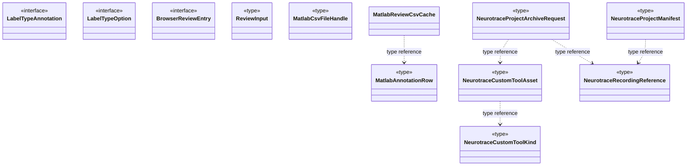
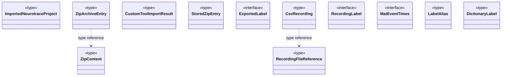
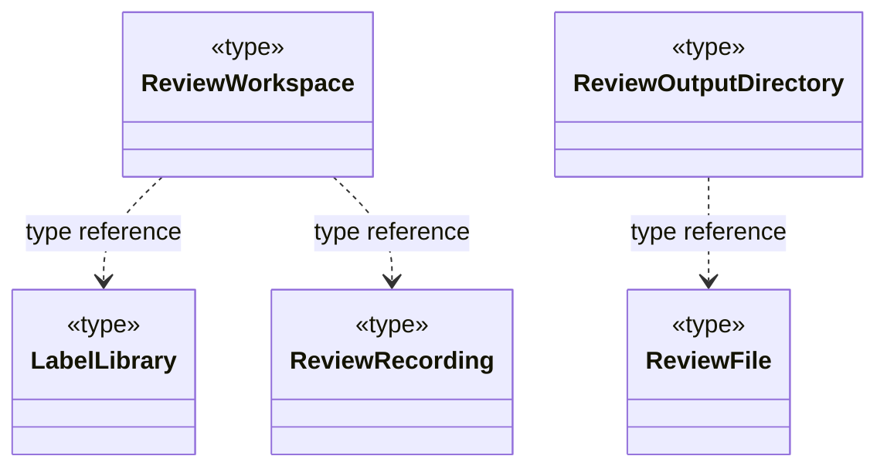

# Review type model

[All models](README.md) · [Feature contracts](../PROJECT_DOC.md)







## LabelTypeAnnotation

Source: [app/label-visibility.ts](../../app/label-visibility.ts). Kind: interface.

```typescript
export interface LabelTypeAnnotation {
  labelId: string;
  recordingLabel?: { label: string };
  dictionaryLabel?: { id: string; name: string };
}
```

## LabelTypeOption

Source: [app/label-visibility.ts](../../app/label-visibility.ts). Kind: interface.

```typescript
export interface LabelTypeOption {
  key: string;
  name: string;
  source: "recording" | "annotation";
  count: number;
}
```

## BrowserReviewEntry

Source: [app/legacy-browser-recovery.ts](../../app/legacy-browser-recovery.ts). Kind: interface.

```typescript
export interface BrowserReviewEntry { key: string; savedAt: string; reviewer: string; labels: number; events: number; name: string }
```

## MatlabAnnotationRow

Source: [app/matlab-annotations-csv.ts](../../app/matlab-annotations-csv.ts). Kind: type.

```typescript
export type MatlabAnnotationRow = Record<typeof MATLAB_ANNOTATION_COLUMNS[number], string | number>;
```

## ReviewInput

Source: [app/matlab-annotations-csv.ts](../../app/matlab-annotations-csv.ts). Kind: type.

```typescript
type ReviewInput = {
  meta: { name: string; sampleRates: number[]; channelLabels: string[] };
  sourceInterpretation: Record<string, unknown> | null;
  sourcePath?: string;
  candidates: { id: string; time: number; label: string; status: string; badChannels?: string; reviewedAt?: string }[];
  annotations: { candidateId?: string; labelId: string; status: string; start: number; end: number; updatedAt: string }[];
};
```

## MatlabCsvFileHandle

Source: [app/matlab-annotations-csv.ts](../../app/matlab-annotations-csv.ts). Kind: type.

```typescript
export type MatlabCsvFileHandle = {
  getFile(): Promise<Blob>;
  createWritable(): Promise<{ write(data: Blob): Promise<void>; close(): Promise<void>; abort?(): Promise<void> }>;
};
```

## MatlabReviewCsvCache

Source: [app/matlab-annotations-csv.ts](../../app/matlab-annotations-csv.ts). Kind: class.

```typescript
export class MatlabReviewCsvCache {
  private sessions = new Map<string, { group: string; rows: MatlabAnnotationRow[] }>();
  /** Replaces the saved rows for one session within its review group. */
  update(session: string, group: string, rows: MatlabAnnotationRow[]): void ;
  /** Returns all saved session rows belonging to a review group. */
  rows(group: string): MatlabAnnotationRow[] ;
}
```

## NeurotraceCustomToolKind

Source: [app/neurotrace-project.ts](../../app/neurotrace-project.ts). Kind: type.

```typescript
export type NeurotraceCustomToolKind =
  | "dictionary"
  | "equation"
  | "filter-method"
  | "label-definitions"
  | "channel-grouping";
```

## NeurotraceCustomToolAsset

Source: [app/neurotrace-project.ts](../../app/neurotrace-project.ts). Kind: type.

```typescript
export type NeurotraceCustomToolAsset = {
  id: string;
  kind: NeurotraceCustomToolKind;
  name: string;
  sourceName: string;
  mimeType: string;
  byteLength: number;
  importedAt: string;
  content: string;
};
```

## NeurotraceRecordingReference

Source: [app/neurotrace-project.ts](../../app/neurotrace-project.ts). Kind: type.

```typescript
export type NeurotraceRecordingReference = {
  name: string;
  format: string;
  byteLength: number;
  durationSec: number;
  channelCount: number;
  sourceContentSha256: string;
  sessionInterpretationSha256: string;
};
```

## NeurotraceProjectArchiveRequest

Source: [app/neurotrace-project.ts](../../app/neurotrace-project.ts). Kind: type.

```typescript
export type NeurotraceProjectArchiveRequest = {
  projectId: string;
  title: string;
  appVersion: string;
  createdAt?: string;
  recording: NeurotraceRecordingReference | null;
  review?: unknown;
  workspace?: unknown;
  labelDefinitions?: unknown;
  customTools?: readonly NeurotraceCustomToolAsset[];
  supportingFiles?: readonly File[];
  recordingFile?: File | null;
};
```

## NeurotraceProjectManifest

Source: [app/neurotrace-project.ts](../../app/neurotrace-project.ts). Kind: type.

```typescript
export type NeurotraceProjectManifest = {
  schema: typeof NEUROTRACE_PROJECT_SCHEMA;
  formatVersion: typeof NEUROTRACE_PROJECT_VERSION;
  appVersion: string;
  projectId: string;
  title: string;
  createdAt: string;
  recording: (NeurotraceRecordingReference & { included: boolean; archivePath: string | null }) | null;
  sections: {
    review: string | null;
    workspace: string | null;
    labelDefinitions: string | null;
    customTools: string | null;
    supportingFiles: string | null;
  };
  contents: Array<{ path: string; role: string; byteLength: number }>;
  security: {
    importedToolsAreExecutable: false;
    note: string;
  };
};
```

## ImportedNeurotraceProject

Source: [app/neurotrace-project.ts](../../app/neurotrace-project.ts). Kind: type.

```typescript
export type ImportedNeurotraceProject = {
  manifest: NeurotraceProjectManifest;
  recordingFile: File | null;
  supportingFiles: File[];
  customToolFiles: File[];
  review: unknown | null;
  workspace: unknown | null;
  /** Opt-in metadata for directory label search; definitions remain inert. */
  labelDefinitions?: unknown;
};
```

## ZipContent

Source: [app/neurotrace-project.ts](../../app/neurotrace-project.ts). Kind: type.

```typescript
type ZipContent = string | Uint8Array | Blob;
```

## ZipArchiveEntry

Source: [app/neurotrace-project.ts](../../app/neurotrace-project.ts). Kind: type.

```typescript
type ZipArchiveEntry = { path: string; content: ZipContent; role: string };
```

## CustomToolImportResult

Source: [app/neurotrace-project.ts](../../app/neurotrace-project.ts). Kind: type.

```typescript
export type CustomToolImportResult = {
  assets: NeurotraceCustomToolAsset[];
  remainingFiles: File[];
  errors: Array<{ fileName: string; message: string }>;
};
```

## StoredZipEntry

Source: [app/neurotrace-project.ts](../../app/neurotrace-project.ts). Kind: type.

```typescript
type StoredZipEntry = {
  path: string;
  size: number;
  localHeaderOffset: number;
  compressionMethod: number;
};
```

## ExportedLabel

Source: [app/recording-labels-csv.ts](../../app/recording-labels-csv.ts). Kind: interface.

```typescript
interface ExportedLabel {
  id: string;
  labelId: string;
  start: number;
  end: number;
  track: string;
  confidence: number;
  status: string;
  origin: string;
  reviewer: string;
  notes: string;
  updatedAt: string;
  candidateId?: string;
  recordingLabel?: { label: string };
  sourceLabel?: string;
}
```

## RecordingFileReference

Source: [app/recording-labels-csv.ts](../../app/recording-labels-csv.ts). Kind: type.

```typescript
export type RecordingFileReference = { name: string; path: string; size: number };
```

## CsvRecording

Source: [app/recording-labels-csv.ts](../../app/recording-labels-csv.ts). Kind: type.

```typescript
export type CsvRecording<T = Record<string, unknown>> = {
  recording: string;
  annotations: readonly T[];
  reviewer?: string;
  format?: string;
  reviewSessionId?: number;
  sourcePath?: string;
  files?: RecordingFileReference[];
  candidates?: readonly unknown[];
  recordingLabelsImported?: boolean;
  interpretation?: Record<string, unknown> | null;
};
```

## RecordingLabel

Source: [app/recording-labels.ts](../../app/recording-labels.ts). Kind: interface.

```typescript
export interface RecordingLabel {
  id: string;
  label: string;
  timeSec: number;
  durationSec: number;
  source: "mat" | "edf+";
  channels: string[];
  notes: string;
}
```

## MatEventTimes

Source: [app/recording-labels.ts](../../app/recording-labels.ts). Kind: interface.

```typescript
interface MatEventTimes {
  groupIndex: number;
  label: string;
  dimensions: readonly number[];
  count: number;
  valueAt: (index: number) => number;
  epochAt?: (index: number) => number;
  channelsAt?: (index: number) => string[];
  notesAt?: (index: number) => string;
}
```

## LabelAlias

Source: [app/review-workspace.ts](../../app/review-workspace.ts). Kind: type.

```typescript
export type LabelAlias = { key: string; alias: string; description: string };
```

## DictionaryLabel

Source: [app/review-workspace.ts](../../app/review-workspace.ts). Kind: type.

```typescript
export type DictionaryLabel = { id: string; name: string; code: string; description: string };
```

## LabelLibrary

Source: [app/review-workspace.ts](../../app/review-workspace.ts). Kind: type.

```typescript
export type LabelLibrary = { aliases: LabelAlias[]; labels: DictionaryLabel[] };
```

## ReviewRecording

Source: [app/review-workspace.ts](../../app/review-workspace.ts). Kind: type.

```typescript
export type ReviewRecording = {
  visitedAt: string;
  completedAt?: string;
  review: Record<string, unknown>;
  view: Record<string, unknown>;
  csvRows: MatlabAnnotationRow[];
};
```

## ReviewWorkspace

Source: [app/review-workspace.ts](../../app/review-workspace.ts). Kind: type.

```typescript
export type ReviewWorkspace = {
  schema: "neurotrace-review/1";
  folderKey: string;
  reviewerId: string;
  reviewSessionId: number;
  instanceId: string;
  createdAt: string;
  updatedAt: string;
  blind: boolean;
  furthestIndex: number;
  position: string | null;
  recordings: Record<string, ReviewRecording>;
  settings: Record<string, unknown>;
  library: LabelLibrary;
  customTools: NeurotraceCustomToolAsset[];
};
```

## ReviewFile

Source: [app/review-workspace.ts](../../app/review-workspace.ts). Kind: type.

```typescript
type ReviewFile = MatlabCsvFileHandle;
```

## ReviewOutputDirectory

Source: [app/review-workspace.ts](../../app/review-workspace.ts). Kind: type.

```typescript
export type ReviewOutputDirectory = { getFileHandle(name: string, options?: { create: boolean }): Promise<ReviewFile> };
```
