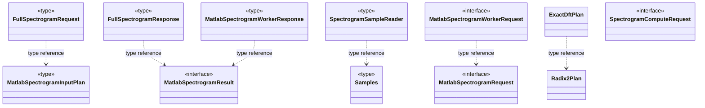
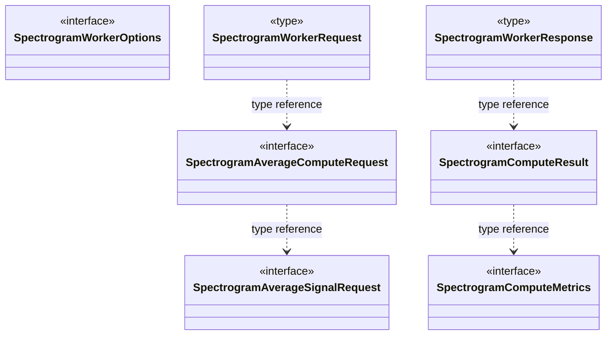

# Spectral type model

[All models](README.md) · [Feature contracts](../PROJECT_DOC.md)





## FullSpectrogramRequest

Source: [app/full-window-spectrogram-worker.ts](../../app/full-window-spectrogram-worker.ts). Kind: type.

```typescript
export type FullSpectrogramRequest = { type: "start"; plan: MatlabSpectrogramInputPlan }
  | { type: "samples"; id: number; data: (Float32Array | Float64Array)[] }
  | { type: "read-error"; id: number; message: string };
```

## FullSpectrogramResponse

Source: [app/full-window-spectrogram-worker.ts](../../app/full-window-spectrogram-worker.ts). Kind: type.

```typescript
export type FullSpectrogramResponse = { type: "read"; id: number; offset: number; count: number }
  | { type: "progress"; completed: number; total: number }
  | { type: "complete"; result: MatlabSpectrogramResult }
  | { type: "error"; name: string; message: string };
```

## Samples

Source: [app/full-window-spectrogram.ts](../../app/full-window-spectrogram.ts). Kind: type.

```typescript
type Samples = Float32Array | Float64Array;
```

## SpectrogramSampleReader

Source: [app/full-window-spectrogram.ts](../../app/full-window-spectrogram.ts). Kind: type.

```typescript
export type SpectrogramSampleReader = (offset: number, count: number) => Promise<Samples[]>;
```

## MatlabSpectrogramInputPlan

Source: [app/matlab-spectrogram-input.ts](../../app/matlab-spectrogram-input.ts). Kind: type.

```typescript
export type MatlabSpectrogramInputPlan = NonNullable<ReturnType<typeof matlabSpectrogramInputPlan>>;
```

## MatlabSpectrogramWorkerRequest

Source: [app/matlab-spectrogram-worker.ts](../../app/matlab-spectrogram-worker.ts). Kind: interface.

```typescript
export interface MatlabSpectrogramWorkerRequest { requestId: number; request: MatlabSpectrogramRequest }
```

## MatlabSpectrogramWorkerResponse

Source: [app/matlab-spectrogram-worker.ts](../../app/matlab-spectrogram-worker.ts). Kind: type.

```typescript
export type MatlabSpectrogramWorkerResponse =
  | { type: "complete"; requestId: number; result: MatlabSpectrogramResult }
  | { type: "error"; requestId: number; name: string; message: string };
```

## MatlabSpectrogramRequest

Source: [app/matlab-spectrogram.ts](../../app/matlab-spectrogram.ts). Kind: interface.

```typescript
export interface MatlabSpectrogramRequest {
  /** Already cropped, synchronized raw group channels; no filtering or resampling. */
  data: readonly (Float32Array | Float64Array)[];
  sampleRate: number;
  /** Plot-axis time of the first supplied sample. */
  dataStart: number;
  /** Plot-axis time of the selected sample, snapped by the caller. */
  baselineTime: number;
}
```

## MatlabSpectrogramResult

Source: [app/matlab-spectrogram.ts](../../app/matlab-spectrogram.ts). Kind: interface.

```typescript
export interface MatlabSpectrogramResult {
  /** Frequency-major matrices: frequencyIndex * width + sampleIndex. */
  power: Float64Array;
  zScores: Float64Array;
  frequencies: Float64Array;
  /** Seconds relative to dataStart, matching MATLAB timeBins. */
  times: Float64Array;
  dataStart: number;
  sampleRate: number;
  width: number;
  height: number;
  baselineMean: Float64Array;
  baselineStd: Float64Array;
  baselineFrameCount: number;
  usedBaselineFallback: boolean;
  colorLimit: number;
  warnings: string[];
  /** Long windows are computed in overlapping tiles, then time-bin averaged. */
  tiled?: boolean;
  timeStride?: number;
  metrics: { computeMs: number; inputBytes: number; outputBytes: number; inputCopyMs?: number; workerRoundTripMs?: number };
}
```

## Radix2Plan

Source: [app/matlab-spectrogram.ts](../../app/matlab-spectrogram.ts). Kind: class.

```typescript
class Radix2Plan {
  readonly size: number;
  private readonly cosine: Float64Array;
  private readonly sine: Float64Array;
  /** Initializes the instance from the supplied arguments. */
  constructor(size: number) ;
  /** Transforms complex samples in place, using the inverse convention when requested. */
  transform(real: Float64Array, imaginary: Float64Array, inverse = false) ;
}
```

## ExactDftPlan

Source: [app/matlab-spectrogram.ts](../../app/matlab-spectrogram.ts). Kind: class.

```typescript
class ExactDftPlan {
  readonly size: number;
  private readonly radix: Radix2Plan;
  private readonly direct: boolean;
  private readonly cosine: Float64Array;
  private readonly sine: Float64Array;
  private readonly kernelReal: Float64Array;
  private readonly kernelImaginary: Float64Array;
  private readonly scratchReal: Float64Array;
  private readonly scratchImaginary: Float64Array;
  /** Initializes the instance from the supplied arguments. */
  constructor(size: number) ;
  /** Transforms complex samples in place, using the inverse convention when requested. */
  transform(real: Float64Array, imaginary: Float64Array, inverse = false) ;
}
```

## SpectrogramComputeRequest

Source: [app/spectrogram-compute.ts](../../app/spectrogram-compute.ts). Kind: interface.

```typescript
export interface SpectrogramComputeRequest {
  data: Float32Array;
  sampleRate: number;
  /** Absolute recording time of sample zero. */
  dataStart?: number;
}
```

## SpectrogramAverageSignalRequest

Source: [app/spectrogram-compute.ts](../../app/spectrogram-compute.ts). Kind: interface.

```typescript
export interface SpectrogramAverageSignalRequest extends SpectrogramComputeRequest {
  dataStart: number;
}
```

## SpectrogramAverageComputeRequest

Source: [app/spectrogram-compute.ts](../../app/spectrogram-compute.ts). Kind: interface.

```typescript
export interface SpectrogramAverageComputeRequest {
  signals: SpectrogramAverageSignalRequest[];
}
```

## SpectrogramComputeMetrics

Source: [app/spectrogram-compute.ts](../../app/spectrogram-compute.ts). Kind: interface.

```typescript
export interface SpectrogramComputeMetrics {
  /** Time spent on the worker's signal math, excluding worker startup and drawing. */
  computeMs: number;
  inputSamples: number;
  finiteFrames: number;
  /** Number of finite sample/taper terms considered by the spectral loops. */
  dftTerms: number;
  /** Populated by the browser client after the transferable input copy is made. */
  inputCopyMs?: number;
  /** Populated by the browser client when the worker response arrives. */
  workerRoundTripMs?: number;
}
```

## SpectrogramComputeResult

Source: [app/spectrogram-compute.ts](../../app/spectrogram-compute.ts). Kind: interface.

```typescript
export interface SpectrogramComputeResult {
  /** Bin-major unsmoothed multitaper powers: `powers[bin * frames + frame]`. */
  powers: Float64Array;
  frequencies: Float64Array;
  /** Frame-center offsets in seconds from the input window start. */
  times: Float64Array;
  /** Actual frame widths; the recording's final partial second is shorter. */
  durations: Float64Array;
  dataStart: number;
  frames: number;
  bins: number;
  maxHz: number;
  sampleRate: number;
  windowSize: number;
  hop: number;
  fftSize: number;
  tapers: number;
  metrics: SpectrogramComputeMetrics;
}
```

## SpectrogramWorkerOptions

Source: [app/spectrogram-worker-client.ts](../../app/spectrogram-worker-client.ts). Kind: interface.

```typescript
export interface SpectrogramWorkerOptions {
  signal?: AbortSignal;
}
```

## SpectrogramWorkerRequest

Source: [app/spectrogram-worker.ts](../../app/spectrogram-worker.ts). Kind: type.

```typescript
export type SpectrogramWorkerRequest =
  | { type: "compute"; requestId: number; request: SpectrogramComputeRequest }
  | { type: "compute-average"; requestId: number; request: SpectrogramAverageComputeRequest };
```

## SpectrogramWorkerResponse

Source: [app/spectrogram-worker.ts](../../app/spectrogram-worker.ts). Kind: type.

```typescript
export type SpectrogramWorkerResponse =
  | { type: "complete"; requestId: number; result: SpectrogramComputeResult }
  | { type: "error"; requestId: number; name: string; message: string };
```
