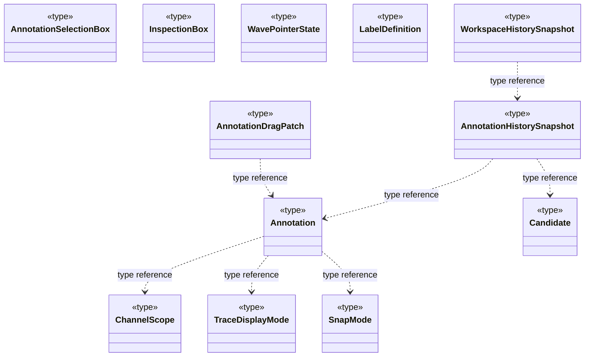
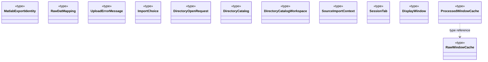
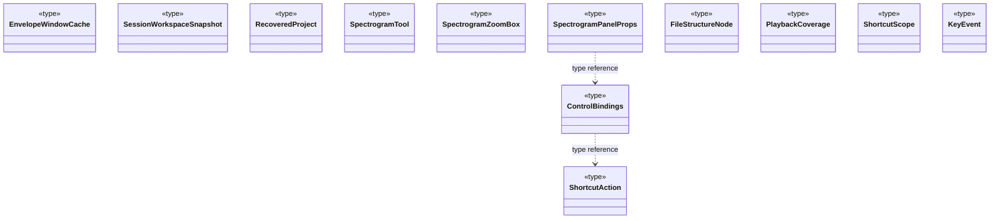
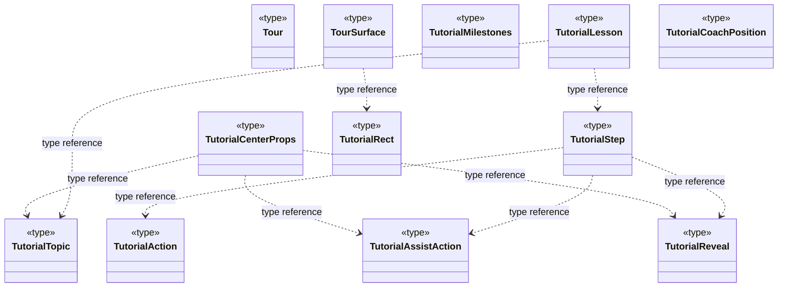
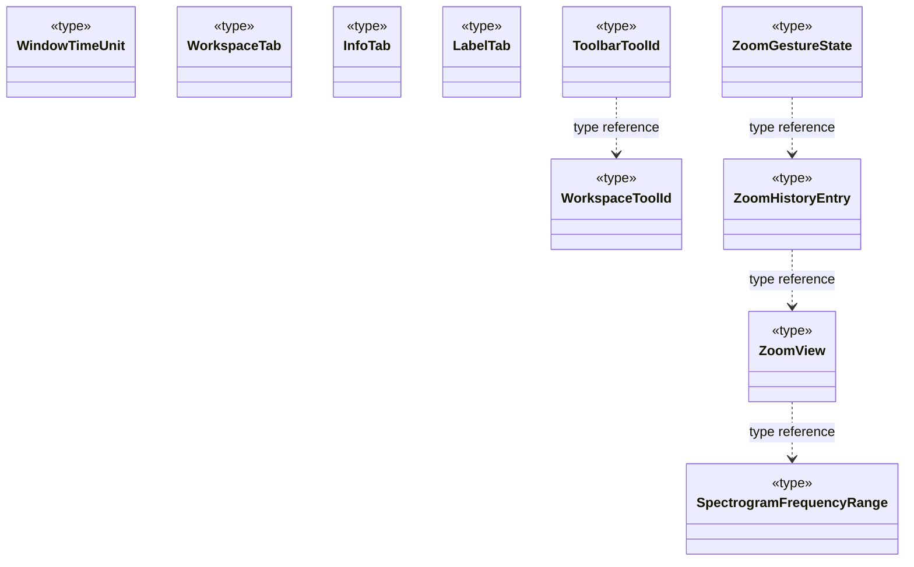

# Workspace type model

[All models](README.md) · [Feature contracts](../PROJECT_DOC.md)

```mermaid
classDiagram
  class T0["ChannelGroupingMode"]
  <<type>> T0
  class T1["ChannelLayoutView"]
  <<type>> T1
  class T2["ChannelRowLayout"]
  <<type>> T2
  class T3["ElectrodeDisplayRows"]
  <<type>> T3
  class T4["CursorDisplayData"]
  <<interface>> T4
  class T5["CursorReadout"]
  <<type>> T5
  class T6["Reliability"]
  <<type>> T6
  class T7["Geometry"]
  <<type>> T7
  class T8["TrackId"]
  <<type>> T8
  class T9["AnnotationStatus"]
  <<type>> T9
  class T10["AnnotationOrigin"]
  <<type>> T10
  class T11["PlacementIntent"]
  <<type>> T11
```













## ChannelGroupingMode

Source: [app/channel-layout.ts](../../app/channel-layout.ts). Kind: type.

```typescript
export type ChannelGroupingMode = "matlab" | "name";
```

## ChannelLayoutView

Source: [app/channel-layout.ts](../../app/channel-layout.ts). Kind: type.

```typescript
export type ChannelLayoutView = {
  expandedChannels: boolean;
  verticalViewport: NormalizedVerticalViewport | null;
  channelScrollTop: number;
  channelGroupGap?: number | null;
};
```

## ChannelRowLayout

Source: [app/channel-layout.ts](../../app/channel-layout.ts). Kind: type.

```typescript
export type ChannelRowLayout = {
  /** User-selected CSS pixels per group gap; absent uses automatic fit spacing. */
  groupGapPx?: number;
  fit?: boolean;
  rowStartUnits: number[];
  /** Integer CSS grid lines; fractional spacing is represented by separate tracks. */
  rowGridLines: number[];
  gridTemplateRows: string;
  totalUnits: number;
  groupStarts: Set<number>;
  groups: Array<{ name: string; startRow: number; endRow: number }>;
  contactLabels: string[];
};
```

## ElectrodeDisplayRows

Source: [app/channel-layout.ts](../../app/channel-layout.ts). Kind: type.

```typescript
type ElectrodeDisplayRows = {
  labels: string[];
  data: (Float32Array | Float64Array)[];
  traceBaselines: number[];
  envelopes: unknown[];
  sampleRates: number[];
  sourceSampleRates: number[];
  sourceStartSampleIndices?: (number | null)[];
  startSecs: number[];
  units: string[];
  sourceIndices: number[][];
  primarySourceIndices: number[];
};
```

## CursorDisplayData

Source: [app/cursor-readout.ts](../../app/cursor-readout.ts). Kind: interface.

```typescript
export interface CursorDisplayData {
  data: readonly ArrayLike<number>[];
  envelopes: readonly ({
    minima: ArrayLike<number>;
    maxima: ArrayLike<number>;
    gaps: ArrayLike<number>;
    startSec: number;
    bucketDurationSec: number;
  } | null)[];
  sampleRates: readonly number[];
  sourceSampleRates: readonly number[];
  /** Actual source index of each row's first sample, independent of plotted time. */
  sourceStartSampleIndices?: readonly (number | null)[];
  /** Plotting origins; MATLAB window-relative timing may differ from source time. */
  startSecs: readonly number[];
  units: readonly string[];
  unreadAfterSec?: number;
}
```

## CursorReadout

Source: [app/cursor-readout.ts](../../app/cursor-readout.ts). Kind: type.

```typescript
export type CursorReadout =
  | {
    kind: "sample";
    value: number;
    unit: string;
    /** Timestamp on the plotted axis, including any MATLAB window-origin convention. */
    sampleTimeSec: number;
    /** Actual source timestamp, or null when the displayed sample has no exact source index. */
    sourceTimeSec: number | null;
    /** Index in this displayed row, whose first sample can start after time zero. */
    displaySampleIndex: number;
    /** Exact source-grid index; this does not imply an unfiltered/raw value. */
    sourceSampleIndex: number | null;
  }
  | {
    kind: "range";
    minimum: number;
    maximum: number;
    unit: string;
    startSec: number;
    endSec: number;
    bucketIndex: number;
  }
  | {
    kind: "unavailable";
    unit: string;
    reason: "invalid-position" | "no-data" | "invalid-timing" | "outside-data" | "missing-data";
  };
```

## Reliability

Source: [app/page.tsx](../../app/page.tsx). Kind: type.

```typescript
type Reliability = "gold" | "silver" | "bronze" | "gray";
```

## Geometry

Source: [app/page.tsx](../../app/page.tsx). Kind: type.

```typescript
type Geometry = "point" | "interval" | "window" | "session";
```

## TrackId

Source: [app/page.tsx](../../app/page.tsx). Kind: type.

```typescript
type TrackId = "context" | "windowed" | "instance";
```

## AnnotationStatus

Source: [app/page.tsx](../../app/page.tsx). Kind: type.

```typescript
type AnnotationStatus = "draft" | "committed" | "suggestion";
```

## AnnotationOrigin

Source: [app/page.tsx](../../app/page.tsx). Kind: type.

```typescript
type AnnotationOrigin = "manual" | "imported" | "detector" | "legacy";
```

## PlacementIntent

Source: [app/page.tsx](../../app/page.tsx). Kind: type.

```typescript
type PlacementIntent = "native" | "instance" | "windowed" | "context-instance" | "context-window";
```

## AnnotationDragPatch

Source: [app/page.tsx](../../app/page.tsx). Kind: type.

```typescript
type AnnotationDragPatch = Pick<Annotation, "start" | "end" | "track" | "geometry">;
```

## AnnotationSelectionBox

Source: [app/page.tsx](../../app/page.tsx). Kind: type.

```typescript
type AnnotationSelectionBox = { left: number; top: number; width: number; height: number };
```

## InspectionBox

Source: [app/page.tsx](../../app/page.tsx). Kind: type.

```typescript
type InspectionBox = {
  dragged: boolean;
  start: number;
  end: number;
  startRow: number;
  endRow: number;
  top: number;
  bottom: number;
  channelLabels: string[];
  sourceIndices: number[];
};
```

## WavePointerState

Source: [app/page.tsx](../../app/page.tsx). Kind: type.

```typescript
type WavePointerState = {
  pointerId: number;
  startX: number;
  startY: number;
  startTime: number;
  startRow: number;
  moved: boolean;
};
```

## LabelDefinition

Source: [app/page.tsx](../../app/page.tsx). Kind: type.

```typescript
type LabelDefinition = {
  id: string;
  name: string;
  short: string;
  color: string;
  geometry: Geometry;
  track: TrackId;
  defaultDuration: number;
  category: "Context" | "Seizure" | "Rhythmic / periodic" | "Ictal pathology" | "Sleep stage" | "Other";
  hidden?: boolean;
  dictionaryLabel?: DictionaryLabel;
};
```

## ChannelScope

Source: [app/page.tsx](../../app/page.tsx). Kind: type.

```typescript
type ChannelScope = {
  displayLabel: string;
  montage: MontageMode;
  primarySourceIndex: number;
  sourceIndices: number[];
  sourceLabels: string[];
};
```

## TraceDisplayMode

Source: [app/page.tsx](../../app/page.tsx). Kind: type.

```typescript
type TraceDisplayMode = "clamped" | "overlap";
```

## SnapMode

Source: [app/page.tsx](../../app/page.tsx). Kind: type.

```typescript
type SnapMode = "none" | "1s" | "100ms" | "sample";
```

## Annotation

Source: [app/page.tsx](../../app/page.tsx). Kind: type.

```typescript
type Annotation = {
  id: string;
  labelId: string;
  start: number;
  end: number;
  track: TrackId;
  geometry: Geometry;
  channels: number[];
  confidence: number;
  reliability: Reliability;
  origin: AnnotationOrigin;
  reviewer: string;
  notes: string;
  status: AnnotationStatus;
  candidateId?: string;
  /** Original recording evidence survives edits, recovery, and exports unchanged. */
  recordingLabel?: RecordingLabel;
  sourceLabel?: string;
  dictionaryLabel?: DictionaryLabel;
  channelScope?: ChannelScope;
  /** Plot-axis seconds stay authoritative; this records their source-grid offset. */
  sourceTimeOffsetSec?: number;
  /** Preserve the creation grid for later movement, including unscoped mixed-rate labels. */
  timingSampleRateHz?: number;
  revisions?: Array<{
    revision: number;
    committedAt: string;
    labelId: string;
    start: number;
    end: number;
    confidence: number;
    reviewer: string;
    notes: string;
    reliability: Reliability;
    origin: AnnotationOrigin;
    geometry: Geometry;
    track: TrackId;
    channels: number[];
    channelScope?: ChannelScope;
    sourceHash: string;
    sourceContentHash: string;
    candidateId?: string;
    displaySnapshot: {
      montage: MontageMode;
      filters: DisplayFilterSettings;
      gain: number;
      snapMode: SnapMode;
      timingConvention?: "matlab-window";
      traceDisplayMode: TraceDisplayMode;
      selectedSourceChannels: number[];
    };
    sourceSnapshot: {
      format: RecordingMeta["format"];
      durationSec: number;
      sampleRates: number[];
      assumptions: string[];
      warnings: string[];
      interpretation?: Record<string, unknown>;
    };
  }>;
  revision: number;
  createdAt: string;
  updatedAt: string;
};
```

## Candidate

Source: [app/page.tsx](../../app/page.tsx). Kind: type.

```typescript
type Candidate = {
  id: string;
  time: number;
  label: string;
  source: Reliability;
  status: "active" | "queued" | "reviewed" | "skipped" | "conflict";
  confidence: number;
  uncertainty?: number;
  /** Optional MATLAB-review compatibility fields. */
  ictalChannels?: string;
  /** MATLAB bad_channels: free text, independent of ictal channels. */
  badChannels?: string;
  legacyConfidence?: "" | "1" | "2" | "3";
  reviewedAt?: string;
  reviewerInitials?: string;
};
```

## AnnotationHistorySnapshot

Source: [app/page.tsx](../../app/page.tsx). Kind: type.

```typescript
type AnnotationHistorySnapshot = {
  kind?: "annotation";
  annotations: Annotation[];
  candidates: Candidate[];
  activeCandidate: number;
};
```

## WorkspaceHistorySnapshot

Source: [app/page.tsx](../../app/page.tsx). Kind: type.

```typescript
type WorkspaceHistorySnapshot = AnnotationHistorySnapshot | ZoomHistoryEntry;
```

## MatlabExportIdentity

Source: [app/page.tsx](../../app/page.tsx). Kind: type.

```typescript
type MatlabExportIdentity = {
  patientId: string;
  matPath: string;
  dataDirectory: string;
  datFile: string;
};
```

## RawDatMapping

Source: [app/page.tsx](../../app/page.tsx). Kind: type.

```typescript
type RawDatMapping = {
  sampleRate: number;
  channelCount: number;
  /** Blank preserves the headerless file as raw ADC counts. */
  physicalScale: number | "";
};
```

## UploadErrorMessage

Source: [app/page.tsx](../../app/page.tsx). Kind: type.

```typescript
type UploadErrorMessage = {
  title: string;
  message: string;
  files: string[];
};
```

## ImportChoice

Source: [app/page.tsx](../../app/page.tsx). Kind: type.

```typescript
type ImportChoice = "edf" | "mat" | "mat-dat";
```

## DirectoryOpenRequest

Source: [app/page.tsx](../../app/page.tsx). Kind: type.

```typescript
type DirectoryOpenRequest = {
  csvReviewRows?: MatlabAnnotationRow[];
  event?: DirectoryTimedEvent;
  incompleteEventChecks?: number;
  catalogId: string;
  recordingId: string;
  sessionId: string;
  format: DirectoryImportFormat;
  files: File[];
  replaceSessionId?: string;
};
```

## DirectoryCatalog

Source: [app/page.tsx](../../app/page.tsx). Kind: type.

```typescript
type DirectoryCatalog = { id: string; plan: DirectoryImportPlan; review?: Pick<ReviewWorkspace, "reviewerId" | "reviewSessionId" | "instanceId" | "blind"> };
```

## DirectoryCatalogWorkspace

Source: [app/page.tsx](../../app/page.tsx). Kind: type.

```typescript
type DirectoryCatalogWorkspace = {
  sessions: Map<string, { sessionId: string; files: File[] }>;
  statuses: Record<string, DirectorySessionStatus>;
  eventRecovery?: Map<string, { key: string; duration: number; channelCount: number }>;
  review?: ReviewWorkspace;
  savedToDiskAt?: string;
};
```

## SourceImportContext

Source: [app/page.tsx](../../app/page.tsx). Kind: type.

```typescript
type SourceImportContext = {
  csvReviewRows?: MatlabAnnotationRow[];
  primaryFile: File;
  uploadedFileInputs: File[];
  companionBundle: BidsCompanionBundle;
  importedAnnotations: Annotation[];
  companionMatFile?: File;
};
```

## SessionTab

Source: [app/page.tsx](../../app/page.tsx). Kind: type.

```typescript
type SessionTab = {
  id: string;
  title: string;
  hasRecording: boolean;
  recoveryStatus: "saved" | "error";
  contentView: "recording" | "structure";
  directoryId?: string;
  directoryRecordingId?: string;
};
```

## DisplayWindow

Source: [app/page.tsx](../../app/page.tsx). Kind: type.

```typescript
type DisplayWindow = {
  /** Wider prepared data used by continuously scrolling playback. */
  playbackBuffer?: boolean;
  /** Processing identity prevents old values appearing under newly selected controls. */
  settingsKey?: string;
  data: SignalSamples[];
  /** Recording references stay fixed during panning, progressive loads, and painting. */
  traceBaselines: number[];
  recordingAnchored?: boolean;
  /** Exact source extrema retained for clipping and dropout metadata. */
  envelopes: Array<{
    minima: SignalSamples;
    maxima: SignalSamples;
    gaps: Uint8Array;
    variation?: Float32Array;
    startSec: number;
    bucketDurationSec: number;
  } | null>;
  labels: string[];
  sampleRates: number[];
  sourceSampleRates: number[];
  sourceStartSampleIndices?: (number | null)[];
  timingConvention?: "matlab-window";
  /** Absolute time represented by sample zero for each displayed row. */
  startSecs: number[];
  units: string[];
  sourceIndices: number[][];
  primarySourceIndices: number[];
  warnings: string[];
  viewStart: number;
  /** Requested duration used to prepare this display, not an inferred sample count. */
  viewDuration?: number;
  flatlineRegions: Array<{ startSec: number; endSec: number }>;
  /** Only present while drawing a progressively indexed recording overview. */
  indexedThroughSec?: number;
  /** A coarse preview is usable while the requested finer grid is still loading. */
  refiningOverview?: boolean;
  processingThroughSec?: number;
  /** Absolute start of the unread tail, never represented as a flat signal. */
  unreadAfterSec?: number;
};
```

## RawWindowCache

Source: [app/page.tsx](../../app/page.tsx). Kind: type.

```typescript
type RawWindowCache = {
  source: SignalSource;
  channelKey: string;
  startSec: number;
  endSec: number;
  data: Float32Array[];
  sampleRates: number[];
  channelStartSecs: number[];
  channelUnits: string[];
  byteLength: number;
  flatlineRegions: Array<{ startSec: number; endSec: number }>;
};
```

## ProcessedWindowCache

Source: [app/page.tsx](../../app/page.tsx). Kind: type.

```typescript
type ProcessedWindowCache = {
  raw: RawWindowCache;
  settingsKey: string;
  data: Float32Array[];
  sampleRates: number[];
  channelStartSecs: number[];
  factors: number[];
  byteLength: number;
};
```

## EnvelopeWindowCache

Source: [app/page.tsx](../../app/page.tsx). Kind: type.

```typescript
type EnvelopeWindowCache = {
  source: SignalSource;
  channelKey: string;
  startSec: number;
  endSec: number;
  levels: EnvelopeWindowData[];
  byteLength: number;
};
```

## SessionWorkspaceSnapshot

Source: [app/page.tsx](../../app/page.tsx). Kind: type.

```typescript
type SessionWorkspaceSnapshot = {
  hasRecording: boolean;
  source: SignalSource;
  primaryFile: File | null;
  uploadedFileInputs: File[];
  companionBundle: BidsCompanionBundle;
  customTools: NeurotraceCustomToolAsset[];
  labelLibrary?: LabelLibrary;
  meta: RecordingMeta;
  sessionKey: string;
  reviewer: string;
  viewStart: number;
  timebase: number;
  gain: number;
  traceDisplayMode: TraceDisplayMode;
  montage: MontageMode;
  filters: DisplayFilterSettings;
  selectedChannels: number[];
  focusedChannel: number;
  spectrogramChannels?: number[];
  annotations: Annotation[];
  recordingLabelsImported: boolean;
  selectedAnnotationId: string | null;
  selection: { start: number; end: number } | null;
  cursorTime: number;
  cursorAmplitude: number | null;
  cursorLocked: boolean;
  snapMode: SnapMode;
  spectrogramOpen: boolean;
  expandedChannels: boolean;
  channelGroupGap?: number | null;
  channelFitRestore?: ChannelLayoutView | null;
  anatomicalGroups: boolean;
  candidates: Candidate[];
  activeCandidate: number;
  sourceHash: string;
  rawSourceHash: string;
  sourceInterpretation: Record<string, unknown> | null;
  recoveryStatus: "saved" | "error";
  waveformVerticalViewport: NormalizedVerticalViewport | null;
  channelScrollTop: number;
  spectrogramFrequencyRange: SpectrogramFrequencyRange;
  undo: WorkspaceHistorySnapshot[];
  redo: WorkspaceHistorySnapshot[];
};
```

## RecoveredProject

Source: [app/page.tsx](../../app/page.tsx). Kind: type.

```typescript
type RecoveredProject = {
  annotations: Annotation[];
  candidates: Candidate[];
  activeCandidate: number;
  reviewer: string | null;
  matlabExportIdentity: MatlabExportIdentity | null;
  recordingLabelsImported: boolean;
};
```

## SpectrogramTool

Source: [app/page.tsx](../../app/page.tsx). Kind: type.

```typescript
type SpectrogramTool = "browse" | "box-zoom";
```

## SpectrogramZoomBox

Source: [app/page.tsx](../../app/page.tsx). Kind: type.

```typescript
type SpectrogramZoomBox = {
  left: number;
  top: number;
  width: number;
  height: number;
};
```

## SpectrogramPanelProps

Source: [app/page.tsx](../../app/page.tsx). Kind: type.

```typescript
type SpectrogramPanelProps = {
  toolsHost?: HTMLDivElement | null;
  controlBindings: ControlBindings;
  waveformCanvasRef: React.RefObject<HTMLCanvasElement | null>;
  spectrum: MatlabSpectrogramResult | null;
  progress: number;
  sampleRate: number;
  channelCount: number;
  inputError: string;
  viewStart: number;
  viewDuration: number;
  sessionDuration: number;
  cursor: number;
  label: string;
  onPreviewStart(start: number): void;
  onCommitStart(start: number): void;
  onCenter(time: number): void;
  frequencyRange: SpectrogramFrequencyRange;
  onFrequencyRangeChange(range: SpectrogramFrequencyRange): void;
  onZoom(range: { start: number; end: number } | null, frequencyRange?: SpectrogramFrequencyRange): void;
  onHelp(): void;
};
```

## FileStructureNode

Source: [app/page.tsx](../../app/page.tsx). Kind: type.

```typescript
type FileStructureNode = { title: string; detail: string };
```

## PlaybackCoverage

Source: [app/playback.ts](../../app/playback.ts). Kind: type.

```typescript
type PlaybackCoverage = {
  viewStart: number;
  viewDuration?: number;
  processingThroughSec?: number;
  unreadAfterSec?: number;
};
```

## ShortcutAction

Source: [app/shortcuts.ts](../../app/shortcuts.ts). Kind: type.

```typescript
export type ShortcutAction = typeof SHORTCUTS[number]["id"];
```

## ShortcutScope

Source: [app/shortcuts.ts](../../app/shortcuts.ts). Kind: type.

```typescript
export type ShortcutScope = typeof SHORTCUTS[number]["scope"];
```

## ControlBindings

Source: [app/shortcuts.ts](../../app/shortcuts.ts). Kind: type.

```typescript
export type ControlBindings = Record<ShortcutAction, string[]>;
```

## KeyEvent

Source: [app/shortcuts.ts](../../app/shortcuts.ts). Kind: type.

```typescript
type KeyEvent = { key: string; code?: string; ctrlKey?: boolean; metaKey?: boolean; shiftKey?: boolean; altKey?: boolean; isComposing?: boolean; getModifierState?(key: string): boolean };
```

## TutorialCenterProps

Source: [app/tutorial-center.tsx](../../app/tutorial-center.tsx). Kind: type.

```typescript
type TutorialCenterProps = {
  controlBindings?: ControlBindings;
  open: boolean;
  topic: TutorialTopic;
  hasRecording: boolean;
  canAnnotate: boolean;
  sessionId: string;
  onAssist(action: TutorialAssistAction): boolean;
  onTopicChange(topic: TutorialTopic): void;
  onClose(): void;
  onOpen(): void;
  onReveal(area: TutorialReveal): void;
};
```

## Tour

Source: [app/tutorial-center.tsx](../../app/tutorial-center.tsx). Kind: type.

```typescript
type Tour = { lessonId: string; stepIndex: number };
```

## TourSurface

Source: [app/tutorial-center.tsx](../../app/tutorial-center.tsx). Kind: type.

```typescript
type TourSurface = { host: HTMLElement; rect: TutorialRect | null; offscreen: boolean; fallback: boolean; ready: boolean; dialogName: string | null; viewport: { width: number; height: number } };
```

## TutorialAction

Source: [app/tutorial-events.ts](../../app/tutorial-events.ts). Kind: type.

```typescript
export type TutorialAction =
  | "import-opened" | "import-format-chosen" | "import-files-ready" | "recording-opened"
  | "directory-files-ready" | "directory-list-opened" | "settings-opened" | "bias-locks-changed"
  | "review-csvs-loaded" | "directory-review-found" | "older-review-opened" | "older-review-restored"
  | "overview-jumped" | "waveform-panned" | "transport-used" | "window-applied"
  | "timestamp-jumped" | "playback-started" | "playback-stopped" | "groups-changed"
  | "waveform-zoom-enabled" | "waveform-zoom-disabled" | "waveform-zoomed"
  | "channels-opened" | "channels-closed" | "montage-changed" | "gain-changed"
  | "clamp-changed" | "filters-opened" | "spectrogram-opened" | "channel-focused"
  | "channel-focus-cleared" | "spectrogram-adjusted" | "spectrogram-browse"
  | "spectrogram-zoom-tool" | "spectrogram-zoomed" | "spectrogram-panned"
  | "label-panel-opened" | "time-selected" | "ephys-label-added" | "annotation-inspected"
  | "label-picker-opened" | "label-picker-closed" | "session-label-picker-opened"
  | "labels-toggled" | "label-filter-opened" | "label-filter-closed" | "label-filter-changed"
  | "source-review-accepted" | "save-opened" | "annotations-saved";
```

## TutorialAssistAction

Source: [app/tutorial-events.ts](../../app/tutorial-events.ts). Kind: type.

```typescript
export type TutorialAssistAction =
  | "open-import" | "open-save" | "open-settings" | "show-label-panel" | "show-label-tracks"
  | "jump-overview" | "pan-waveform" | "page-forward" | "shorten-window"
  | "enable-waveform-zoom" | "disable-waveform-zoom" | "zoom-waveform" | "open-channels"
  | "increase-gain" | "toggle-clamp" | "open-filters" | "open-spectrogram"
  | "clear-channel-focus" | "spectrogram-browse" | "spectrogram-zoom-tool" | "spectrogram-reset"
  | "select-time-window" | "open-label-picker" | "open-session-label-picker" | "toggle-labels"
  | "open-directory-list" | "open-label-filter";
```

## TutorialMilestones

Source: [app/tutorial-progress.ts](../../app/tutorial-progress.ts). Kind: type.

```typescript
export type TutorialMilestones = {
  scope: string;
  stateKey: string;
  recording: string | null;
  importOpen: boolean;
  importFormat: string | null;
  filesReady: boolean;
  directoryFilesReady: boolean;
  directoryListOpen: boolean;
  settingsOpen: boolean;
  biasLocks: boolean;
  channelsOpen: boolean;
  montage: string;
  groups: boolean;
  playing: boolean;
  labelFilterOpen: boolean;
  olderReviewOpen: boolean;
  gain: number;
  clamp: string;
  filtersOpen: boolean;
  boxZoom: boolean;
  spectrogramOpen: boolean;
  labelsPanelOpen: boolean;
  labelPickerOpen: boolean;
  sessionLabelPickerOpen: boolean;
  labelsVisible: boolean;
  saveOpen: boolean;
};
```

## TutorialTopic

Source: [app/tutorials.ts](../../app/tutorials.ts). Kind: type.

```typescript
export type TutorialTopic = typeof tutorialTopics[number]["id"];
```

## TutorialReveal

Source: [app/tutorials.ts](../../app/tutorials.ts). Kind: type.

```typescript
export type TutorialReveal = "recording-panel" | "label-panel" | "spectrogram" | "label-tracks" | "view-panel" | "window-panel" | "session-labels" | "event-labels" | "file-panel";
```

## TutorialStep

Source: [app/tutorials.ts](../../app/tutorials.ts). Kind: type.

```typescript
export type TutorialStep = {
  title: string;
  instruction: string;
  target: string;
  fallback?: string;
  readyTarget?: string;
  /** Follow a workflow into its dialog without replacing its instructions. */
  dialogTarget?: string;
  unavailable: string;
  reveal?: TutorialReveal;
  tip?: string;
} & (
  // Reading-only steps cannot offer an action or advance on unrelated workspace activity.
  | { completeOn?: never; assist?: never }
  | { completeOn: readonly [TutorialAction, ...TutorialAction[]]; assist?: { action: TutorialAssistAction; description: string; completesStep?: boolean } }
);
```

## TutorialLesson

Source: [app/tutorials.ts](../../app/tutorials.ts). Kind: type.

```typescript
export type TutorialLesson = {
  id: string;
  topic: TutorialTopic;
  title: string;
  description: string;
  duration: string;
  requires: "workspace" | "recording" | "review";
  steps: readonly TutorialStep[];
};
```

## TutorialRect

Source: [app/tutorials.ts](../../app/tutorials.ts). Kind: type.

```typescript
export type TutorialRect = { left: number; top: number; width: number; height: number };
```

## TutorialCoachPosition

Source: [app/tutorials.ts](../../app/tutorials.ts). Kind: type.

```typescript
export type TutorialCoachPosition = { left: number; top: number; width: number };
```

## WindowTimeUnit

Source: [app/window-amount.ts](../../app/window-amount.ts). Kind: type.

```typescript
export type WindowTimeUnit = typeof WINDOW_TIME_UNITS[number];
```

## WorkspaceTab

Source: [app/workspace-layout.ts](../../app/workspace-layout.ts). Kind: type.

```typescript
export type WorkspaceTab = typeof WORKSPACE_TABS[number]["id"];
```

## InfoTab

Source: [app/workspace-layout.ts](../../app/workspace-layout.ts). Kind: type.

```typescript
export type InfoTab = typeof INFO_TABS[number]["id"];
```

## LabelTab

Source: [app/workspace-layout.ts](../../app/workspace-layout.ts). Kind: type.

```typescript
export type LabelTab = typeof LABEL_TABS[number]["id"];
```

## WorkspaceToolId

Source: [app/workspace-layout.ts](../../app/workspace-layout.ts). Kind: type.

```typescript
export type WorkspaceToolId = typeof WORKSPACE_TOOLS[number]["id"];
```

## ToolbarToolId

Source: [app/workspace-layout.ts](../../app/workspace-layout.ts). Kind: type.

```typescript
export type ToolbarToolId = WorkspaceToolId | `label:${string}`;
```

## SpectrogramFrequencyRange

Source: [app/zoom-history.ts](../../app/zoom-history.ts). Kind: type.

```typescript
export type SpectrogramFrequencyRange = { min: number; max: number };
```

## ZoomView

Source: [app/zoom-history.ts](../../app/zoom-history.ts). Kind: type.

```typescript
export type ZoomView = ChannelLayoutView & {
  viewStart: number;
  timebase: number;
  gain: number;
  anatomicalGroups?: boolean;
  channelFitRestore?: ChannelLayoutView | null;
  frequencyRange: SpectrogramFrequencyRange;
};
```

## ZoomHistoryEntry

Source: [app/zoom-history.ts](../../app/zoom-history.ts). Kind: type.

```typescript
export type ZoomHistoryEntry = { kind: "zoom"; before: ZoomView; after: ZoomView; boxAction?: "in" | "out" };
```

## ZoomGestureState

Source: [app/zoom-history.ts](../../app/zoom-history.ts). Kind: type.

```typescript
export type ZoomGestureState = { entry?: ZoomHistoryEntry; group?: string; lastAt?: number };
```
